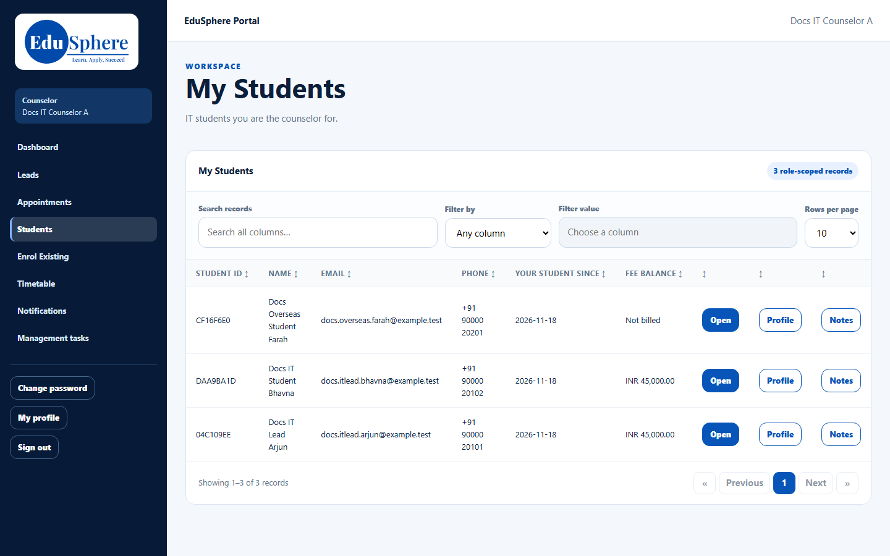
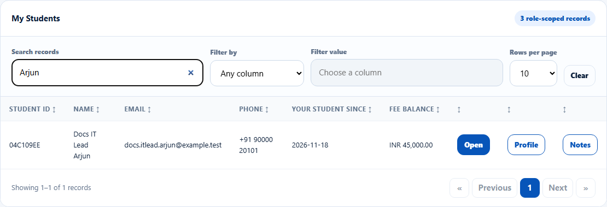

# My students
> Doc ID: DOC-ITC-STU-001 · Verified on 2026-11-18 against `main` @ `6b61546c` · Roles: IT Counselor

## Purpose
See every IT student you are the counselor for, with their fee balance, and open their record or notes.

## Who Can Use This Feature
- **IT Counselor**: only the students assigned to them. A student assigned to another counselor is not listed.

## Prerequisites
- A student becomes yours when you convert or enrol them (see [Convert a lead](../conversion/conv-001-convert-new-student.md) and [Enrol an existing Overseas student](../conversion/conv-005-enrol-existing-overseas.md)), or when the IT Admin assigns them to you ([Assign or change a student's counselor](../../admin-manual/admin/adm-003-student-counselor.md)).

## How to Access
Sidebar **Students** (page title **My Students**).

## Steps
### Step 1 — Read the list
Each row shows **Student ID**, **Name**, **Email**, **Phone**, **Your student since** and **Fee balance**. **Fee balance** reads **Not billed** for a student with no enrolment fee yet. Select a column heading to sort.

### Step 2 — Search or filter
Type in **Search records** to match any column, or choose a column in **Filter by** and type a **Filter value**. **Clear** resets both. **Rows per page** sets 10, 25 or 50.

### Step 3 — Open a student
- **Open**: the read-only [Student 360](stu-002-student-360.md).
- **Profile**: the editable [Student record](stu-003-student-record.md).
- **Notes**: [Student notes](../notes/note-001-student-notes.md).

## Expected Result
You see only your own students. If the IT Admin moves a student to another counselor, the student leaves your list and you get a **Student reassigned** notification.

## Tips
- A student who joined IT from Overseas (for example **Docs Overseas Student Farah**) appears here like any other IT student.

## Related Features
- [Student 360](stu-002-student-360.md)
- [Notifications](../notifications/notif-001-notifications.md)
