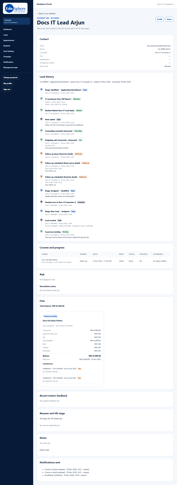

# Student 360
> Doc ID: DOC-ITC-STU-002 · Verified on 2026-11-18 against `main` @ `6b61546c` · Roles: IT Counselor (IT Admin: same page under `/it/admin/students/{id}`)

## Purpose
See everything about one student on one read-only page: contact, lead history, courses, fees, risk, trainer feedback, resume, HR stage, notes and the notifications they were sent.

## Who Can Use This Feature
| Role | What they see |
|---|---|
| IT Counselor | Their own students only. Another counselor's student shows **404 This page could not be found.** |
| IT Admin | Every IT student (from **Students** → **Open**; from code, not captured in S7). |

## Prerequisites
- The student is assigned to you.

## How to Access
**Students** → **Open** on the row. The page title is **STUDENT 360 · {Student ID}** and the student's name.

## Steps
### Step 1 — Read the sections
The page says "Read only. Each section is the live record; edit it on its own page." The sections are:

| Section | Shows |
|---|---|
| Contact | Email, Phone, Counselor, City, Qualification, Emergency contact, Phone calls (Allowed or not) |
| Lead history | The lead the student came from (Lead ID, stage, owner, created and converted dates) and its timeline. "This student did not come from an IT lead." if there is none |
| Courses and progress | Each enrolment and its progress |
| Risk | At-risk flag and **Remediation plans** |
| Fees | Fee account summary, or "No fee account yet: the student has no enrolment." |
| Recent trainer feedback | Graded feedback from trainers |
| Resume and HR stage | Latest resume and HR review stage |
| Notes | Latest notes, with **Open notes** |
| Notifications sent | What EduSphere told the student, with time and read state |

### Step 2 — Go to the editable pages
Use **Profile** (the [Student record](stu-003-student-record.md)) or **Notes** at the top. **← Back to my students** returns to the list.

## Expected Result
You see the live state of the student. Nothing can be changed on this page.

## Validation Messages
| Message | When |
|---|---|
| 404 This page could not be found. | The student is not yours (for example, moved to another counselor) |

## Tips
- The 404 page has no menu. Use your browser's Back button or go to `/it/counselor/students` (finding P12).

## Related Features
- [My students](stu-001-my-students.md)
- [Student record](stu-003-student-record.md)
