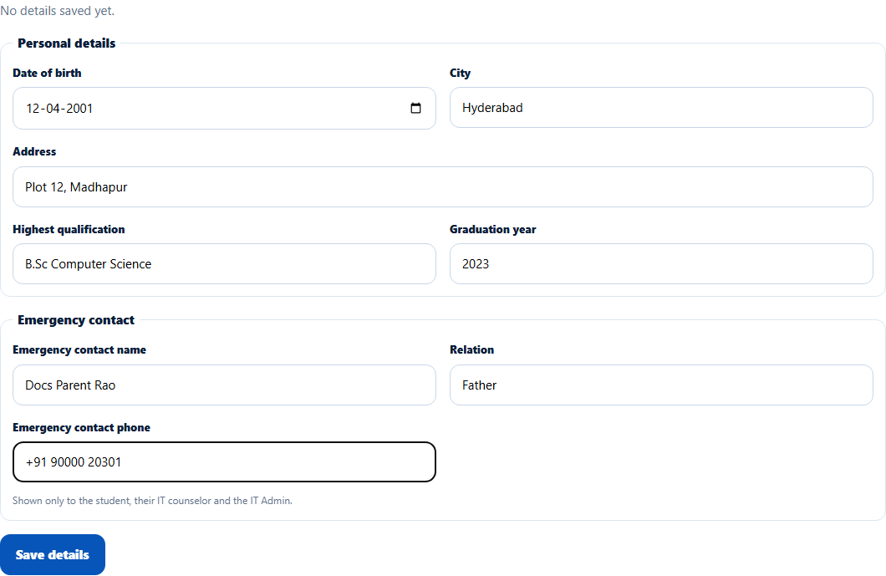
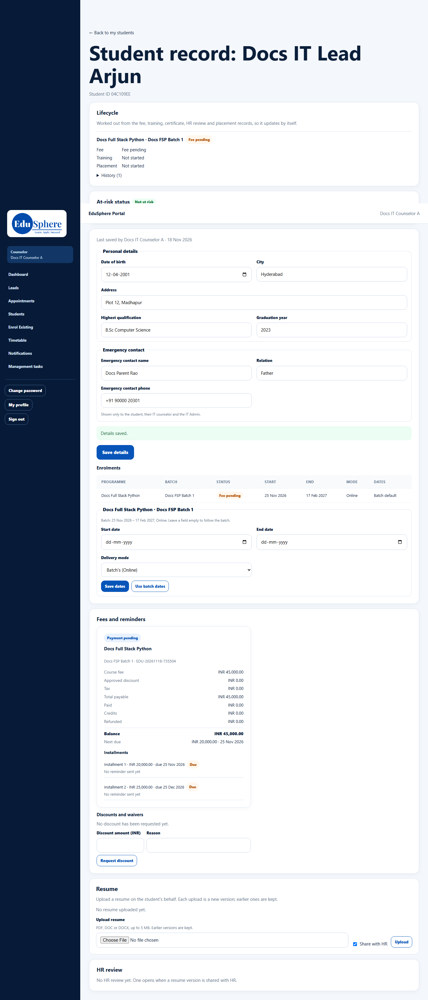

# Student record: personal details, emergency contact, enrolments
> Doc ID: DOC-ITC-STU-003 · Verified on 2026-11-18 against `main` @ `6b61546c` · Roles: IT Counselor (IT Admin: same page)

## Purpose
Keep a student's personal details and emergency contact up to date, and see their lifecycle and enrolments.

## Who Can Use This Feature
- **IT Counselor**: their own students.
- **IT Admin**: any IT student (**Students** → **Profile**).

## Prerequisites
- The student is assigned to you.

## How to Access
**Students** → **Profile** on the row (page title **Student record: {name}**).

## Steps
### Step 1 — Check the lifecycle
**Lifecycle** is "Worked out from the fee, training, certificate, HR review and placement records, so it updates by itself." For each enrolment it shows **Fee**, **Training** and **Placement** stages and a **History** link. **At-risk status** shows the result of the last daily check (see [Risk and lifecycle cards](stu-004-risk-lifecycle.md), S9).

### Step 2 — Fill in personal details and the emergency contact
Fill **Date of birth**, **City**, **Address**, **Highest qualification**, **Graduation year**, and under **Emergency contact**: **Emergency contact name**, **Relation**, **Emergency contact phone**. These are "Shown only to the student, their IT counselor and the IT Admin."

### Step 3 — Save
Select **Save details**. The message **Details saved.** appears, and the record shows **Last saved by {you} · {date}**.

### Step 4 — Check enrolments
**Enrolments** lists **Programme**, **Batch**, **Status**, **Start**, **End**, **Mode** and **Dates** (for example **Batch default**). Under each enrolment you can set its own **Start date**, **End date** and **Delivery mode** and select **Save dates**, or **Use batch dates** to follow the batch again ("Leave a field empty to follow the batch."). Changing dates was not captured.

## Fields
| Field | Required | Example |
|---|---|---|
| Date of birth | No | 12-04-2001 |
| City | No | Hyderabad |
| Address | No | Plot 12, Madhapur |
| Highest qualification | No | B.Sc Computer Science |
| Graduation year | No | 2023 |
| Emergency contact name | No | Docs Parent Rao |
| Relation | No | Father |
| Emergency contact phone | No | +91 90000 20301 |

## Expected Result
The details show on the [Student 360](stu-002-student-360.md) **Contact** section.

## Validation Messages
| Message | When |
|---|---|
| Details saved. | Saved |

## Tips
- The lower sections of the page, **Fees and reminders**, **Resume** and **HR review**, are described in [Fee summary](../fees/fee-001-fee-summary.md) and the resume pages (S8).

## Related Features
- [Student 360](stu-002-student-360.md)
- [Student notes](../notes/note-001-student-notes.md)
