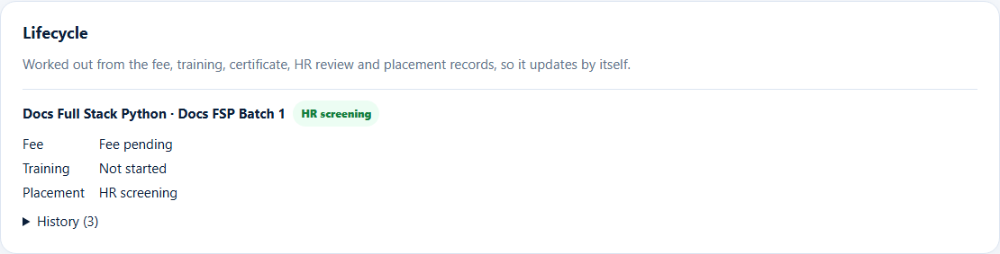
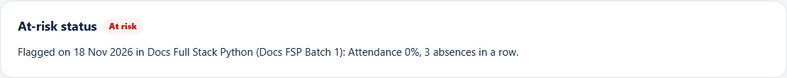

# Risk and lifecycle cards
> Doc ID: DOC-ITC-STU-004 · Verified on 2026-11-18 against `main` @ `6b61546c` (state prepared by data setup) · Roles: IT Counselor (IT Admin: can also set a stage by hand)

## Purpose
See where a student is in their journey (fee, training, placement) and whether the daily check has flagged them at risk.

## Who Can Use This Feature
| Role | What they see |
|---|---|
| IT Counselor | Lifecycle and at-risk status, read only |
| IT Admin | The same, plus **Set by hand** (see [Set a lifecycle stage; audit log](../../admin-manual/admin/adm-015-lifecycle-audit.md)) |

## Prerequisites
- The student has an enrolment. The at-risk check covers **active** enrolments of programmes the IT Admin monitors ([At-risk thresholds](../../admin-manual/admin/adm-011-at-risk.md)).

## How to Access
**Students** → **Profile** → cards **Lifecycle** and **At-risk status**. The Student 360 shows the flag under **Risk**.

## Steps
### Step 1 — Read the lifecycle
"Worked out from the fee, training, certificate, HR review and placement records, so it updates by itself." For each enrolment: the current stage (for example **HR screening**), then **Fee** (Fee pending, Partially paid, Paid), **Training** (Not started, Training active, Completed) and **Placement**. **History ({n})** lists each change.

### Step 2 — Read the at-risk status
**Not at risk** ("Not at risk at the last daily check.") or **At risk** with the reason, for example "Flagged on 18 Nov 2026 in Docs Full Stack Python (Docs FSP Batch 1): Attendance 0%, 3 absences in a row."

## Expected Result
When a student is flagged, you get **Student at risk**, the student gets **Let's get you back on track**, and the student appears under **Students at risk** on your dashboard. Everyone is told again when the student is back on track.

## Tips
- The check runs daily at 07:00 IST. In this guide three absences were added with a data setup and the check was run by hand.
- Stages are labelled by the IT Admin ([Status labels](../../admin-manual/admin/adm-013-status-labels.md)).

## Related Features
- [Student 360](stu-002-student-360.md)
- [Dashboard](../dashboard/dash-001-dashboard.md)
