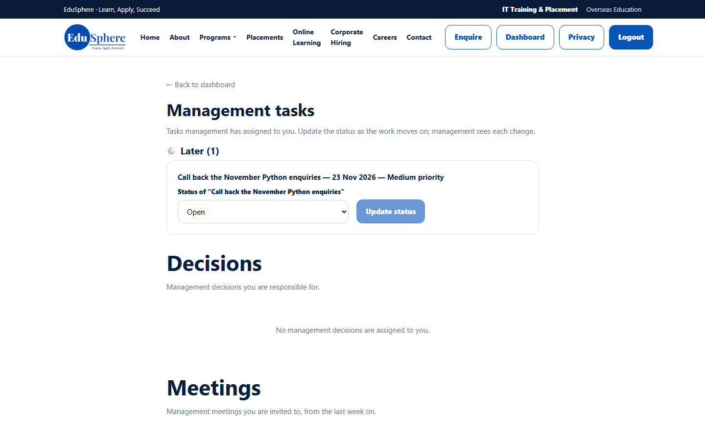
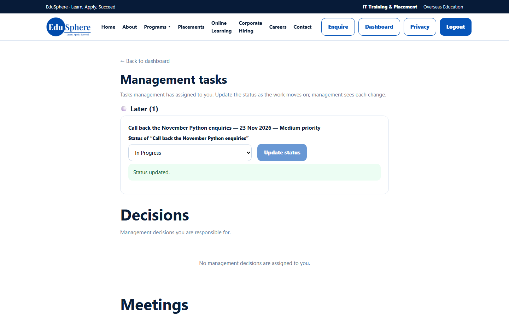

# Management tasks
> Doc ID: DOC-ITC-TASK-001 · Verified on 2026-11-18 against `main` @ `6b61546c` · Roles: IT Counselor (any staff member management assigns work to)

## Purpose
See the tasks, decisions and meetings management has given you, and update each task's status.

## Who Can Use This Feature
- **IT Counselor** (and other staff): tasks where they are the owner.
- Management (partners) create the tasks; this guide does not cover the management portal.

## Prerequisites
- A partner has assigned you a task. In the example, Arjun Partner created **Call back the November Python enquiries** for Docs IT Counselor A, due in five days.

## How to Access
Sidebar **Management tasks**. The page opens with the public site header. **← Back to dashboard** returns to your portal.

## Steps
### Step 1 — Find your task
Tasks are grouped by deadline (for example **Later (1)**). Each shows **{title} — {deadline} — {priority} priority**.

### Step 2 — Update the status
Choose **Open**, **In Progress** or **Completed** in **Status of "{title}"** and select **Update status**. The message **Status updated.** appears.

### Step 3 — Check decisions and meetings
**Decisions** lists "Management decisions you are responsible for." **Meetings** lists "Management meetings you are invited to, from the last week on."

## Expected Result
Management sees each status change.

## Validation Messages
| Message | When |
|---|---|
| Status updated. | Status saved |
| No management tasks are assigned to you. | No tasks |
| No management decisions are assigned to you. | No decisions |
| No management meetings for you this week or later. | No meetings |

## Tips
- Only management can cancel a task.
- The task form tells management that "The owner is notified". That notification was not captured.

## Related Features
- [Portal tour](../navigation/nav-001-portal-tour.md)
