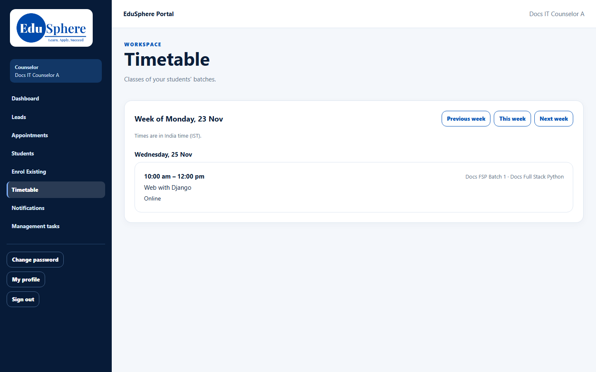

# Timetable
> Doc ID: DOC-ITC-TT-001 · Verified on 2026-11-18 against `main` @ `6b61546c` · Roles: IT Counselor

## Purpose
See the classes of your students' batches, week by week.

## Who Can Use This Feature
- **IT Counselor**: read only. The IT Admin keeps the weekly slots (**Timetable** in the IT Admin portal).

## Prerequisites
- At least one of your students has an **active** enrolment in a batch with weekly slots. An enrolment becomes active when the student accepts the enrolment agreement. A batch whose students are still **Pending consent** does not appear.

## How to Access
Sidebar **Timetable** ("Classes of your students' batches.").

## Steps
### Step 1 — Pick the week
The page opens on **This week** (**Week of Monday, {date}**). Use **Previous week** and **Next week** to move. "Times are in India time (IST)."

### Step 2 — Read the classes
Each day lists its classes: time, topic, **Online** or **In person** with the room, and **{batch} · {programme}**. "No classes this week." appears when there are none.

## Expected Result
Classes appear from the batch start date. In the example, Docs FSP Batch 1 starts on Wednesday 25 Nov, so the Monday slot first appears the following week.

## Tips
- Class links are not shown to counselors; students see them on their own timetable.
- When the IT Admin changes the slots, you get a **Student's batch updated** notification ("Changed: timetable.").

## Related Features
- [Notifications](../notifications/notif-001-notifications.md)
