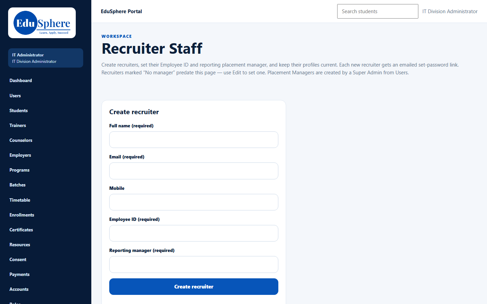
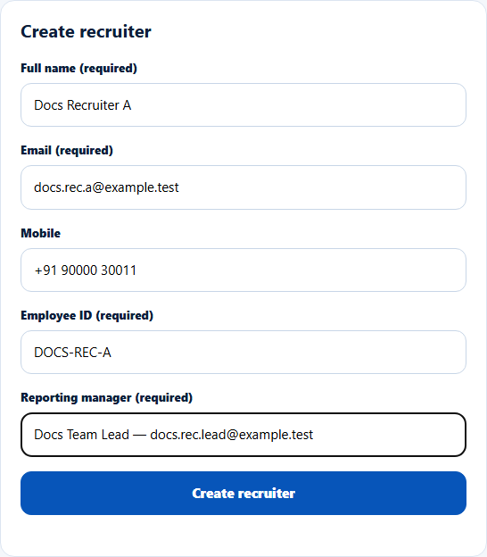
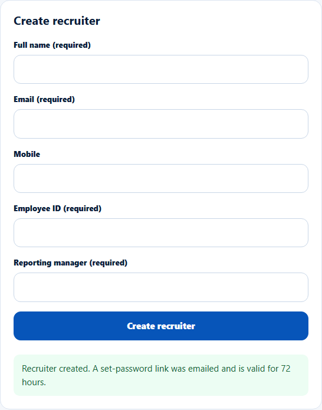
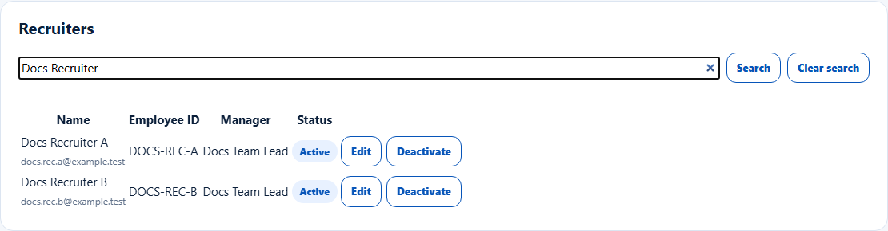
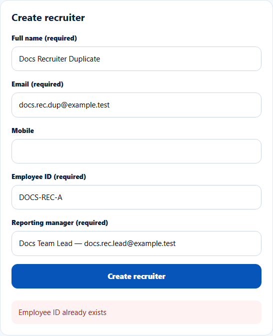

# Create a recruiter (Recruiter Staff)
> Doc ID: DOC-REC-ADM-001 · Verified on 2026-11-18 against `main` @ `6b61546c` · Roles: IT Admin, Super Admin

## Purpose
Give a new recruiter (role **placement team**) an account, an Employee ID and a reporting Team Lead, so they can sign in to the Recruiter workspace.

## Who Can Use This Feature
- **IT Admin**: sidebar **Recruiter Staff** (`/it/admin/recruiter-staff`).
- **Super Admin**: the same screen at `/admin/recruiter-staff`.

## Prerequisites
- At least one active Team Lead (role **placement manager**). Only a Super Admin creates one; see [Create other recruitment users](adm-002-create-recruitment-users.md). Without one the form says "No active placement manager — a Super Admin must create one first (Users → Placement Manager)."
- The recruiter's email is not used by another account.

## How to Access
IT Admin sidebar **Recruiter Staff**. The page explains: "Create recruiters, set their Employee ID and reporting placement manager, and keep their profiles current. Each new recruiter gets an emailed set-password link."

## Steps
### Step 1 — Fill in the form
Under **Create recruiter**, enter **Full name (required)**, **Email (required)**, **Mobile** and **Employee ID (required)**. In **Reporting manager (required)**, type part of the Team Lead's name and pick them from the list.

### Step 2 — Create
Select **Create recruiter**. The message **Recruiter created. A set-password link was emailed and is valid for 72 hours.** appears.

### Step 3 — Find the recruiter
After creating, the **Recruiters** list is filtered to the new Employee ID. To see others, type in **Search recruiters** (name, email or Employee ID) and select **Search**, or **Clear search**. Each row shows **Name**, **Employee ID**, **Manager**, **Status** and **Edit** / **Deactivate**.

## Fields
| Field | Required | Example |
|---|---|---|
| Full name | Yes | Docs Recruiter A |
| Email | Yes | docs.rec.a@example.test |
| Mobile | No | +91 90000 30011 |
| Employee ID | Yes, unique | DOCS-REC-A |
| Reporting manager | Yes | Docs Team Lead |

## Expected Result
The recruiter receives a welcome email. They set their password from it (valid 72 hours) and sign in at `/it/login`, landing on the Recruiter dashboard.

## Validation Messages
| Message | When |
|---|---|
| Recruiter created. A set-password link was emailed and is valid for 72 hours. | Created |
| Employee ID already exists | Another recruiter has that Employee ID |

## Tips
- A recruiter created from **Users** instead gets an empty profile; set their Employee ID and manager here with **Edit**. Rows marked **No manager** predate this page.

## Related Features
- [Edit, deactivate or reactivate a recruiter](adm-003-manage-recruiter.md)
- [Create other recruitment users](adm-002-create-recruitment-users.md)
