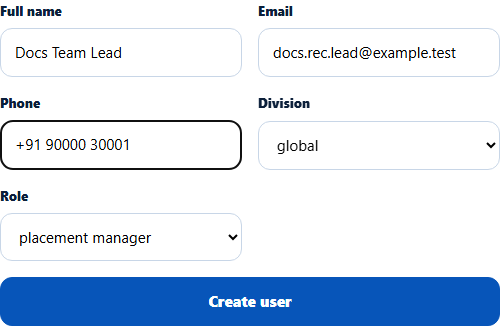
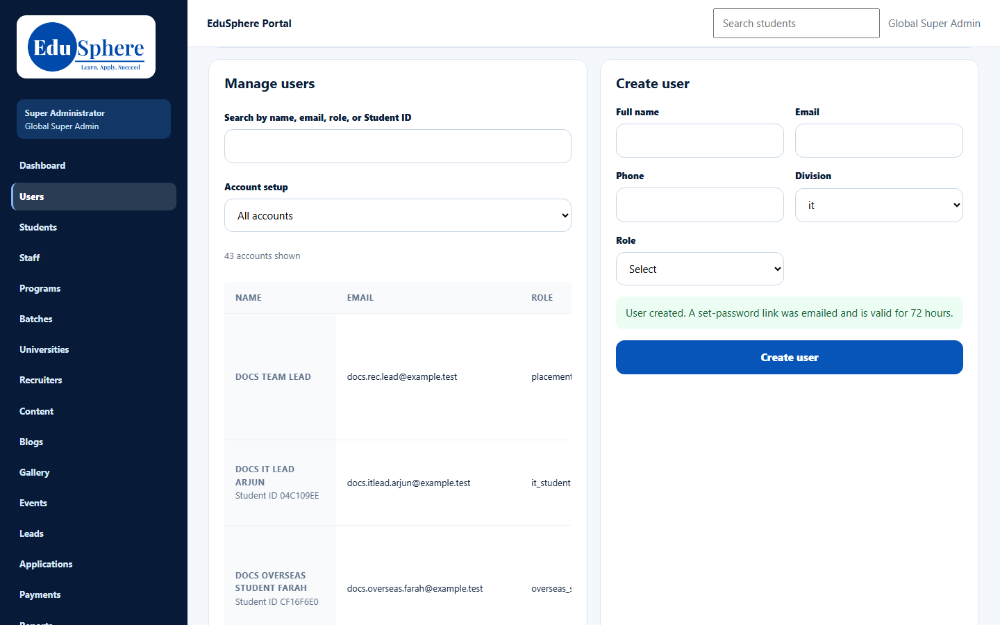
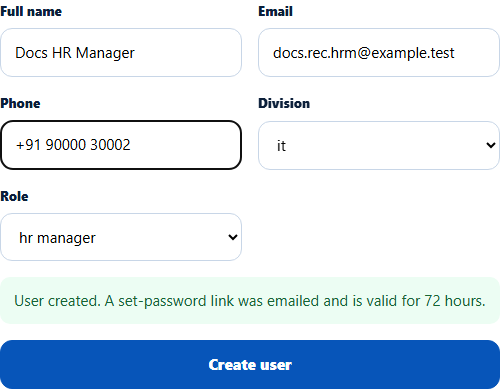
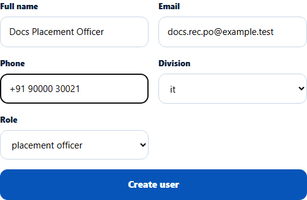
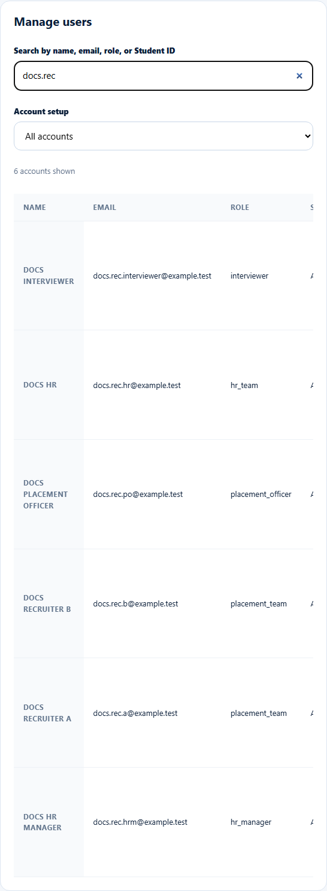

# Create other recruitment users
> Doc ID: DOC-REC-ADM-002 · Verified on 2026-11-18 against `main` @ `6b61546c` · Roles: Super Admin, IT Admin

## Purpose
Create accounts for the Team Lead, HR Manager, Placement Officer, HR Team and Interviewer roles.

## Who Can Use This Feature
| Role to create | Created by | Division |
|---|---|---|
| Team Lead (**placement manager**) | Super Admin only | global |
| HR Manager (**hr manager**) | Super Admin only | it |
| Placement Officer, HR Team, Interviewer | IT Admin or Super Admin | it |
| Recruiter (**placement team**) | Use [Recruiter Staff](adm-001-create-recruiter.md) | it |

The IT Admin's **Role** list offers it student, trainer, placement team, hr team, counselor, coordinator, placement officer, interviewer and it admin. It does not offer HR Manager or Team Lead.

## Prerequisites
- The email is not used by another account.

## How to Access
- Super Admin: `/admin/login` → sidebar **Users** → card **Create user**.
- IT Admin: `/it/login` → sidebar **Users** → card **Create user**.

## Steps
### Step 1 — Fill in Create user
Enter **Full name**, **Email** and **Phone**. Choose the **Division** (**global** for a Team Lead, **it** for the others) and the **Role**.

### Step 2 — Create
Select **Create user**. The message **User created. A set-password link was emailed and is valid for 72 hours.** appears.

### Step 3 — Repeat for each role
- **HR Manager:** Super Admin, Division **it**, Role **hr manager**.

- **Placement Officer, HR Team, Interviewer:** IT Admin, Division **it**.

## Expected Result
The new users appear in **Manage users** with **Active** and **Awaiting setup** until they set a password. The Team Lead is a global user and is not listed in the IT Admin's directory.

| Role | Signs in at | Lands on |
|---|---|---|
| Team Lead | `/admin/login` | `/recruiter/manager/team` |
| HR Manager, Placement Officer, HR Team, Interviewer | `/it/login` | their own dashboard |

## Validation Messages
| Message | When |
|---|---|
| User created. A set-password link was emailed and is valid for 72 hours. | Created |
| Only a Super Admin can create HR managers | An IT Admin tries to create an HR Manager by other means (from code; not captured) |

## Tips
- Manage these users afterwards (edit, re-send link, deactivate) on **Users** → **Manage users**, as for other staff.

## Related Features
- [Create a recruiter](adm-001-create-recruiter.md)
