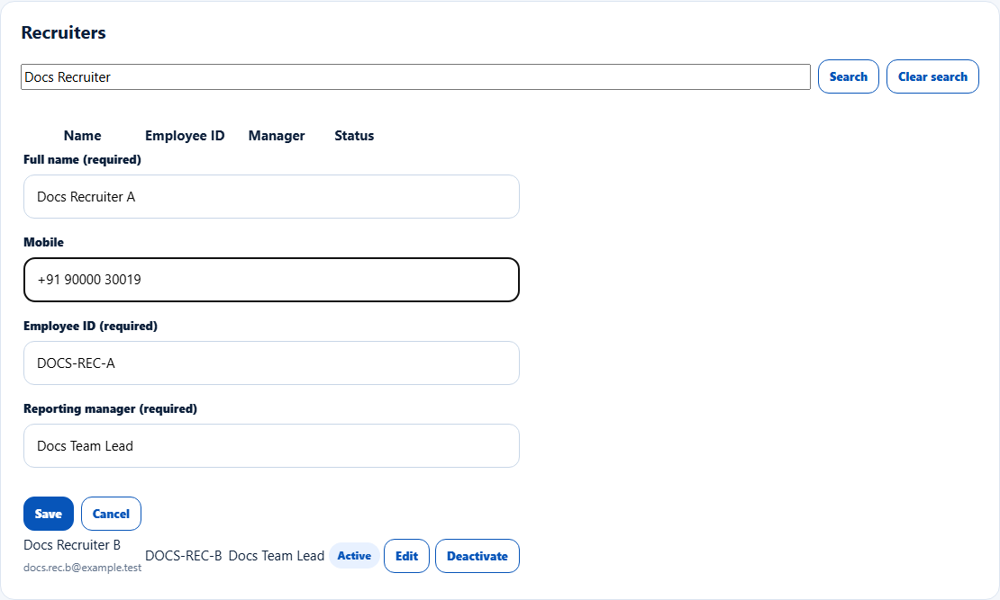
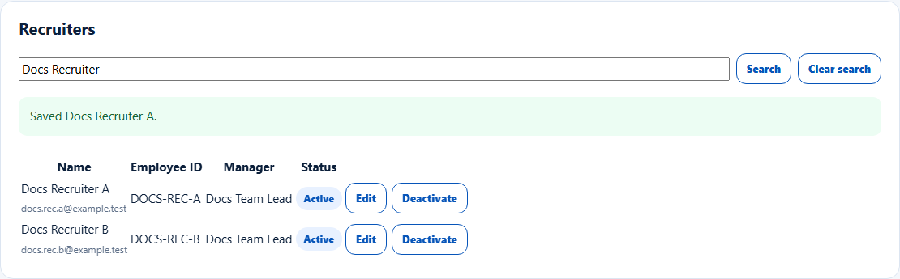

# Edit, deactivate or reactivate a recruiter
> Doc ID: DOC-REC-ADM-003 · Verified on 2026-11-18 against `main` @ `6b61546c` (edit). Deactivate / reactivate: added in session S16 · Roles: IT Admin, Super Admin

## Purpose
Keep a recruiter's name, mobile, Employee ID and Team Lead correct, and switch the account off when they leave.

## Who Can Use This Feature
- **IT Admin** and **Super Admin**, on **Recruiter Staff**.

## Prerequisites
- The recruiter exists. See [Create a recruiter](adm-001-create-recruiter.md).

## How to Access
Sidebar **Recruiter Staff** → **Recruiters** → the recruiter's row.

## Steps
### Step 1 — Edit
Select **Edit** on the row. The row opens with **Full name (required)**, **Mobile**, **Employee ID (required)** and **Reporting manager (required)**. Change what you need.

### Step 2 — Save
Select **Save** (or **Cancel**). The message **Saved {name}.** appears.

### Step 3 — Deactivate or reactivate
VERIFICATION REQUIRED — captured in session S16.

## Validation Messages
| Message | When |
|---|---|
| Saved {name}. | Edit saved |
| Employee ID already exists | The new Employee ID belongs to another recruiter (from code; not captured) |

## Tips
- The email can't be changed here.

## Related Features
- [Create a recruiter](adm-001-create-recruiter.md)
