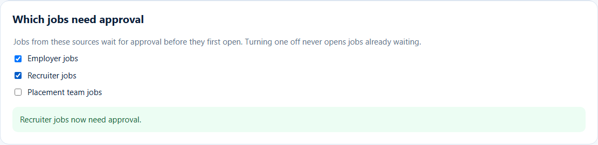

# Approval sources, result release and retention
> Doc ID: DOC-REC-ADM-006 · Verified on 2026-11-19 against `main` @ `6b61546c` · Roles: Super Admin

## Purpose
Decide which job requirements must be approved before they open. (Automatic result release and the retention rule are added to this page in later sessions.)

## Who Can Use This Feature
- **Super Admin** only. HR Managers see the settings read only.

## Prerequisites
- None.

## How to Access
Open `/it/hr-manager/approvals` as the Super Admin → **Which jobs need approval**.

## Steps
### Step 1 — Choose the sources
"Jobs from these sources wait for approval before they first open. Turning one off never opens jobs already waiting." Tick or clear each source; it saves at once.

| Source | Default |
|---|---|
| Employer jobs | On |
| Recruiter jobs | Off |
| Placement team jobs | Off |

Defaults are from code. Turning **Recruiter jobs** on shows **Recruiter jobs now need approval.**

Turning it off again shows **Recruiter jobs no longer need approval.** The Docs stack was put back to the defaults after the screenshots.

## Validation Messages
| Message | When |
|---|---|
| {source} now need approval. | Source turned on |
| {source} no longer need approval. | Source turned off |

## Tips
- Turning a source off does not open requirements already waiting; the HR Manager still decides them ([Vacancy approvals](../../user-manual/hr-manager/hrm-001-vacancy-approvals.md)).
- Approval applies only before a job first opens; a job that was open once can pause and reopen freely (from code).

## Related Features
- [Vacancy approvals](../../user-manual/hr-manager/hrm-001-vacancy-approvals.md)
- [Submit for approval](../../user-manual/requirements/req-007-approval.md)
