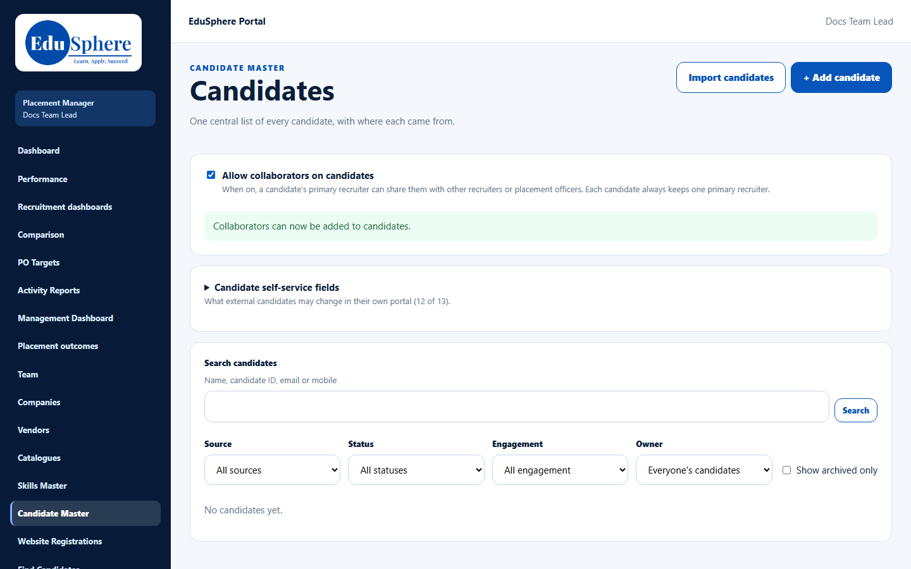

# Candidate collaborators and self-service fields
> Doc ID: DOC-REC-ADM-007 · Verified on 2026-11-18 against `main` @ `6b61546c` · Roles: Team Lead, Super Admin

## Purpose
Decide whether recruiters may share candidates with collaborators, and which fields external candidates may change themselves.

## Who Can Use This Feature
- **Team Lead** and **Super Admin**. Recruiters don't see these settings.

## Prerequisites
- None.

## How to Access
Sidebar **Candidate Master** (page **Candidates**), above the search.

## Steps
### Step 1 — Allow collaborators
Tick **Allow collaborators on candidates**: "When on, a candidate's primary recruiter can share them with other recruiters or placement officers. Each candidate always keeps one primary recruiter." The message **Collaborators can now be added to candidates.** appears. Unticking shows **New collaborators can no longer be added. Existing ones stay until removed.**

### Step 2 — Self-service fields
Open **Candidate self-service fields** ("What external candidates may change in their own portal (12 of 13)."), tick the **Fields candidates may edit** and select **Save fields**. The message **Candidates can now edit the chosen fields in their portal.** appears (from code; the list was not changed in this guide).

## Validation Messages
| Message | When |
|---|---|
| Collaborators can now be added to candidates. | Switched on |
| New collaborators can no longer be added. Existing ones stay until removed. | Switched off (from code; not captured) |
| Candidates can now edit the chosen fields in their portal. | Fields saved (from code; not captured) |

## Related Features
- [Candidate portal: profile](../../user-manual/candidate-portal/cand-004-profile.md)
