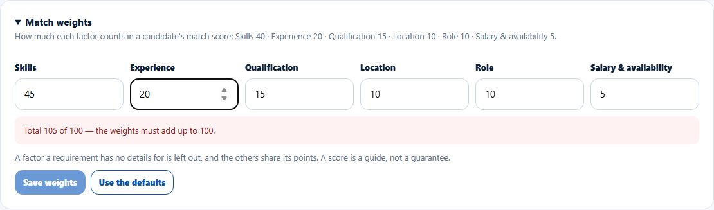
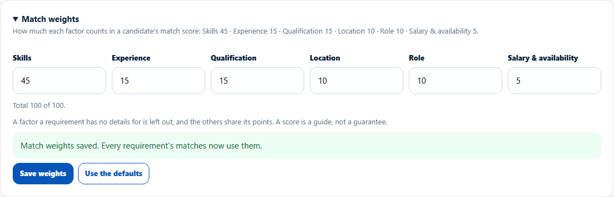

# Match weights
> Doc ID: DOC-REC-ADM-008 · Verified on 2026-11-18 against `main` @ `6b61546c` · Roles: Super Admin

## Purpose
Decide how much each factor counts in a candidate's match score for a requirement.

## Who Can Use This Feature
- **Super Admin** only, on **Job Requirements** (`/recruiter/requirements`).

## Prerequisites
- None. Defaults: Skills 40 · Experience 20 · Qualification 15 · Location 10 · Role 10 · Salary & availability 5.

## How to Access
Sign in at `/admin/login`, open `/recruiter/requirements` (**All job requirements**) and expand **Match weights**.

## Steps
### Step 1 — Change the weights
Enter whole numbers for **Skills**, **Experience**, **Qualification**, **Location**, **Role** and **Salary & availability**. The line under them shows the total; it must be 100 ("Total 105 of 100 — the weights must add up to 100.").

### Step 2 — Save
When the total is **100 of 100**, select **Save weights**. The message **Match weights saved. Every requirement's matches now use them.** appears.

### Step 3 — Go back to the defaults
Select **Use the defaults**, then **Save weights**. (In this guide the defaults were restored.)

## Validation Messages
| Message | When |
|---|---|
| Total {n} of 100 — the weights must add up to 100. | The total isn't 100 |
| Each weight must be a whole number from 0 to 100. | A weight is out of range (from code; not captured) |
| Match weights saved. Every requirement's matches now use them. | Saved |

## Tips
- "A factor a requirement has no details for is left out, and the others share its points. A score is a guide, not a guarantee."

## Related Features
- [Matching candidates](../../user-manual/hiring/hire-002-matching.md)
