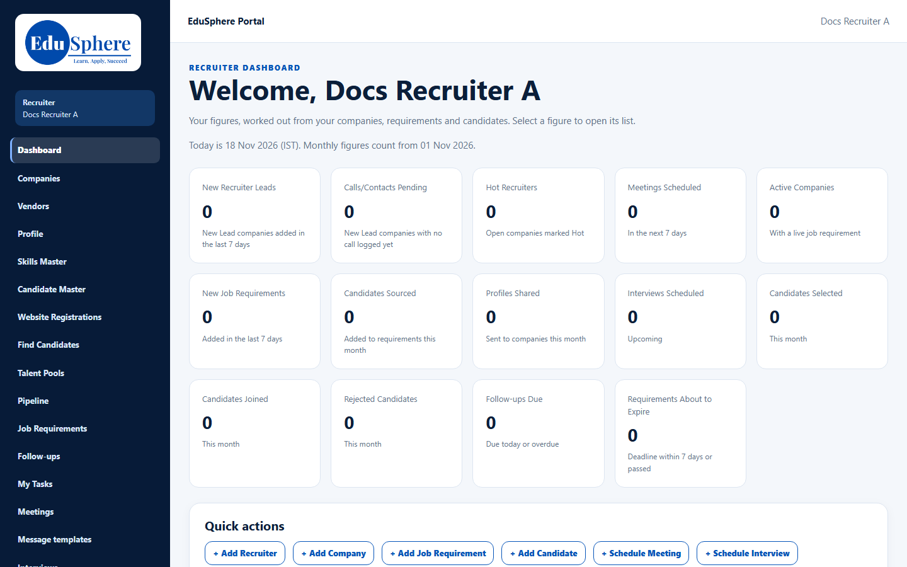
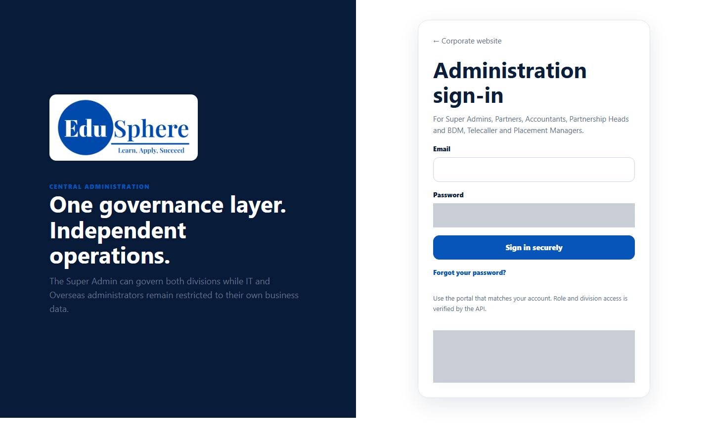
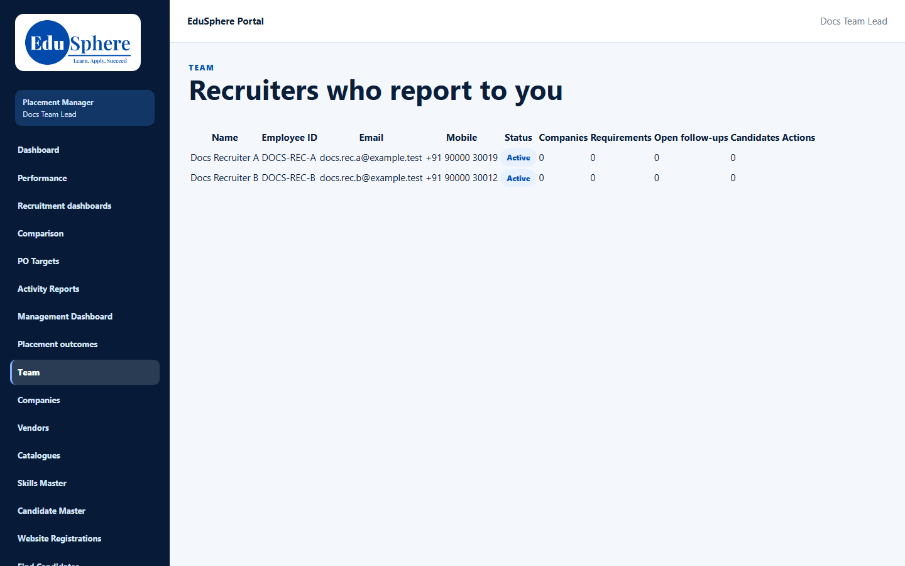
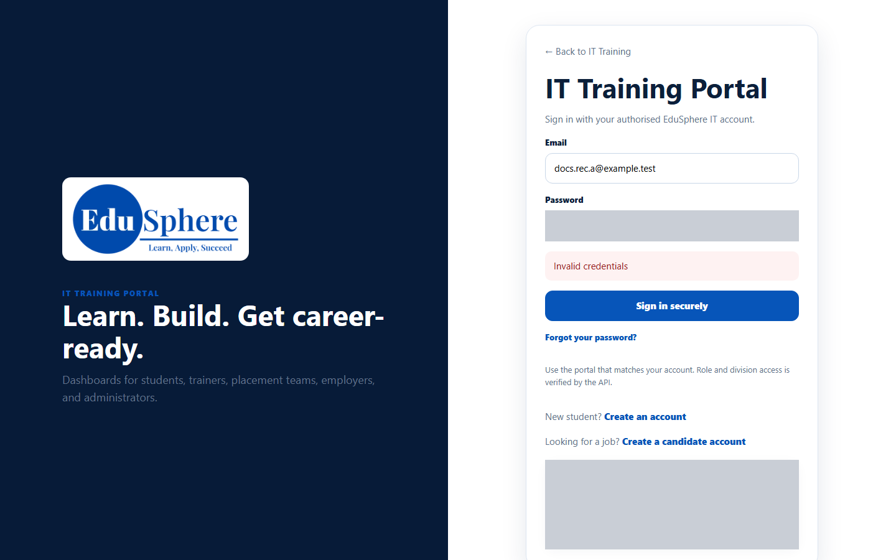
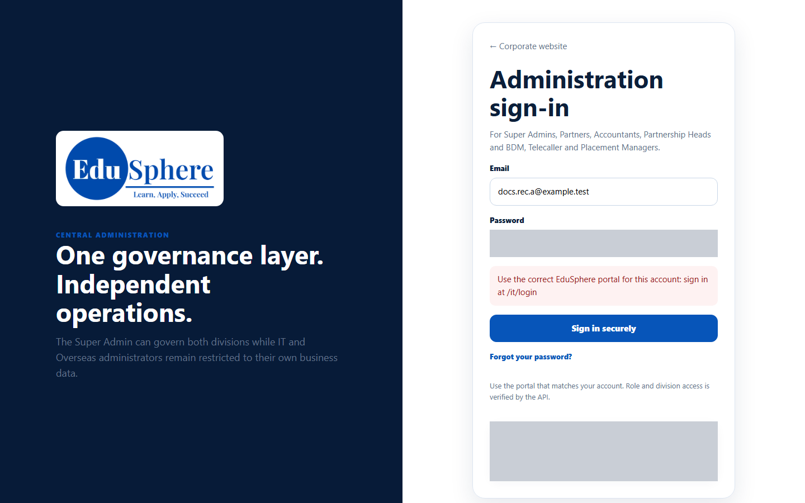

# Sign in
> Doc ID: DOC-REC-AUTH-001 · Verified on 2026-11-18 against `main` @ `6b61546c` · Roles: Recruiter, Team Lead, Placement Officer, HR Team, HR Manager, Interviewer

## Purpose
Sign in to your recruitment workspace.

## Who Can Use This Feature
| Role | Sign-in page | Lands on |
|---|---|---|
| Recruiter | `/it/login` | **Recruiter dashboard** (`/recruiter/dashboard`) |
| Placement Officer, HR Team, HR Manager, Interviewer | `/it/login` | Their own dashboard |
| Team Lead (placement manager) | `/admin/login` | **Team** (`/recruiter/manager/team`) |

## Prerequisites
- You set your password from the welcome email. See [Set your first password](auth-002-first-password.md).

## How to Access
Open `/it/login` (**IT Training Portal**) or, for a Team Lead, `/admin/login`.

## Steps
### Step 1 — Enter your details
Type your **Email** and **Password** and select **Sign in securely**.

### Step 2 — Land on your workspace
A recruiter lands on **Welcome, {name}** with the dashboard figures.

A Team Lead signs in at `/admin/login` and lands on **Recruiters who report to you**.

## Validation Messages
| Message | When |
|---|---|
| Invalid credentials | Wrong email or password |
| Use the correct EduSphere portal for this account: sign in at /it/login | A recruiter (or other IT role) used `/admin/login` |

## Tips
- If you open a recruitment page while signed out, you are sent to the sign-in page and return to that page afterwards.

## Related Features
- [Forgot / reset your password](auth-003-forgot-password.md)
- [Recruiter workspace tour](../navigation/nav-001-recruiter-workspace.md)
