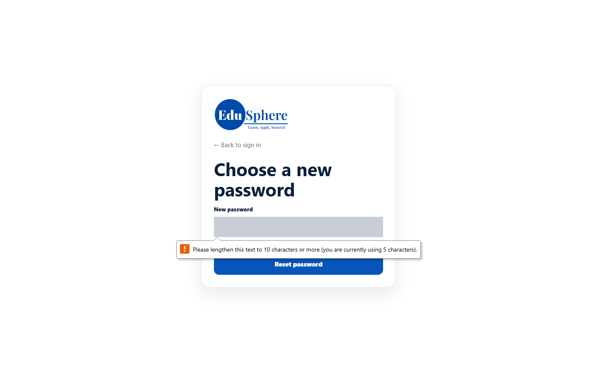
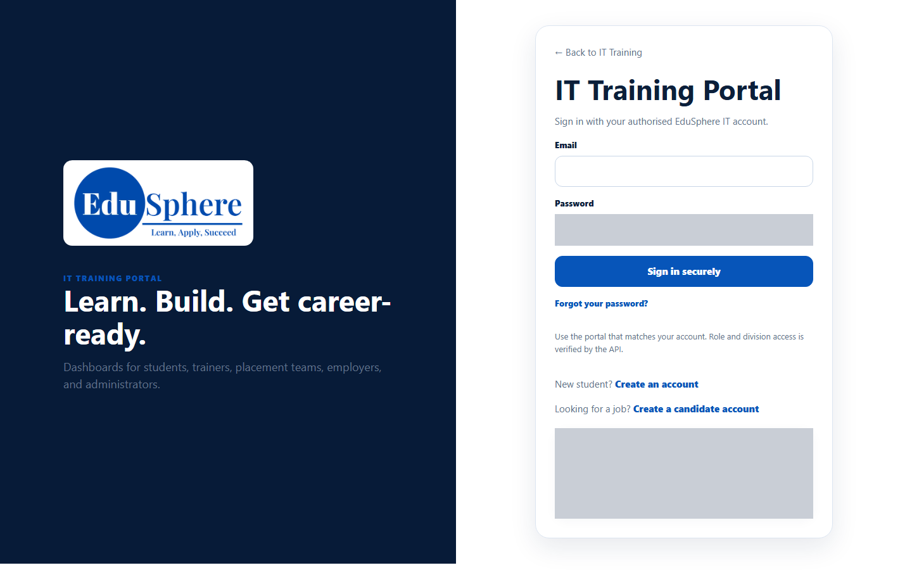

# Set your first password
> Doc ID: DOC-REC-AUTH-002 · Verified on 2026-11-18 against `main` @ `6b61546c` · Roles: all recruitment staff

## Purpose
Activate your new account by choosing a password from the welcome email.

## Who Can Use This Feature
- Every new recruitment user. The admin who created you sent the email ([Create a recruiter](../../admin-manual/admin/adm-001-create-recruiter.md)).

## Prerequisites
- The welcome email. Its link is valid for **72 hours** and works once.

## How to Access
Open the link in the welcome email. A Team Lead's link opens the administration version of the same page.

## Steps
### Step 1 — Choose a password
The page **Choose a new password** asks for a **New password** ("Use at least 10 characters.").

### Step 2 — Save it
Select **Reset password**. A shorter password is stopped by the browser ("Please lengthen this text to 10 characters or more…").

### Step 3 — Sign in
You are taken to the sign-in page (`/it/login`; `/admin/login` for a Team Lead). Sign in with the new password.

## Validation Messages
| Message | When |
|---|---|
| Please lengthen this text to 10 characters or more… | Fewer than 10 characters (browser message) |
| Reset token is invalid or expired… | The link was used, replaced, or is older than 72 hours (from code; not captured) |

## Tips
- Lost the email or it expired? Ask your admin to **Re-send link**.

## Related Features
- [Sign in](auth-001-sign-in.md)
