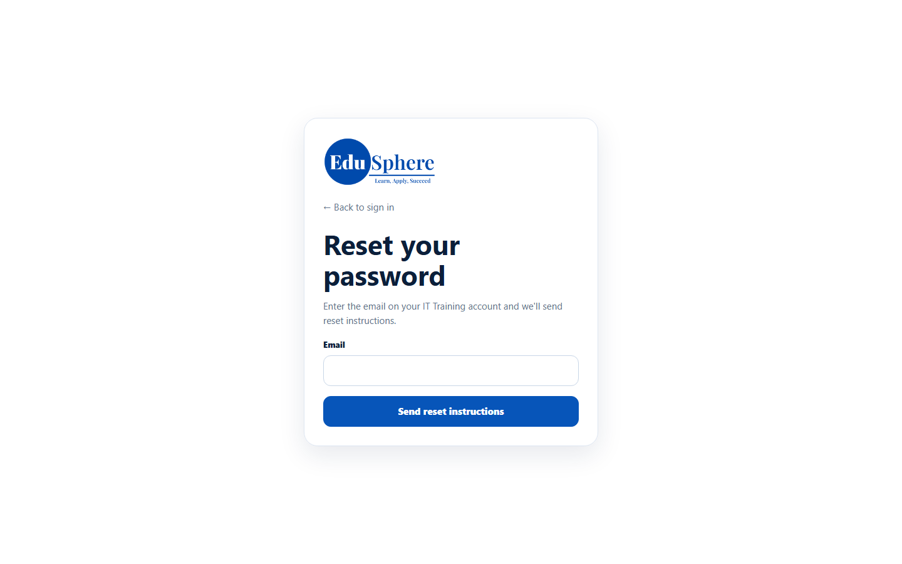
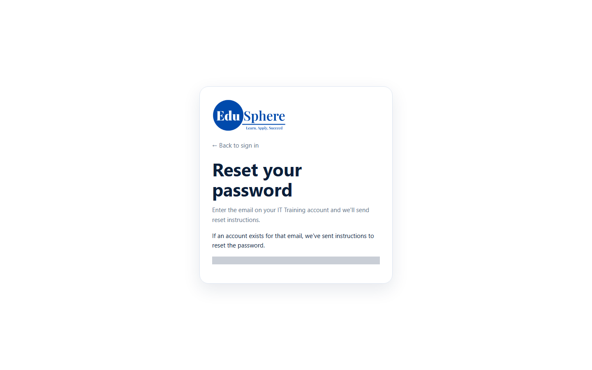

# Forgot / reset your password
> Doc ID: DOC-REC-AUTH-003 · Verified on 2026-11-18 against `main` @ `6b61546c` · Roles: all recruitment staff

## Purpose
Get back into your account when you forget the password.

## Who Can Use This Feature
- Every recruitment user with an active account.

## Prerequisites
- Access to your sign-in email.

## How to Access
Sign-in page → **Forgot your password?**

## Steps
### Step 1 — Request the email
Enter your **Email** and select **Send reset instructions**. The message **If an account exists for that email, we've sent instructions to reset the password.** appears.

### Step 2 — Choose a new password
Open the link in the email, enter a **New password** (at least 10 characters) and select **Reset password**. You are taken to the sign-in page.

## Validation Messages
| Message | When |
|---|---|
| If an account exists for that email, we've sent instructions to reset the password. | Always, so nobody can test which emails have accounts |
| Reset token is invalid or expired… | The link was already used or is older than 30 minutes (from code; not captured) |

## Tips
- A reset link expires after 30 minutes and works once.

## Related Features
- [Sign in](auth-001-sign-in.md)
