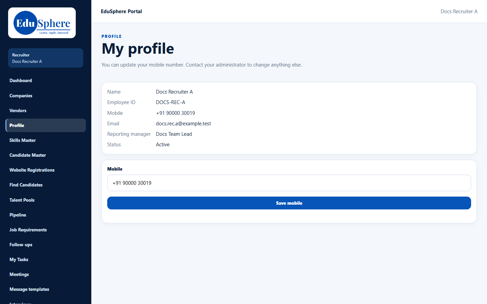
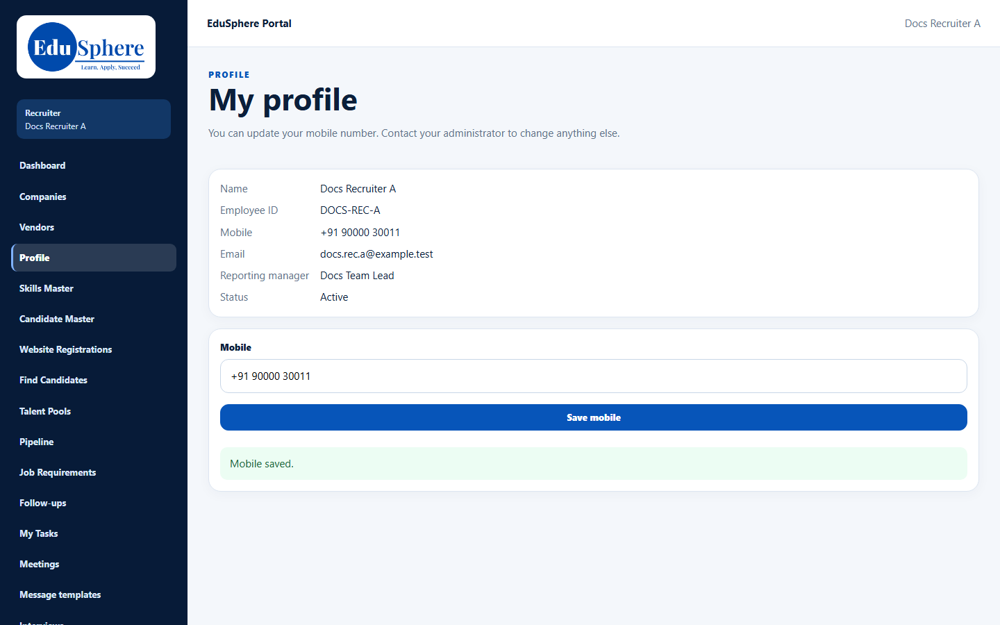
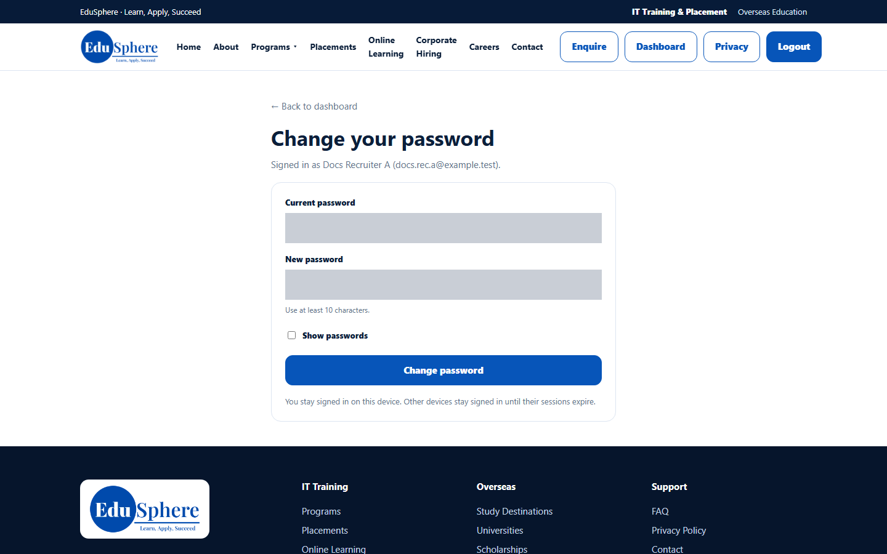
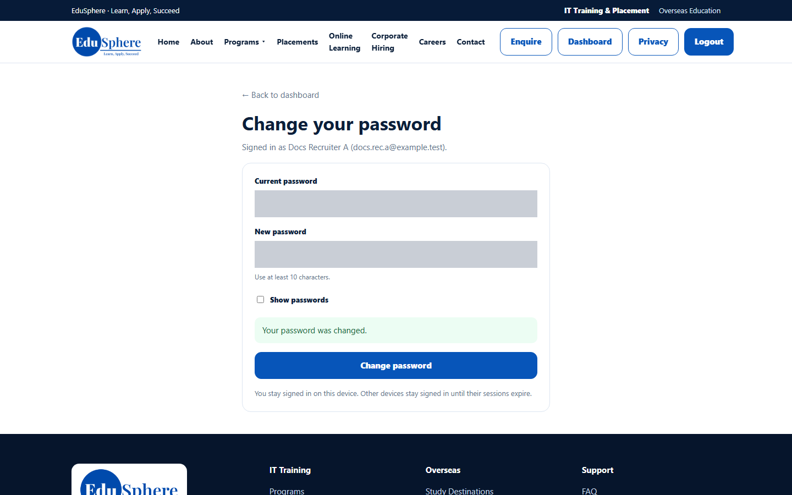

# Recruiter profile and change password
> Doc ID: DOC-REC-AUTH-004 · Verified on 2026-11-18 against `main` @ `6b61546c` · Roles: Recruiter (profile); all staff (change password)

## Purpose
Check your recruiter record, keep your mobile number current, and change your password.

## Who Can Use This Feature
- **Recruiter**: sidebar **Profile** (`/recruiter/profile`).
- **Everyone**: **Change password** and **My profile** at the bottom of the sidebar.

## Prerequisites
- You are signed in.

## How to Access
Recruiter sidebar **Profile**; sidebar footer **Change password**.

## Steps
### Step 1 — Read your recruiter profile
**My profile**: "You can update your mobile number. Contact your administrator to change anything else." It shows **Name**, **Employee ID**, **Mobile**, **Email**, **Reporting manager** and **Status**.

### Step 2 — Update your mobile
Change **Mobile** and select **Save mobile**. The message **Mobile saved.** appears.

### Step 3 — Change your password
Select **Change password**. Enter **Current password** and **New password**, then select **Change password**. The message **Your password was changed.** appears.

## Validation Messages
| Message | When |
|---|---|
| Mobile saved. | Mobile updated |
| Your password was changed. | Password changed |
| Incorrect current password | The current password is wrong (with a **Forgot your current password?** link) |

## Tips
- Name, Employee ID and reporting manager are changed by the admin on **Recruiter Staff**.

## Related Features
- [Edit a recruiter (admin)](../../admin-manual/admin/adm-003-manage-recruiter.md)
