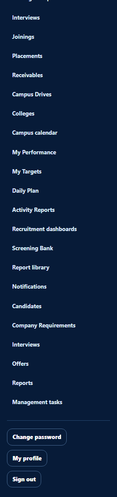

# Sign out, deactivated account
> Doc ID: DOC-REC-AUTH-005 · Verified on 2026-11-18 against `main` @ `6b61546c` (sign out). Deactivated account: added in session S16 · Roles: all recruitment staff

## Purpose
End your session, and know what happens when your account is switched off.

## Who Can Use This Feature
- Every recruitment user.

## Prerequisites
- You are signed in.

## How to Access
Bottom of the sidebar → **Sign out**.

## Steps
### Step 1 — Sign out
Scroll to the bottom of the sidebar and select **Sign out**.

### Step 2 — After signing out
Opening a recruitment page again takes you to the sign-in page; after you sign in you return to that page.

### Deactivated account
VERIFICATION REQUIRED — captured in session S16.

## Expected Result
You are signed out on this browser.

## Related Features
- [Sign in](auth-001-sign-in.md)
