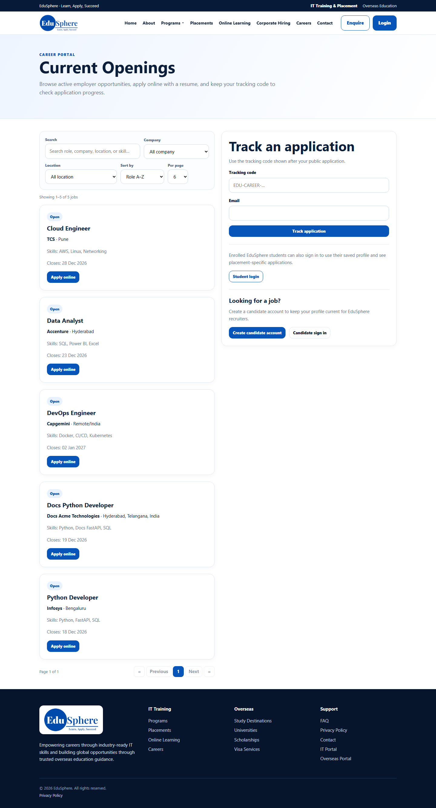
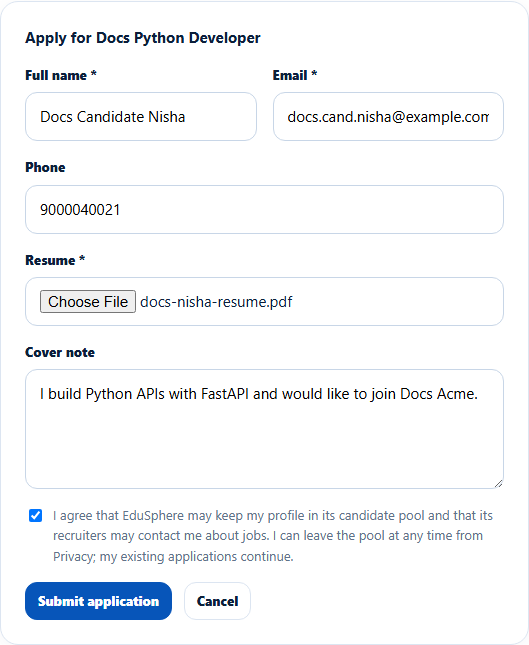
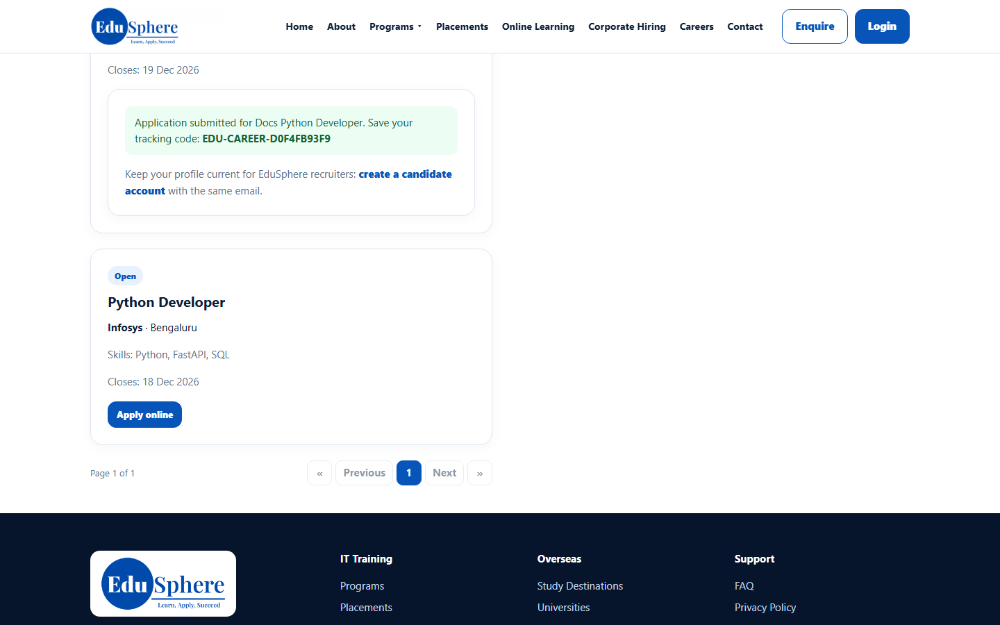

# Careers page and Apply online
> Doc ID: DOC-REC-CAND-001 · Verified on 2026-11-19 against `main` @ `6b61546c` · Roles: Anyone (no sign-in)

## Purpose
Let anyone browse open jobs on EduSphere's public careers page and apply with a resume, without creating an account.

## Who Can Use This Feature
- Anyone. Jobs appear here when their [visibility](../requirements/req-008-visibility.md) is **Public website** and they are open.

## Prerequisites
- A resume file.

## How to Access
`/it/careers` (**Career portal**).

## Steps
### Step 1 — Browse the jobs
**Current Openings**: "Browse active employer opportunities, apply online with a resume, and keep your tracking code to check application progress." Filter with **Search**, **Company**, **Location**, **Sort by** (Role A–Z, Company A–Z, Closing soon) and **Per page**. Each job shows its title, company, location, skills, closing date and **Apply online**.

### Step 2 — Apply
Select **Apply online** on the job. The form **Apply for {job}** opens in place: **Full name \***, **Email \***, **Phone**, **Resume \***, **Cover note**, and the consent "I agree that EduSphere may keep my profile in its candidate pool and that its recruiters may contact me about jobs. I can leave the pool at any time from Privacy; my existing applications continue."

### Step 3 — Submit
Select **Submit application**: **Application submitted for Docs Python Developer. Save your tracking code: EDU-CAREER-…**, followed by "Keep your profile current for EduSphere recruiters: create a candidate account with the same email."

## Validation Messages
| Message | When |
|---|---|
| Application submitted for {job}. Save your tracking code: {code} | Submitted |

## Tips
- Keep the tracking code: it is needed to [track the application](cand-002-track.md).
- The applicant joins the Candidate Master and appears on the recruiters' [Website registrations](../candidates/can-014-website-registrations.md), assigned by the routing rules.
- Use an address that can receive mail; EduSphere refuses addresses ending in `.test`.

## Related Features
- [Track an application](cand-002-track.md)
- [Create a candidate account](cand-003-register.md)
