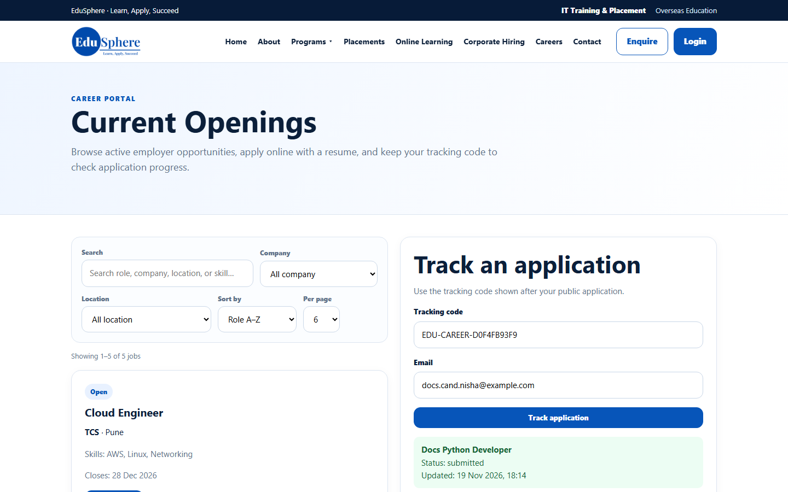

# Track an application
> Doc ID: DOC-REC-CAND-002 · Verified on 2026-11-19 against `main` @ `6b61546c` · Roles: Anyone (no sign-in)

## Purpose
Let someone who applied on the careers page check the status of the application without an account.

## Who Can Use This Feature
- Anyone who has a tracking code and the email used to apply.

## Prerequisites
- An application made on the [careers page](cand-001-careers-apply.md).

## How to Access
`/it/careers` → **Track an application** (lower on the page).

## Steps
### Step 1 — Enter the code and email
"Use the tracking code shown after your public application." Enter the **Tracking code** and **Email**, then select **Track application**.

### Step 2 — Read the status
The application shows under the form: the job (**Docs Python Developer**), **Status: submitted** and **Updated: {date and time}**.

## Tips
- Enrolled EduSphere students can **Student login** instead, to use their saved profile and see placement-specific applications.
- With a [candidate account](cand-003-register.md), the portal's **My applications** page lists every application (covered with the hiring flow, session S10).

## Related Features
- [Careers page and Apply online](cand-001-careers-apply.md)
- [Create a candidate account](cand-003-register.md)
