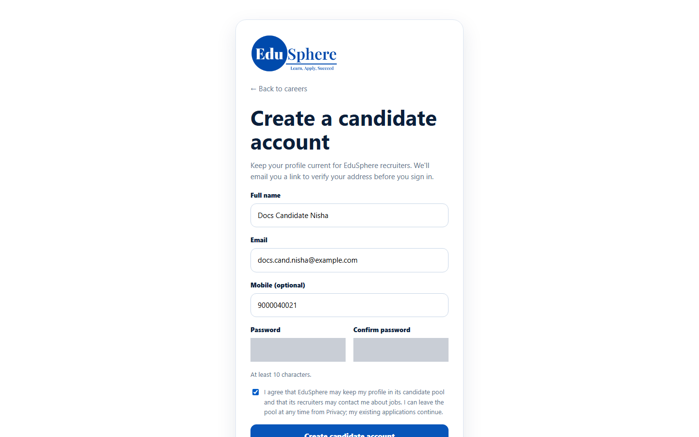
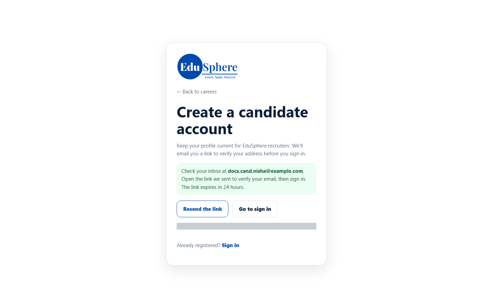
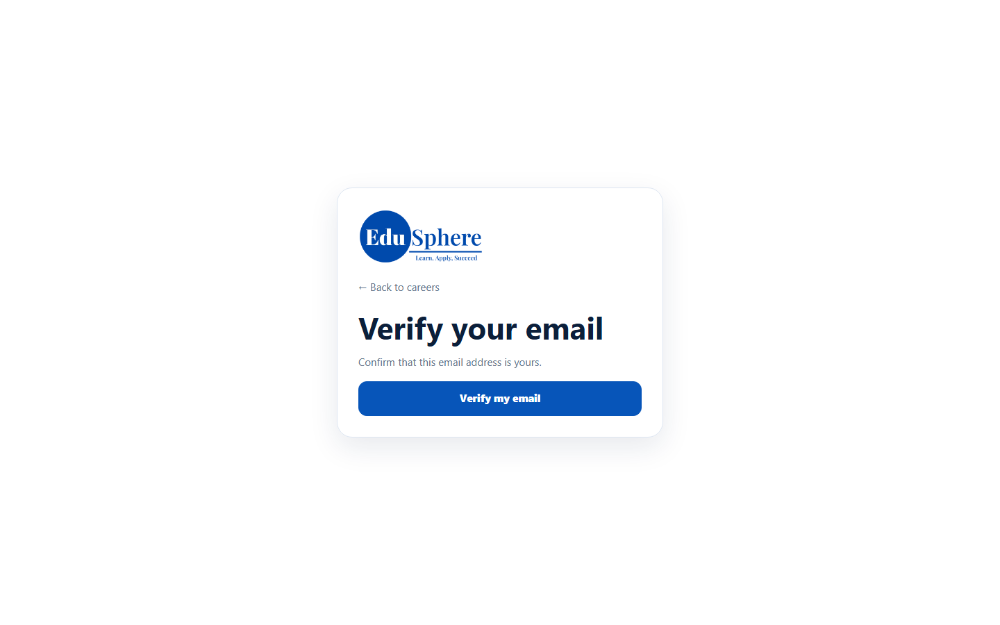
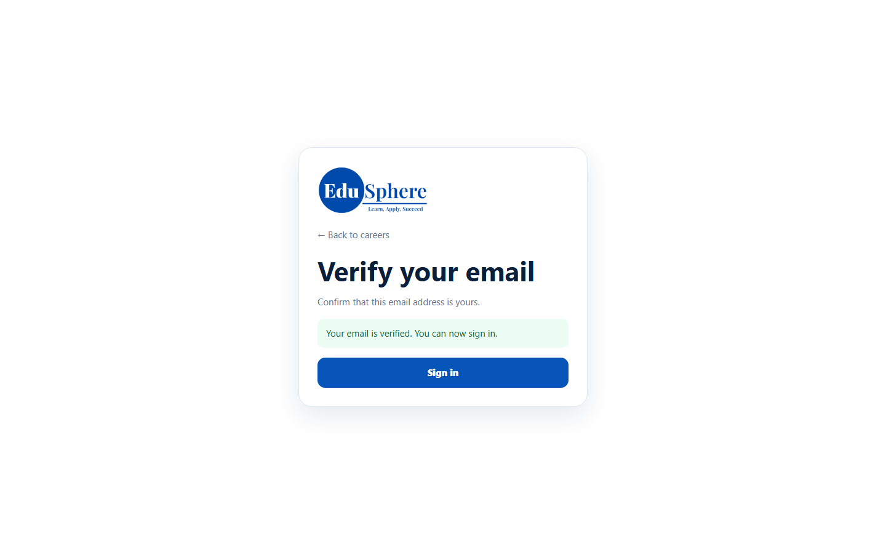

# Create a candidate account and verify the email
> Doc ID: DOC-REC-CAND-003 · Verified on 2026-11-19 against `main` @ `6b61546c` · Roles: External candidate

## Purpose
Let a job seeker create their own account, so they can keep their profile current for EduSphere recruiters and follow their applications.

## Who Can Use This Feature
- Anyone with an email address. If they already applied on the careers page, using the same email links the account to that candidate record.

## Prerequisites
- An email address that can receive mail (addresses ending in `.test` are refused).

## How to Access
`/it/careers` → **Create candidate account** (`/it/careers/register`), or **Looking for a job? Create a candidate account** on the IT sign-in page.

## Steps
### Step 1 — Fill in the form
"Keep your profile current for EduSphere recruiters. We'll email you a link to verify your address before you sign in." Enter **Full name**, **Email**, **Mobile (optional)**, **Password** and **Confirm password** (at least 10 characters), and tick the consent ("I agree that EduSphere may keep my profile in its candidate pool…").

### Step 2 — Check your inbox
Select **Create candidate account**: "Check your inbox at {email}. Open the link we sent to verify your email, then sign in. The link expires in 24 hours." **Resend the link** sends it again.

### Step 3 — Verify
The email "Verify your email address -- EduSphere" has a link to `/it/careers/verify-email`. It opens **Verify your email** ("Confirm that this email address is yours."). Select **Verify my email**.

The message **Your email is verified. You can now sign in.** appears with **Sign in**.

### Step 4 — Sign in
Sign in at `/it/login` with the email and password. The candidate lands on **My profile** ([Candidate profile](cand-004-profile.md)).

## Validation Messages
| Message | When |
|---|---|
| Check your inbox at {email}. … The link expires in 24 hours. | Account created. The same answer is shown for an email that already has an account, so the page never reveals who is registered (from code) |
| Your email is verified. You can now sign in. | Link confirmed |
| Verify your email address first -- use the link we emailed you, or request a new one. | Signing in before verifying |

## Tips
- Docs Candidate Nisha applied first and registered afterwards with the same email; her account opened on the same candidate, CAN-000007.
- Verifying the email is what ticks **Contact verified** (10%) in the recruiter's [profile completeness](../candidates/can-003-candidate-page.md#step-2--profile-completeness).

## Related Features
- [Candidate profile and change email](cand-004-profile.md)
- [Careers page and Apply online](cand-001-careers-apply.md)
