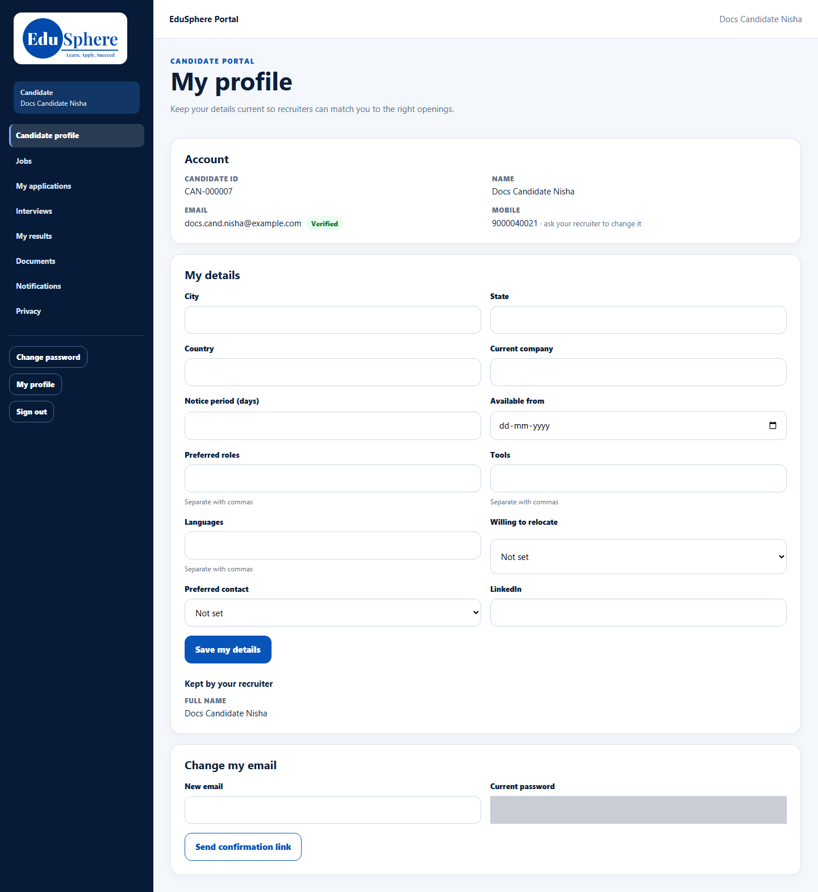
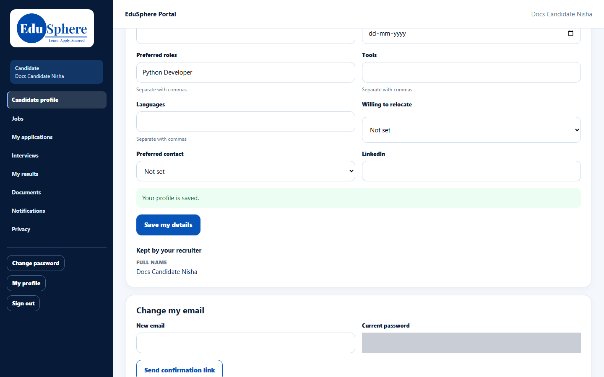
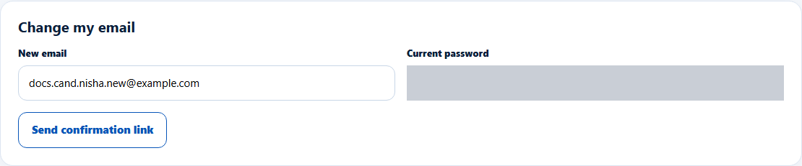

# Candidate profile and change email
> Doc ID: DOC-REC-CAND-004 · Verified on 2026-11-19 against `main` @ `6b61546c` · Roles: External candidate

## Purpose
Let candidates keep their own details current, so recruiters match them to the right openings, and change the email they sign in with.

## Who Can Use This Feature
- A signed-in external candidate. Which fields they may change is set by the Team Lead ([Candidate self-service fields](../../admin-manual/admin/adm-007-candidate-settings.md); 12 of 13 here).

## Prerequisites
- A verified [candidate account](cand-003-register.md).

## How to Access
Sign in at `/it/login` → **Candidate profile** (`/it/careers/portal/profile`). The portal menu: Candidate profile, Jobs, My applications, Interviews, My results, Documents, Notifications, Privacy.

## Steps
### Step 1 — Read the profile
**My profile**: "Keep your details current so recruiters can match you to the right openings." **Account** shows the **Candidate ID** (CAN-000007), **Name**, **Email** (marked **Verified**) and **Mobile** ("ask your recruiter to change it"). **Kept by your recruiter** lists what only staff can change (here **Full name**).

### Step 2 — Update my details
Under **My details** edit **City**, **State**, **Country**, **Current company**, **Notice period (days)**, **Available from**, **Preferred roles**, **Tools**, **Languages**, **Willing to relocate**, **Preferred contact** and **LinkedIn**. Select **Save my details**: **Your profile is saved.**

### Step 3 — Change my email
Under **Change my email** enter the **New email** and your **Current password**, then **Send confirmation link**: "If {new email} can be used, we've sent a confirmation link to it. Your current email stays in use until you open that link."

## Validation Messages
| Message | When |
|---|---|
| Your profile is saved. | Details saved |
| If {email} can be used, we've sent a confirmation link to it. Your current email stays in use until you open that link. | Email change requested |
| Incorrect current password | Wrong password (from code; not captured) |

## Tips
- The change is only made when the link in the new mailbox is opened; this guide did not open it, so Nisha still signs in with her first email.
- Recruiters see the saved details at once: Nisha's location (Hyderabad) and completeness appeared on [Website registrations](../candidates/can-014-website-registrations.md).

## Related Features
- [Create a candidate account](cand-003-register.md)
- [Candidate self-service fields](../../admin-manual/admin/adm-007-candidate-settings.md)
