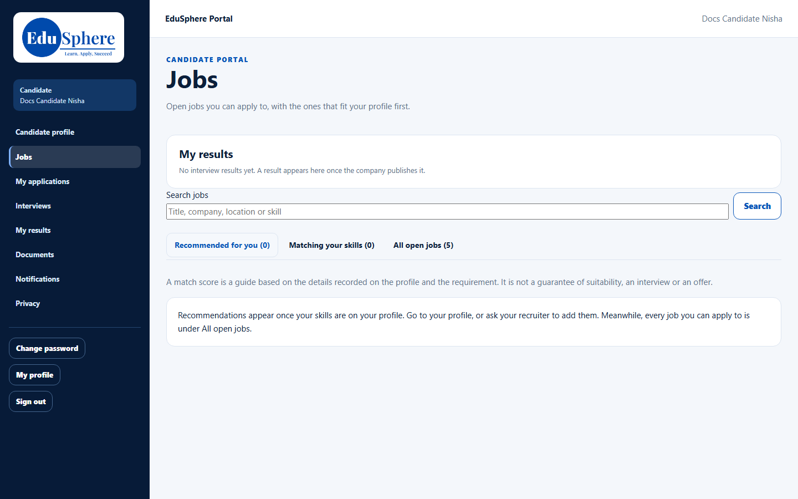
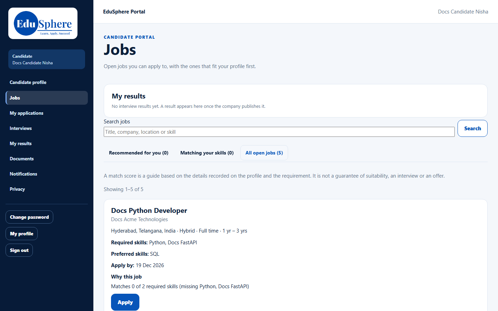
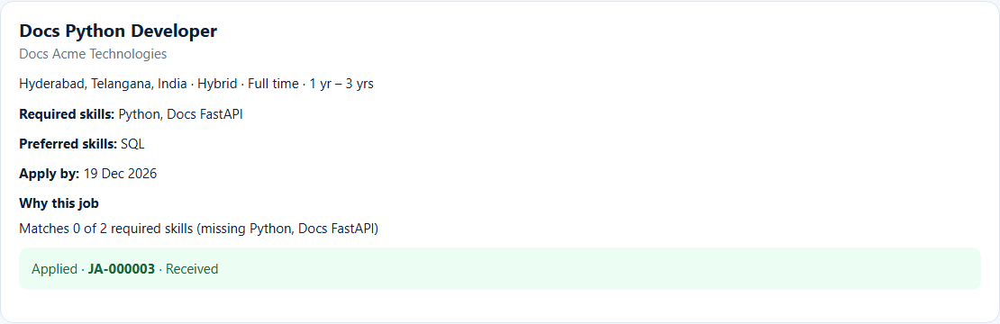

# Jobs for you and apply
> Doc ID: DOC-REC-CAND-005 · Verified on 2026-11-19 against `main` @ `6b61546c` · Roles: External candidate

## Purpose
Show a signed-in candidate the open jobs, best fits first, and let them apply with one click using their saved profile.

## Who Can Use This Feature
- A signed-in external candidate ([Create a candidate account](cand-003-register.md)).

## Prerequisites
- Skills on the profile, for recommendations (the candidate or their recruiter adds them).

## How to Access
Candidate portal → **Jobs** (`/it/careers/portal/jobs`).

## Steps
### Step 1 — Read the tabs
"Open jobs you can apply to, with the ones that fit your profile first." Tabs: **Recommended for you**, **Matching your skills**, **All open jobs**, and **Search jobs**. With no skills on the profile: "Recommendations appear once your skills are on your profile. Go to your profile, or ask your recruiter to add them. Meanwhile, every job you can apply to is under All open jobs."

### Step 2 — All open jobs
Each job shows the company, location, work mode, employment type, experience, required and preferred skills, **Apply by** date, **Why this job** ("Matches 0 of 2 required skills (missing Python, Docs FastAPI)") and **Apply**.

### Step 3 — Apply
Select **Apply**. There is no form: the saved profile is used. The job now reads **Applied · JA-000003 · Received**.

The application appears at once on the requirement's [Candidates](../hiring/hire-001-candidates-statuses.md) list as **Sourced**, source **Candidate portal**.

## Validation Messages
| Message | When |
|---|---|
| Applied · {application} · Received | Applied |

## Tips
- Apply from the portal rather than the public careers page: a portal application goes straight onto the requirement, a public one does not (finding P17).
- "A match score is a guide … It is not a guarantee of suitability, an interview or an offer."

## Related Features
- [My applications](cand-006-my-applications.md)
- [Candidate profile](cand-004-profile.md)
