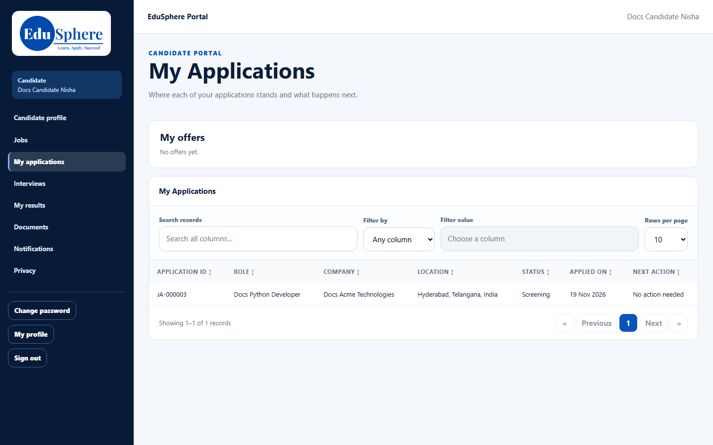

# My applications and offers
> Doc ID: DOC-REC-CAND-006 · Verified on 2026-11-19 against `main` @ `6b61546c` · Roles: External candidate

## Purpose
Show candidates where each of their applications stands and what happens next, and any offers they have.

## Who Can Use This Feature
- A signed-in external candidate.

## Prerequisites
- An application made in the portal ([Jobs for you](cand-005-jobs-apply.md)).

## How to Access
Candidate portal → **My applications** (`/it/careers/portal/applications`).

## Steps
### Step 1 — Read the page
"Where each of your applications stands and what happens next." **My offers** comes first ("No offers yet."). **My Applications** is a table with **Application ID**, **Role**, **Company**, **Location**, **Status**, **Applied on** and **Next action**, with search, a column filter, and rows per page.

Nisha's JA-000003 shows **Screening** and "No action needed" after the recruiter moved it to **Screened**.

## Tips
- The candidate sees a simple stage, not the recruiter's exact status.
- A public careers-page application is followed with its tracking code ([Track an application](cand-002-track.md)); it is not listed here (finding P17).
- Offers are covered with the hiring flow (session S11).

## Related Features
- [Jobs for you and apply](cand-005-jobs-apply.md)
- [Candidates and statuses](../hiring/hire-001-candidates-statuses.md)
