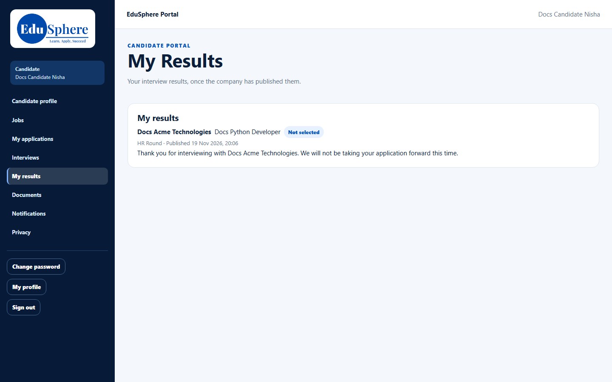
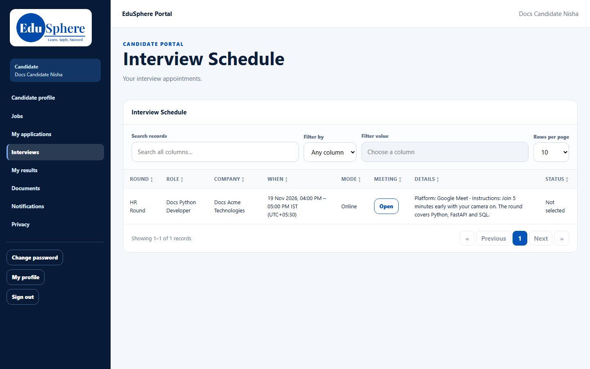

# Interviews and results (candidate)
> Doc ID: DOC-REC-CAND-007 · Verified on 2026-11-19 against `main` @ `6b61546c` · Roles: External candidate

## Purpose
Show candidates their interview appointments and, once published, the outcome with the company's message.

## Who Can Use This Feature
- A signed-in external candidate with an application in the portal.

## Prerequisites
- A recruiter scheduled an interview ([Schedule an interview](../hiring/hire-006-schedule-interview.md)).

## How to Access
Candidate portal → **Interviews** (`/it/careers/portal/interviews`) and **My results** (`/it/careers/portal/results`).

## Steps
### Step 1 — Interview schedule
"Your interview appointments." A table with **Round**, **Role**, **Company**, **When** (in the candidate's time zone, here "IST (UTC+05:30)"), **Mode**, **Meeting** (**Open** for the link), **Details** (platform, instructions) and **Status**. Nisha's HR Round showed **Rescheduled** at its new time.

### Step 2 — My results
"Your interview results, once the company has published them." Each result shows the company, role, outcome (**Not selected**), round, publish date and the message.

Before publishing: "No interview results yet. A result appears here once the company publishes it."

## Tips
- Feedback, scores and notes are never shown to the candidate.
- The interview schedule after the result:
  

## Related Features
- [My applications](cand-006-my-applications.md)
- [Result approvals](../hr-manager/hrm-002-result-approvals.md)
