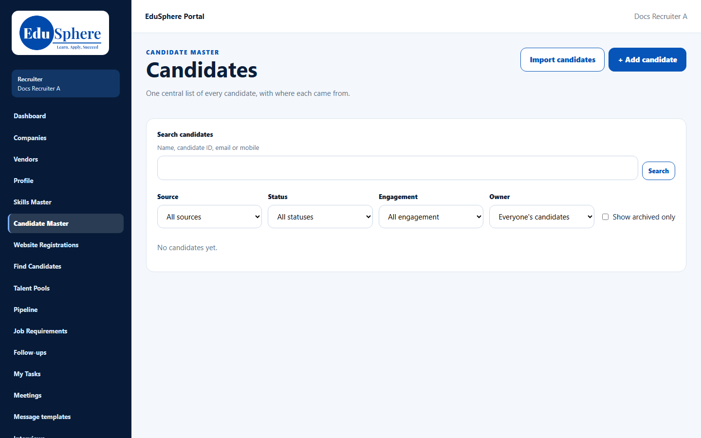
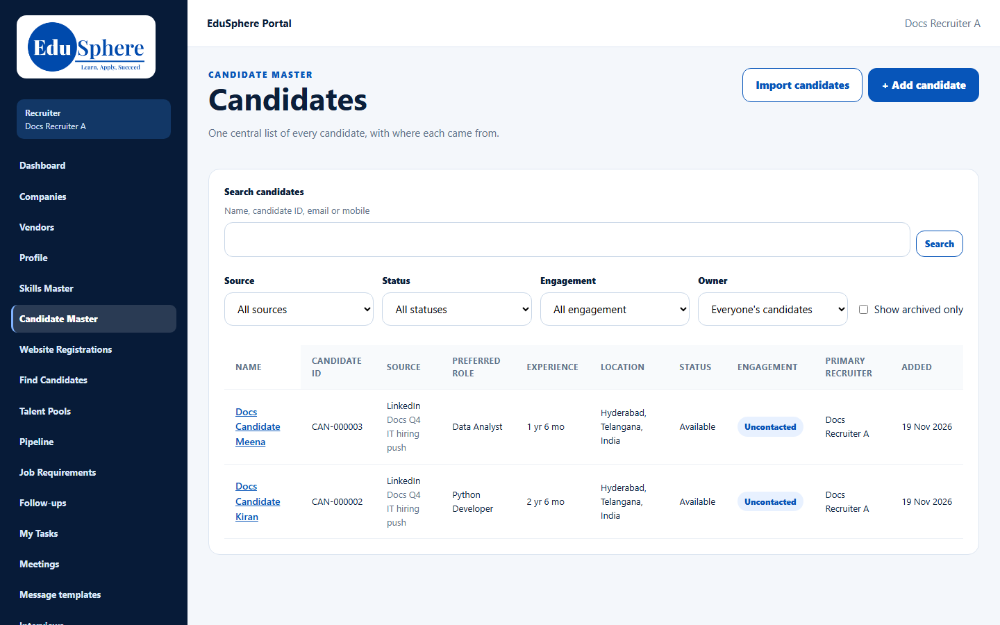
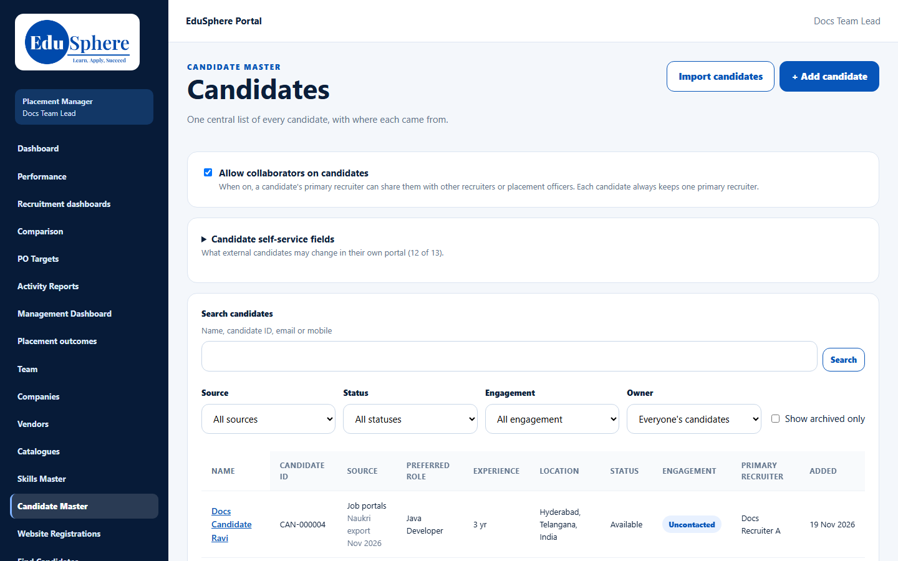

# Candidate Master list and filters
> Doc ID: DOC-REC-CAN-001 · Verified on 2026-11-19 against `main` @ `6b61546c` · Roles: Recruiter, Team Lead

## Purpose
Find any candidate in EduSphere's pool (people added by recruiters, imported, registered on the website, or IT students who opted in) and see where each came from.

## Who Can Use This Feature
| Role | What they get |
|---|---|
| Recruiter | The list, **Import candidates** and **+ Add candidate**. The **Owner** filter starts at "Everyone's candidates". |
| Team Lead | The same, plus two settings at the top: **Allow collaborators on candidates** and **Candidate self-service fields** ([Candidate settings](../../admin-manual/admin/adm-007-candidate-settings.md)), and the **Unassigned Queue** and **Duplicate Review** sidebar links. |
| Placement Officer | No access to candidates. |

## Prerequisites
- None.

## How to Access
Sidebar → **Candidate Master** (`/recruiter/candidates`).

## Steps
### Step 1 — Open the list
"One central list of every candidate, with where each came from." Before anyone is added it says **No candidates yet.**

The table shows **Name**, **Candidate ID** (CAN-000002…), **Source** (with the source detail), **Preferred role**, **Experience**, **Location**, **Status**, **Engagement**, **Primary recruiter** and **Added**. Select a name to open the [candidate page](can-003-candidate-page.md).

### Step 2 — Filter
Use any of these, then **Search**:
- **Search candidates**: name, candidate ID, email or mobile.
- **Source**: College placements, Edusphere students, IT training students, Job portals, LinkedIn, Referral, Walk-ins, Social media, Career fairs, Campus drives, Database, Employee referrals, Vendor, Website, Community, Institution.
- **Status**: Available, Interviewing, Placed, Not looking, Do not contact.
- **Engagement**: New, Uncontacted, Contacted, Screened, Shortlisted, Active, Inactive, Placed, Not interested, Do not contact.
- **Owner**: Everyone's candidates, My candidates, Unassigned.
- **Show archived only**: archived candidates instead of active ones ([archive](can-003-candidate-page.md#step-4--archive-and-restore)).

## Tips
- **Engagement** is not set by hand: Kiran went from **Uncontacted** to **Contacted** once Recruiter A had called and messaged him.
- A candidate merged into another is archived and stays out of the list ([Duplicate review](can-012-duplicates.md)).

## Related Features
- [Add a candidate](can-002-add-candidate.md)
- [Import candidates](can-011-import.md)
- [Unassigned queue](can-013-unassigned-routing.md)
