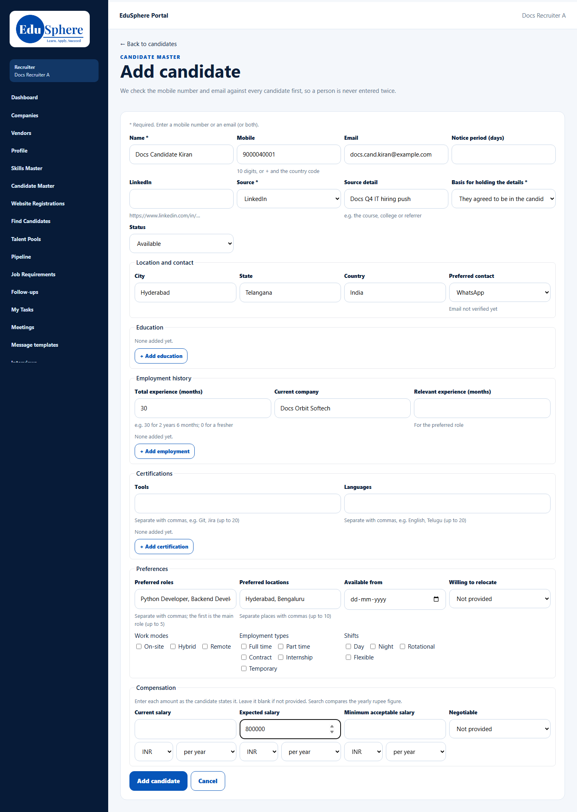
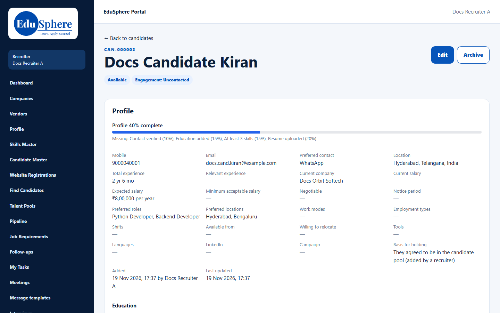
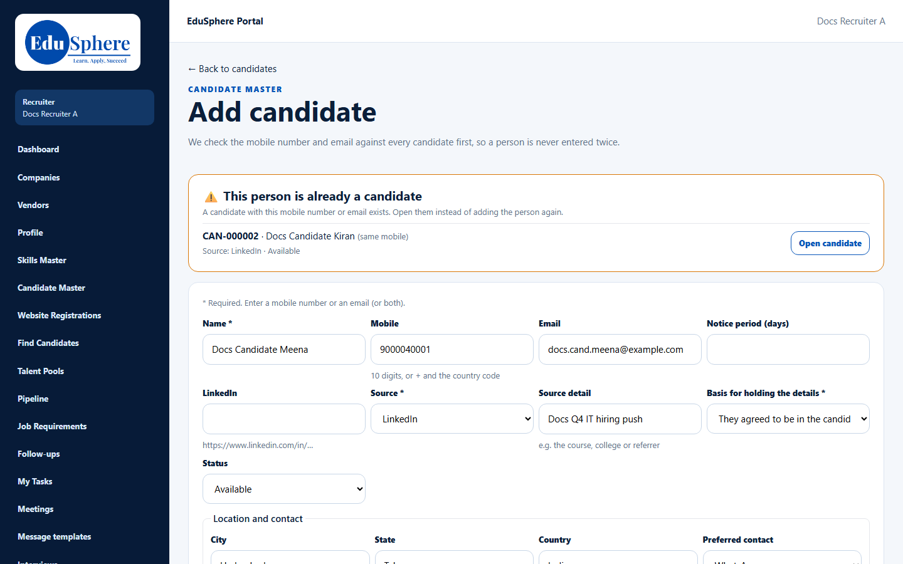

# Add a candidate
> Doc ID: DOC-REC-CAN-002 · Verified on 2026-11-19 against `main` @ `6b61546c` · Roles: Recruiter, Team Lead

## Purpose
Add one person to the candidate pool by hand, with where they came from and why EduSphere may hold their details, without ever entering the same person twice.

## Who Can Use This Feature
- **Recruiter** and **Team Lead**. The person who adds the candidate becomes the **Primary recruiter**.

## Prerequisites
- You have the person's mobile number or email (at least one).

## How to Access
**Candidate Master** → **+ Add candidate** (`/recruiter/candidates/new`).

## Steps
### Step 1 — Fill in the form
"We check the mobile number and email against every candidate first, so a person is never entered twice." Required: **Name**, a **Mobile** or an **Email**, **Source** and **Basis for holding the details**.

| Section | Fields |
|---|---|
| Top | **Name \***, **Mobile** (10 digits, or + and the country code), **Email**, **Notice period (days)**, **LinkedIn**, **Source \*** (same list as the [filter](can-001-candidate-list.md)), **Source detail** (the course, college or referrer), **Basis for holding the details \*** (They shared their details for job placement / They agreed to be in the candidate pool), **Status** |
| Location and contact | **City**, **State**, **Country**, **Location** (replaced by city, state and country once entered), **Preferred contact** (Phone call, WhatsApp, Email) |
| Education | **+ Add education**: **Degree**, **Specialisation**, **Institution**, **Year** |
| Employment history | **Total experience (months)** (0 for a fresher), **Current company**, **Relevant experience (months)**, **+ Add employment** |
| Certifications | **Tools**, **Languages** (comma-separated, up to 20), **+ Add certification** |
| Preferences | **Preferred roles** (the first is the main role, up to 5), **Preferred locations**, **Available from**, **Willing to relocate**, **Work modes**, **Employment types**, **Shifts** |
| Compensation | **Current salary**, **Expected salary**, **Minimum acceptable salary** (each INR or USD, per year or per month), **Negotiable**. "Search compares the yearly rupee figure." |

Example: Docs Recruiter A added **Docs Candidate Kiran** (mobile 9000040001, source LinkedIn, "Docs Q4 IT hiring push", basis "They agreed to be in the candidate pool", Hyderabad, 30 months at Docs Orbit Softech, Python Developer, expected ₹8,00,000 a year).

### Step 2 — Save
Select **Add candidate**. The [candidate page](can-003-candidate-page.md) opens with the new ID (**CAN-000002**).

### Step 3 — If the person already exists
When the mobile or email matches a candidate, nothing is saved. The form shows **This person is already a candidate**: "A candidate with this mobile number or email exists. Open them instead of adding the person again.", with the match (**CAN-000002 · Docs Candidate Kiran (same mobile)**) and **Open candidate**.

## Validation Messages
| Message | When |
|---|---|
| This person is already a candidate. Open the existing candidate instead. | Mobile or email already used |
| Enter a valid email address | Email not accepted (addresses ending in `.test` are refused) |

## Tips
- People with the same name but a different mobile are not blocked here; the [Duplicate review](can-012-duplicates.md) catches them.
- Choose the basis honestly: it is shown on the profile as **Basis for holding** and records why EduSphere keeps the details.

## Related Features
- [Candidate page](can-003-candidate-page.md)
- [Import candidates](can-011-import.md)
