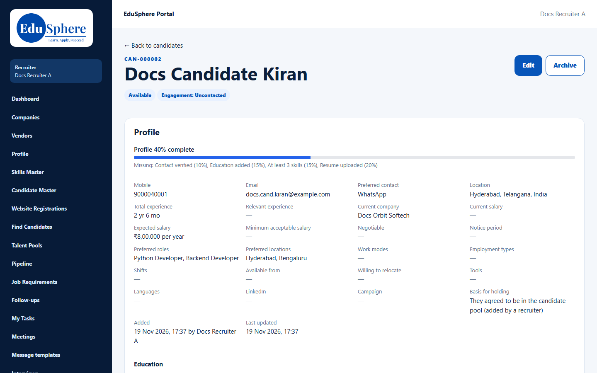
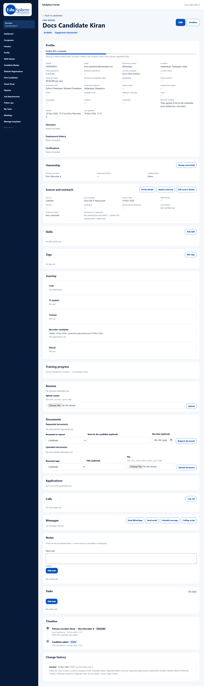
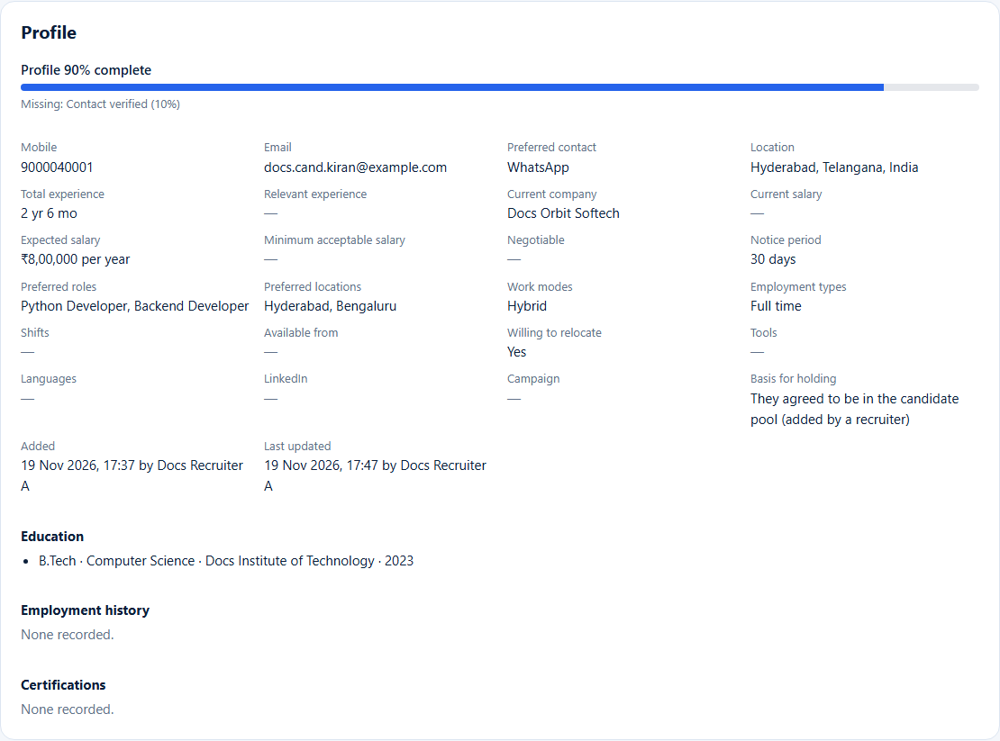
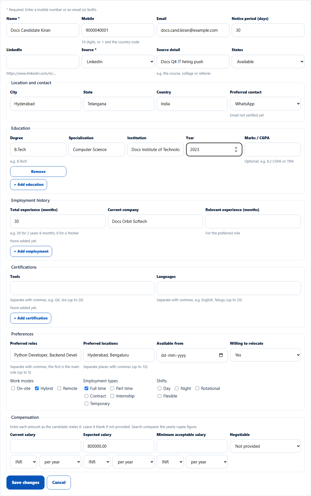
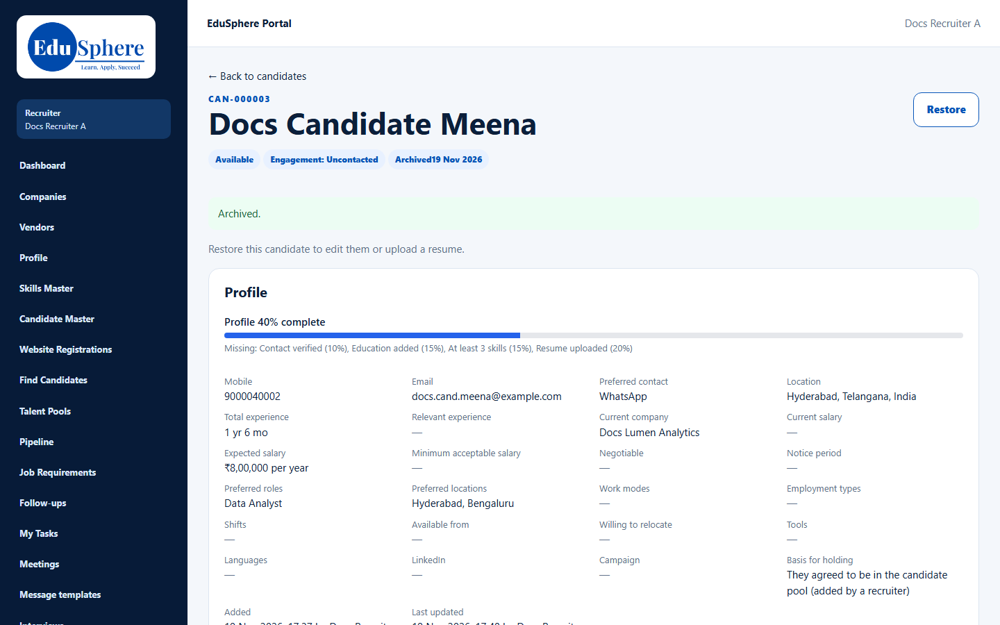
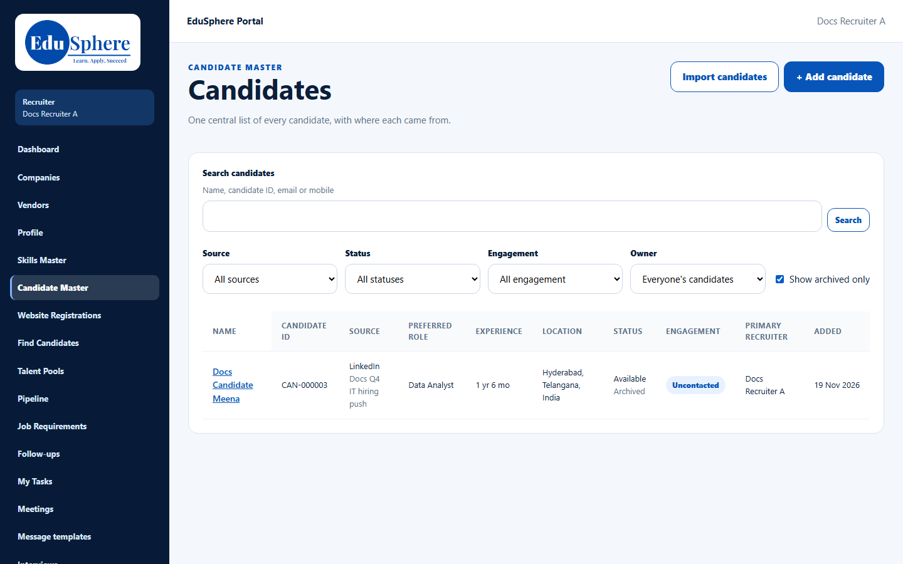

# Candidate page, edit, archive and completeness
> Doc ID: DOC-REC-CAN-003 · Verified on 2026-11-19 against `main` @ `6b61546c` · Roles: Recruiter, Team Lead

## Purpose
See everything EduSphere knows about one candidate, keep the profile complete and current, and take people out of the list without deleting them.

## Who Can Use This Feature
- **Recruiter** and **Team Lead**.

## Prerequisites
- The candidate exists ([Add a candidate](can-002-add-candidate.md), [import](can-011-import.md), website registration or [IT student opt-in](../student/stu-001-join-pool.md)).

## How to Access
**Candidate Master** → select the name.

## Steps
### Step 1 — Read the page
The header shows the ID (CAN-000002), the name, the **Status** and **Engagement**, with **Edit** and **Archive**. The cards:

| Card | Page |
|---|---|
| Profile (with Education, Employment history, Certifications) | This page |
| Ownership | [Ownership](can-004-ownership.md) |
| Source and outreach | [Source, verification and permission](can-010-source-outreach.md) |
| Skills, Tags | [Skills and tags](can-005-skills-tags.md) |
| Journey, Training progress | [What staff see for IT students](../student/stu-002-staff-view.md) |
| Resume | [Resume and extracted details](can-006-resume.md) |
| Documents | [Document requests](can-007-documents.md) |
| Applications | The hiring flow (later sessions) |
| Calls, Messages | [Calls and messages](can-009-calls-messages.md) |
| Notes, Tasks, Timeline, Change history | [Notes, tasks and history](can-008-notes-tasks-timeline.md) |

The whole page of a new candidate, just after Kiran was added:

### Step 2 — Profile completeness
**Profile {n}% complete** and **Missing:** list what is left, with its weight:

| Item | Weight | Met when |
|---|---|---|
| Contact verified | 10% | The candidate has verified their email in the [candidate portal](../candidate-portal/cand-003-register.md) |
| Education added | 15% | At least one education row |
| At least 3 skills | 15% | Three or more [skills](can-005-skills-tags.md) |
| Experience or fresher recorded | 15% | Total experience entered (0 for a fresher) |
| Preferred role and location | 15% | Both entered |
| Resume uploaded | 20% | A [resume](can-006-resume.md) version exists |
| Expected salary provided | 10% | Expected salary entered |

Kiran went from **40%** to **90%**. Only **Contact verified** is left: a recruiter's **Verify details** does not count for it (finding P14).

### Step 3 — Edit
Select **Edit**. The form has the same sections as [Add a candidate](can-002-add-candidate.md) (without the basis). Docs Recruiter A set **Notice period** 30 days, **Willing to relocate** Yes, **Hybrid**, **Full time**, and added education **B.Tech**, Computer Science, Docs Institute of Technology, 2023. Select **Save changes**: **Changes saved.**

### Step 4 — Archive and restore
Select **Archive** and confirm "Archive Docs Candidate Meena? They leave the candidate list until restored. Nothing is deleted.": **Archived.** The header shows **Archived {date}** and **Restore** ("Restore this candidate to edit them or upload a resume.").

Archived candidates appear only with **Show archived only** on the list, marked **Archived**. Open one and select **Restore**: **Restored.**

## Validation Messages
| Message | When |
|---|---|
| Changes saved. | Profile edited |
| Archived. | Archived |
| Restored. | Restored |

## Tips
- The **Profile** card also shows **Basis for holding** (for example "They agreed to be in the candidate pool (added by a recruiter)") and who added the candidate and when.
- An archived candidate cannot be edited and cannot get a new resume until restored.

## Related Features
- [Candidate list](can-001-candidate-list.md)
- [Duplicate review](can-012-duplicates.md)
