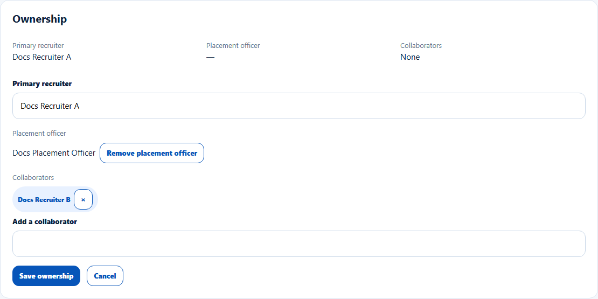
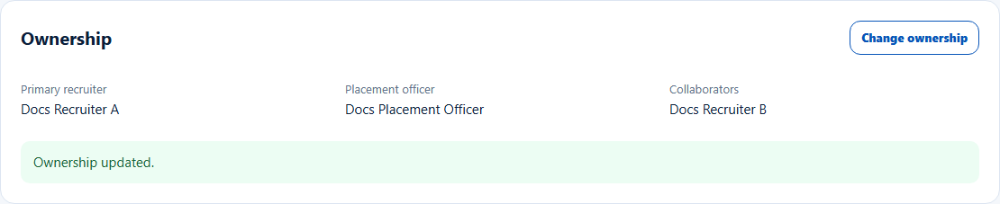

# Candidate ownership: primary recruiter, placement officer, collaborators
> Doc ID: DOC-REC-CAN-004 · Verified on 2026-11-19 against `main` @ `6b61546c` · Roles: Recruiter (primary), Team Lead

## Purpose
Make clear who looks after a candidate, and share them with a placement officer or other recruiters when several people work on the same person.

## Who Can Use This Feature
- The candidate's **primary recruiter** and the **Team Lead**.
- Collaborators can only be added while the Team Lead's **Allow collaborators on candidates** is on ([Candidate settings](../../admin-manual/admin/adm-007-candidate-settings.md); it is on in this guide).

## Prerequisites
- The people you add have recruitment accounts.

## How to Access
Candidate page → **Ownership** → **Change ownership**.

## Steps
### Step 1 — Change ownership
The form has **Primary recruiter**, **Placement officer** and **Add a collaborator** (type and pick). Docs Recruiter A set the placement officer to **Docs Placement Officer** and added **Docs Recruiter B** as a collaborator.

### Step 2 — Save
Select **Save ownership**: **Ownership updated.** The card lists the primary recruiter, placement officer and collaborators.

Each change appears in the [Timeline](can-008-notes-tasks-timeline.md) ("Placement officer: None → Docs Placement Officer", "Collaborator added: Docs Recruiter B").

## Validation Messages
| Message | When |
|---|---|
| Ownership updated. | Saved |

## Tips
- "Each candidate always keeps one primary recruiter." Candidates from the website or the IT student opt-in may arrive with none; the Team Lead gives them one from the [Unassigned queue](can-013-unassigned-routing.md).

## Related Features
- [Unassigned queue and routing](can-013-unassigned-routing.md)
- [Candidate page](can-003-candidate-page.md)
