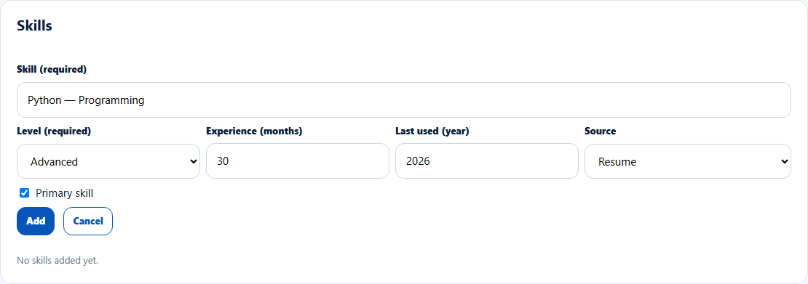
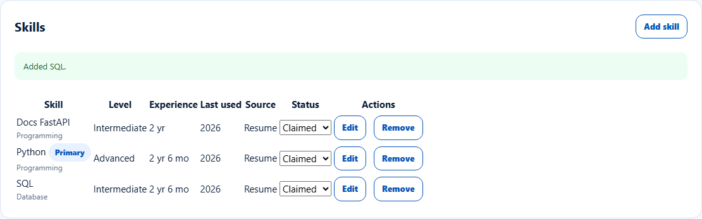
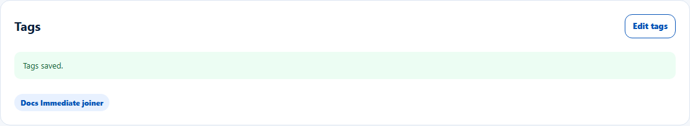

# Candidate skills and tags
> Doc ID: DOC-REC-CAN-005 · Verified on 2026-11-19 against `main` @ `6b61546c` · Roles: Recruiter, Team Lead

## Purpose
Record what a candidate can do, at what level and how recently, so [Find Candidates](../search/srch-001-find-candidates.md) and matching can find them, and label them with tags.

## Who Can Use This Feature
- **Recruiter** and **Team Lead**. Tags come from the list the Team Lead manages ([Catalogues](../masters/mst-003-catalogues.md)).

## Prerequisites
- The skill exists in the [Skills Master](../masters/mst-001-skills-master.md).

## How to Access
Candidate page → **Skills** → **Add skill**; **Tags** → **Edit tags**.

## Steps
### Step 1 — Add a skill
Fill in **Skill (required)** (type and pick from the Skills Master), **Level (required)** (Beginner, Intermediate, Advanced, Expert), **Experience (months)**, **Last used (year)**, **Source** (Resume, Interview verified, Assessment verified, Course completed, Certification, Employer verified) and **Primary skill**. Select **Add**: **Added {skill}.**

Docs Recruiter A added **Python** (Advanced, 30 months, primary), **Docs FastAPI** (Intermediate, 24 months) and **SQL** (Intermediate, 30 months).

### Step 2 — Read the skills table
Each row shows the skill and its category (Programming, Database…), **Level**, **Experience**, **Last used**, **Source**, a **Status** of **Claimed**, **Verified** or **Assessed**, and **Edit** / **Remove**. The primary skill is marked **Primary**.

### Step 3 — Tags
Select **Edit tags**, tick the tags under "Choose the candidate's tags" (here **Docs Immediate joiner**) and select **Save tags**: **Tags saved.**

## Validation Messages
| Message | When |
|---|---|
| Added {skill}. | Skill added |
| Tags saved. | Tags saved |

## Tips
- Skills can also come from the resume: see [Resume and extracted details](can-006-resume.md) ("Added 4 skills.").
- Three or more skills count towards [profile completeness](can-003-candidate-page.md#step-2--profile-completeness).

## Related Features
- [Resume and extracted details](can-006-resume.md)
- [Skills Master](../masters/mst-001-skills-master.md)
