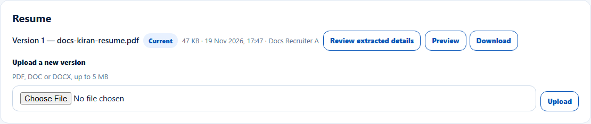
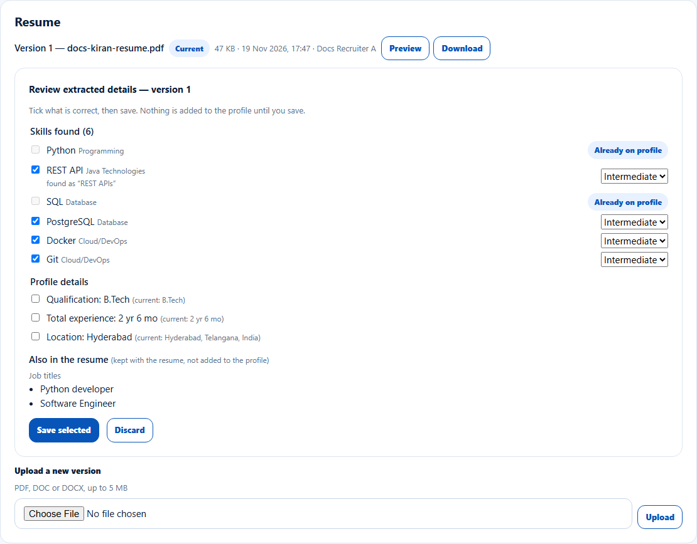
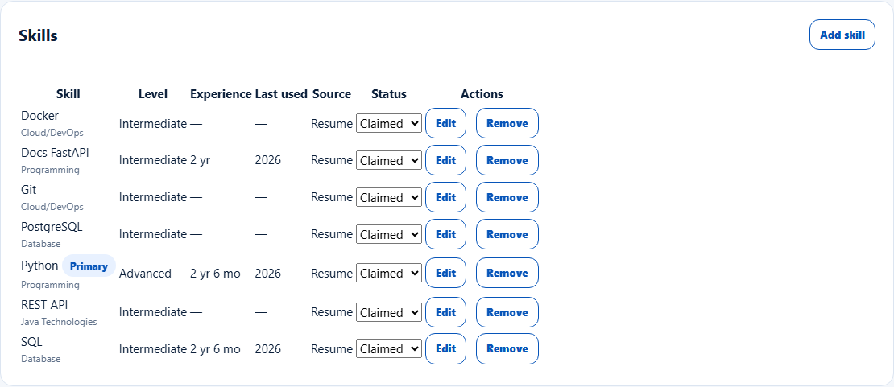

# Resume upload and extracted details
> Doc ID: DOC-REC-CAN-006 · Verified on 2026-11-19 against `main` @ `6b61546c` · Roles: Recruiter, Team Lead

## Purpose
Keep the candidate's resume in versions, and copy the skills found in it onto the profile after checking them.

## Who Can Use This Feature
- **Recruiter** and **Team Lead**.

## Prerequisites
- The candidate is not archived.
- A PDF, DOC or DOCX file up to 5 MB.

## How to Access
Candidate page → **Resume**.

## Steps
### Step 1 — Upload
With no resume the card says "No resume uploaded yet." Choose the file under **Upload resume** and select **Upload**: **Resume version 1 uploaded.** The card shows **Version 1 — {file}**, **Current**, the size, date and uploader, with **Preview**, **Download** and **Review extracted details**. **Upload a new version** adds version 2 and so on.

### Step 2 — Review what was extracted
Select **Review extracted details**. "Tick what is correct, then save. Nothing is added to the profile until you save."
- **Skills found**: each with its category. Skills already on the profile say **Already on profile**; others have a tick box and a level (Beginner to Expert). Where the resume wording differs, it says how it was found ("found as 'REST APIs'").
- **Profile details**: what the resume says next to the current value (Qualification, Total experience, Location).
- **Also in the resume**: job titles found, "kept with the resume, not added to the profile".

### Step 3 — Save the ticked skills
Every skill not yet on the profile starts **ticked** at **Intermediate**; the profile details start unticked. Untick what is wrong, adjust the levels, and select **Save selected**: **Added 4 skills.** (**Discard** closes the review.)

The skills now appear in **Skills** with source **Resume**.

## Validation Messages
| Message | When |
|---|---|
| Resume version {n} uploaded. | Uploaded |
| Added {n} skills. | Extracted skills saved |

## Tips
- Check each category before saving: "REST APIs" in a Python resume was filed under **Java Technologies** (finding P15).
- Because new skills start ticked, saving straight away adds all of them (here REST API, PostgreSQL, Docker and Git).

## Related Features
- [Skills and tags](can-005-skills-tags.md)
- [Document requests](can-007-documents.md)
