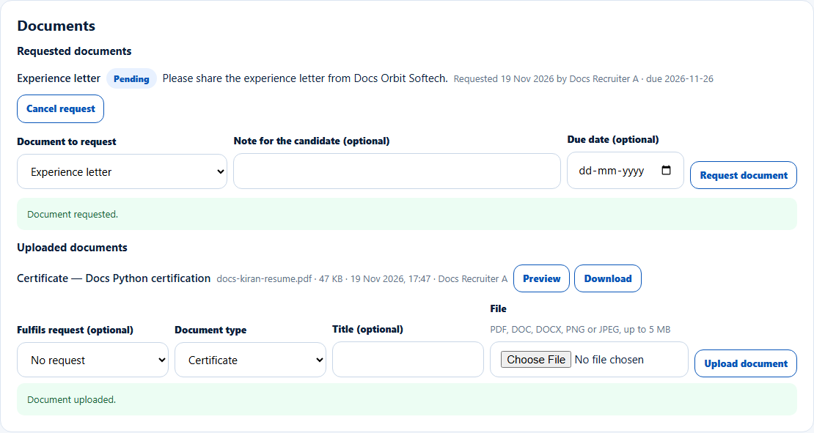

# Candidate document requests
> Doc ID: DOC-REC-CAN-007 · Verified on 2026-11-19 against `main` @ `6b61546c` · Roles: Recruiter, Team Lead

## Purpose
Ask a candidate for the documents a client or a joining needs, and keep the files on the candidate's record.

## Who Can Use This Feature
- **Recruiter** and **Team Lead**. Candidates answer requests from their own portal (later sessions).

## Prerequisites
- The candidate is not archived.

## How to Access
Candidate page → **Documents**.

## Steps
### Step 1 — Request a document
Under **Requested documents** choose the **Document to request** (Certificate, Education (degree or marksheet), Experience letter, Relieving letter, Payslip, ID proof, Other), add a **Note for the candidate (optional)** and a **Due date (optional)**, and select **Request document**: **Document requested.** The request shows as **Pending** with the note, who asked, when and the due date, and **Cancel request**.

### Step 2 — Upload a document yourself
Under **Uploaded documents** choose the **Document type**, an optional **Title** and the **File** (PDF, DOC, DOCX, PNG or JPEG, up to 5 MB), then **Upload document**: **Document uploaded.** Each file has **Preview**, **Download** and **Fulfils request (optional)**, to mark it as the answer to an open request.

Docs Recruiter A requested an **Experience letter** due in 7 days and uploaded a **Certificate** titled "Docs Python certification".

## Validation Messages
| Message | When |
|---|---|
| Document requested. | Request sent |
| Document uploaded. | File uploaded |

## Tips
- IT students who joined the pool see "Requested from you" and can upload in their **Placement Status** page ([Join the pool](../student/stu-001-join-pool.md)).

## Related Features
- [Resume](can-006-resume.md)
- [Candidate page](can-003-candidate-page.md)
