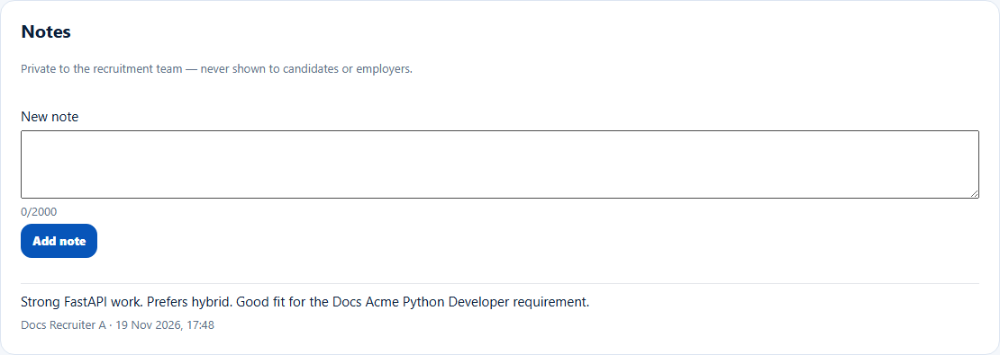
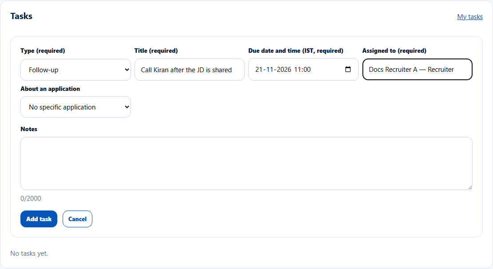
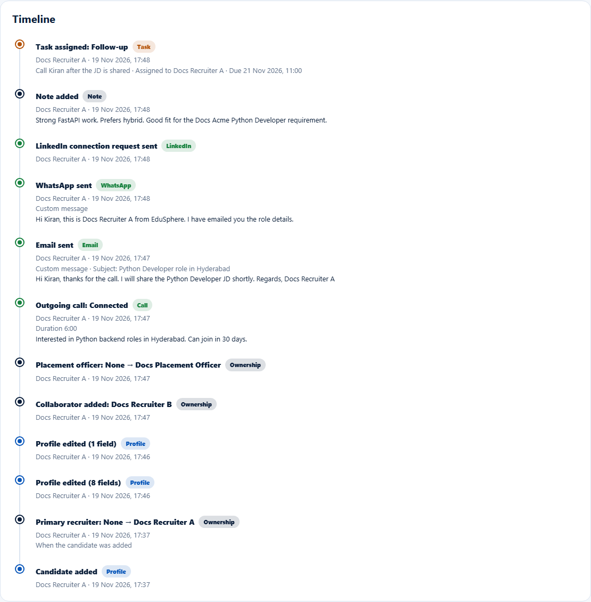
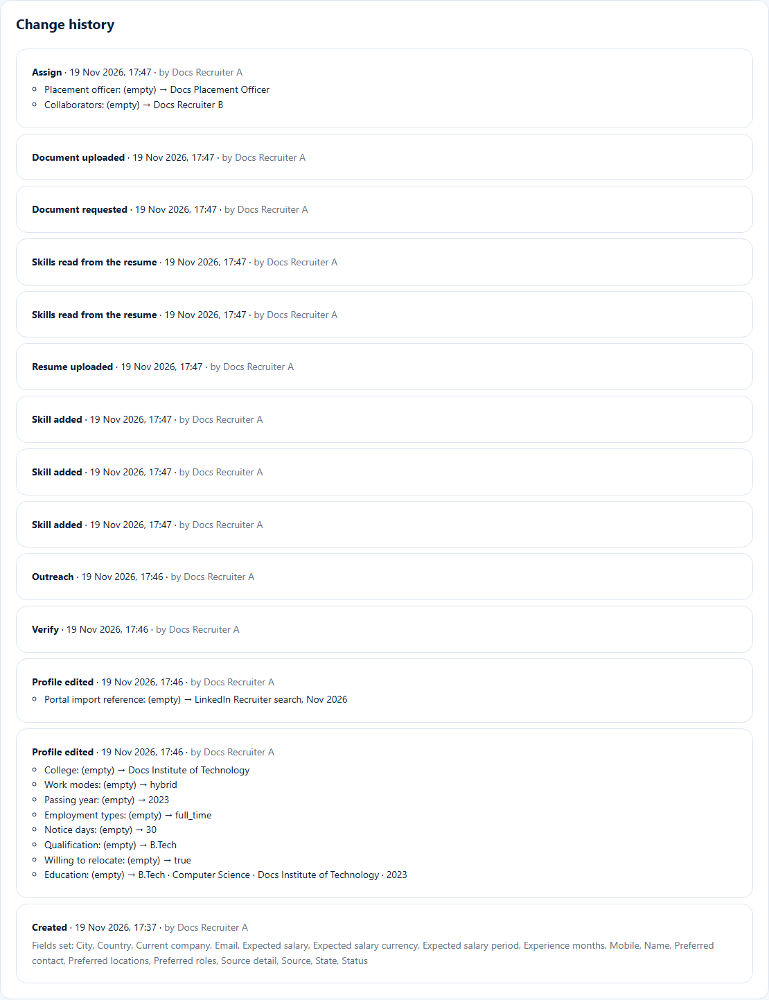

# Candidate notes, tasks, timeline and change history
> Doc ID: DOC-REC-CAN-008 · Verified on 2026-11-19 against `main` @ `6b61546c` · Roles: Recruiter, Team Lead

## Purpose
Keep private working notes on a candidate, set yourself or a colleague a dated to-do, and see everything that happened to the record.

## Who Can Use This Feature
- **Recruiter** and **Team Lead**.

## Prerequisites
- None.

## How to Access
Candidate page → **Notes**, **Tasks**, **Timeline**, **Change history**.

## Steps
### Step 1 — Add a note
"Private to the recruitment team — never shown to candidates or employers." Type in **New note** (up to 2,000 characters) and select **Add note**.

### Step 2 — Add a task
Select **Add task** and fill in **Type (required)** (Follow-up, Resume screening, Interview coordination, Employer feedback), **Title (required)**, **Due date and time (IST, required)**, **Assigned to (required)**, **About an application** (optional) and **Notes**. Select **Add task**: **Task added.** Each task shows its type, due time and assignee, with **Done**, **Edit** and **Cancel task**.

Docs Recruiter A added the follow-up "Call Kiran after the JD is shared", due in two days at 11:00, for themselves.

### Step 3 — Timeline
**Timeline** lists every event, newest first, with its type, who and when: tasks, notes, calls, messages, ownership changes, profile edits and when the candidate was added.

### Step 4 — Change history
**Change history** lists each save with the fields it set or changed ("Created · 19 Nov 2026 · by Docs Recruiter A · Fields set: City, Country, …").

## Validation Messages
| Message | When |
|---|---|
| Task added. | Task saved |

## Tips
- The sidebar's **My Tasks** page is covered with daily work (session S14).
- The **Tasks** card is headed **My tasks**.

## Related Features
- [Calls and messages](can-009-calls-messages.md)
- [Ownership](can-004-ownership.md)
