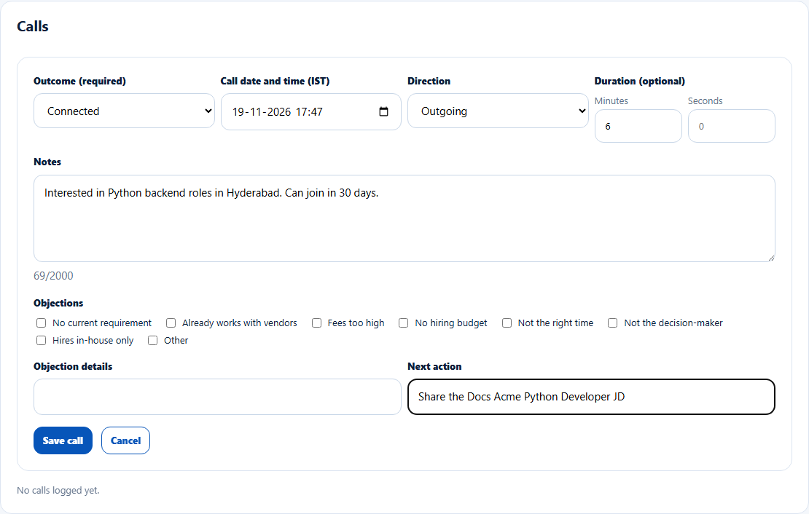
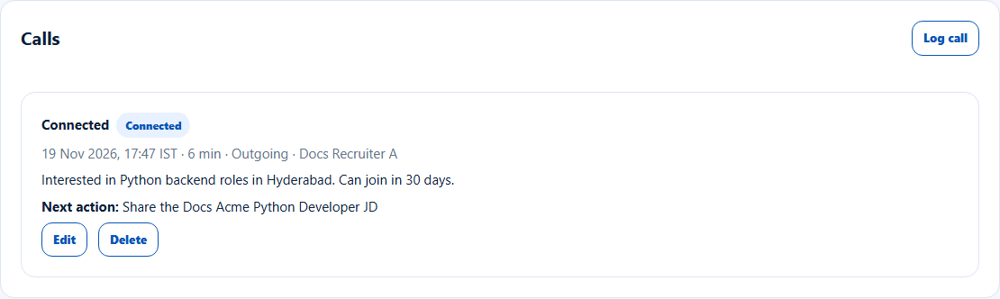
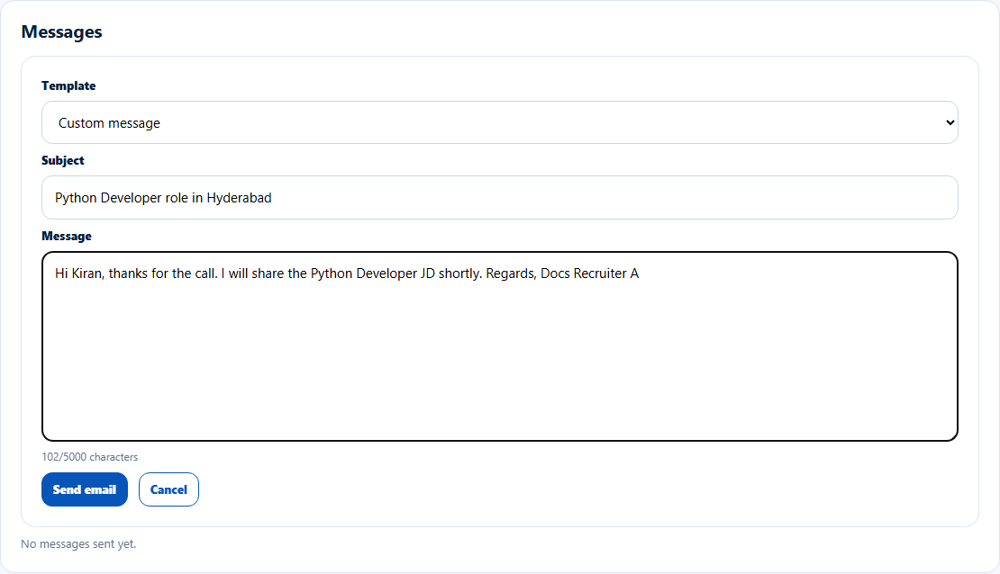
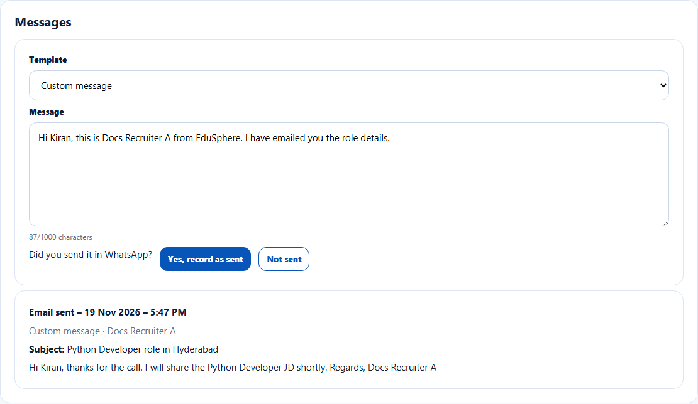
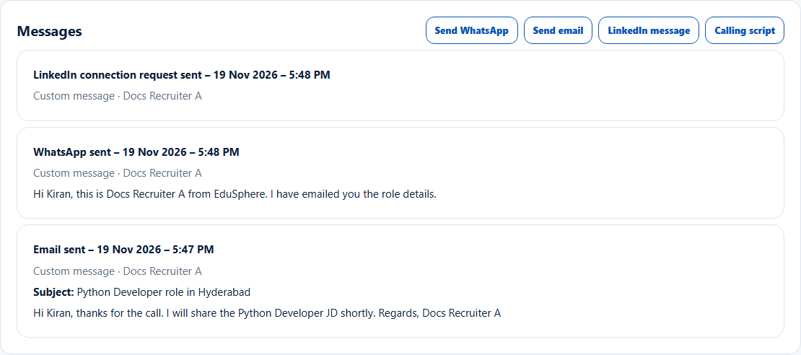

# Calls and messages to a candidate
> Doc ID: DOC-REC-CAN-009 · Verified on 2026-11-19 against `main` @ `6b61546c` · Roles: Recruiter, Team Lead

## Purpose
Record every call with a candidate and send email, WhatsApp and LinkedIn messages from the candidate page, so the whole team sees the conversation.

## Who Can Use This Feature
- **Recruiter** and **Team Lead**.

## Prerequisites
- The candidate has a mobile number (calls, WhatsApp) or an email (email).

## How to Access
Candidate page → **Calls** and **Messages**.

## Steps
### Step 1 — Log a call
Select **Log call** and fill in **Outcome (required)** (Connected, Call back requested, Busy, No answer, Switched off, Wrong number), **Call date and time (IST)**, **Direction** (Outgoing, Incoming), **Duration (optional)** in minutes and seconds, **Notes**, any **Objections**, and **Next action**. Select **Save call**: **Call logged.**

The call appears with its outcome, time, duration, direction and caller, and **Edit call** / **Delete call**.

### Step 2 — Send an email
Select **Send email**, choose a **Template** (Custom message, Candidate profiles, Company introduction, Recruitment proposal, JD acknowledgement, Interview confirmation, Offer follow-up, Joining confirmation) or write your own **Subject** and **Message** (up to 5,000 characters). Select **Send email**: **Email to Docs Candidate Kiran queued for sending.**

### Step 3 — Send a WhatsApp message
Select **Send WhatsApp**, choose a **Template** (approved WhatsApp templates, such as **Docs interview reminder (Python)**) or **Custom message**, and write the **Message** (up to 1,000 characters). Select **Open WhatsApp (opens in a new tab)** and send the message there (WhatsApp was blocked on the Docs stack, so only the recording is shown). Back in EduSphere, answer "Did you send it in WhatsApp?" with **Yes, record as sent** or **Not sent**: **WhatsApp to Docs Candidate Kiran recorded.**

### Step 4 — Log a LinkedIn message
Select **LinkedIn message**, choose **What did you send on LinkedIn?** (Connection request, Message), a **Template** if any, and the **Message sent** (optional for a connection request). Select **Log as sent**: **LinkedIn connection request to Docs Candidate Kiran logged.**

### Step 5 — Read the messages
**Messages** lists each one, newest first, with the channel, time, template and sender.

## Validation Messages
| Message | When |
|---|---|
| Call logged. | Call saved |
| Email to {name} queued for sending. | Email sent |
| WhatsApp to {name} recorded. | WhatsApp recorded as sent |
| LinkedIn connection request to {name} logged. | LinkedIn logged |

## Tips
- EduSphere does not send WhatsApp or LinkedIn messages itself: you send them in the app, then record them.
- **Calling script** shows an approved calling-script template; none were approved here ("No approved calling script templates yet.").
- Templates come from [Message templates](../masters/mst-004-message-templates.md).

## Related Features
- [Notes, tasks and timeline](can-008-notes-tasks-timeline.md)
- [Source and outreach](can-010-source-outreach.md)
