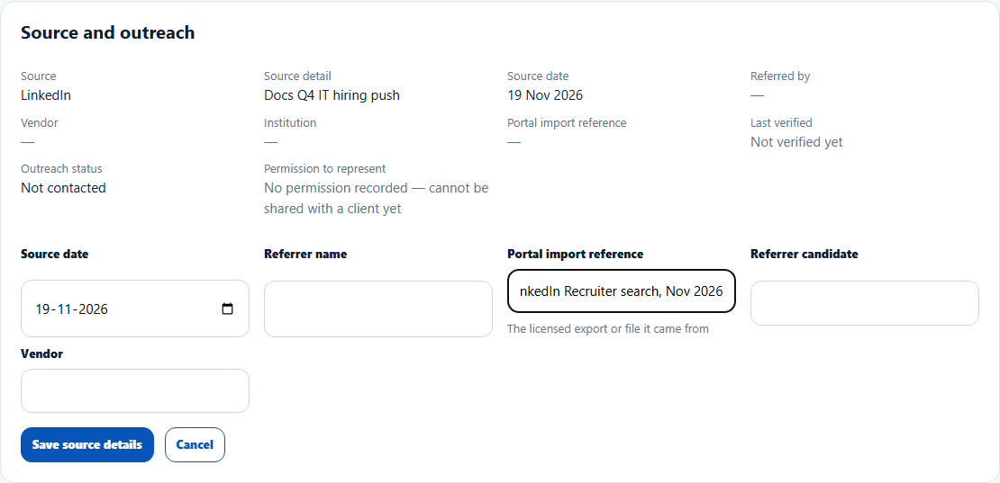
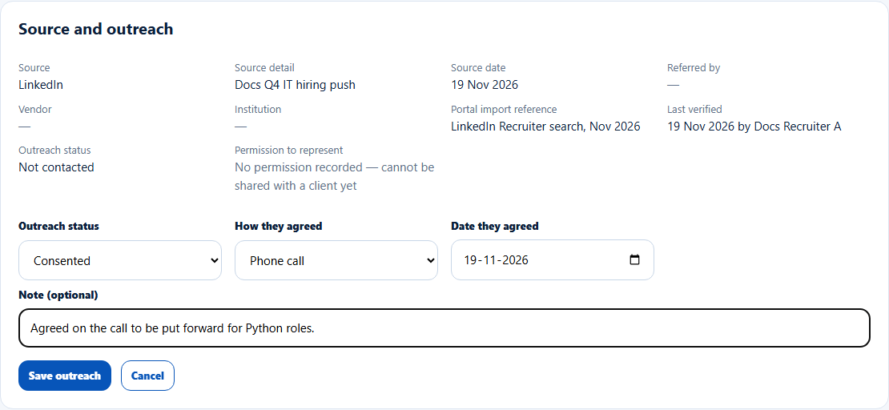
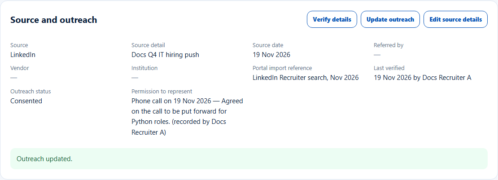

# Source, verification and permission to represent
> Doc ID: DOC-REC-CAN-010 · Verified on 2026-11-19 against `main` @ `6b61546c` · Roles: Recruiter, Team Lead

## Purpose
Record where a candidate came from, confirm their details, and record that they agreed to be put forward to clients. Without that permission a candidate cannot be shared with a client.

## Who Can Use This Feature
- **Recruiter** and **Team Lead**.

## Prerequisites
- None.

## How to Access
Candidate page → **Source and outreach**.

## Steps
### Step 1 — Read the card
It shows **Source**, **Source detail**, **Source date**, **Referred by**, **Vendor**, **Institution**, **Portal import reference**, **Last verified**, **Outreach status** and **Permission to represent**. A new candidate has "No permission recorded — cannot be shared with a client yet".

### Step 2 — Edit the source details
Select **Edit source details**: **Source date**, **Referrer name**, **Portal import reference** ("The licensed export or file it came from"), **Referrer candidate** and **Vendor**. Select **Save source details**: **Source details saved.**

### Step 3 — Verify the details
After checking the details with the candidate, select **Verify details**. It saves at once: **Details verified.** **Last verified** shows the date and your name.

### Step 4 — Record outreach and permission
Select **Update outreach** and choose the **Outreach status**: Not contacted, Contacted, Responded, Consented, Declined. **Consented** also needs **How they agreed** (Phone call, Email, WhatsApp, LinkedIn message, In person, Signed form, Other) and **Date they agreed**, with an optional **Note**.

Select **Save outreach**: **Outreach updated.** **Permission to represent** now reads "Phone call on 19 Nov 2026 — Agreed on the call to be put forward for Python roles. (recorded by Docs Recruiter A)".

## Validation Messages
| Message | When |
|---|---|
| Source details saved. | Source details saved |
| Details verified. | Verified |
| Outreach updated. | Outreach saved |
| Choose how the candidate agreed to be represented. | **Consented** without **How they agreed** |

## Tips
- **Verify details** does not tick **Contact verified** in profile completeness; only the candidate verifying their own email does (finding P14).

## Related Features
- [Calls and messages](can-009-calls-messages.md)
- [Candidate page](can-003-candidate-page.md)
