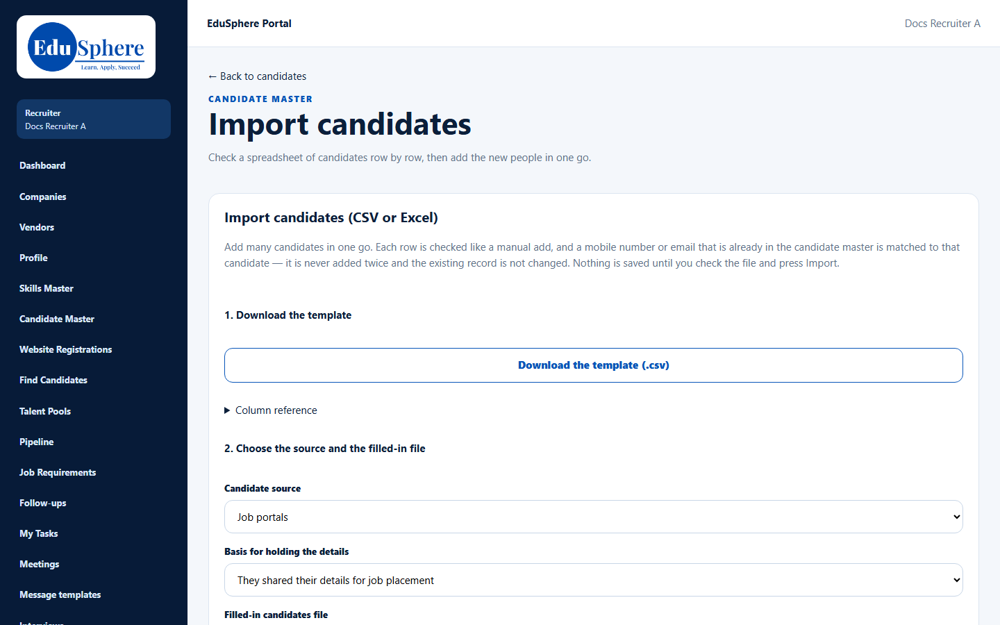
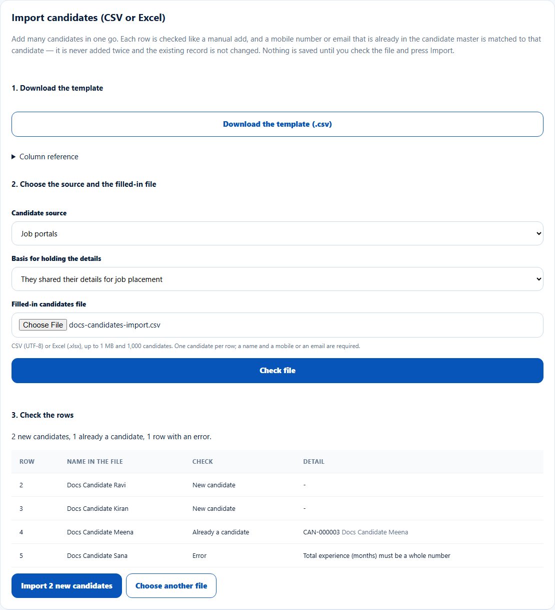
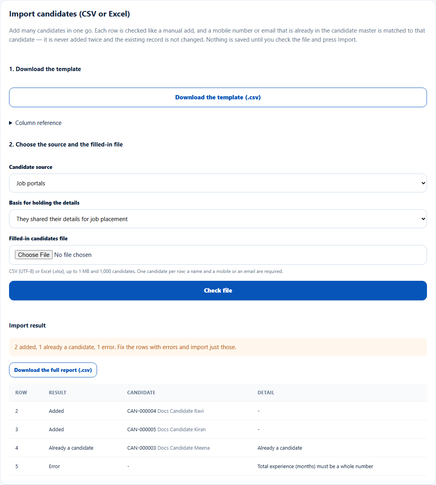
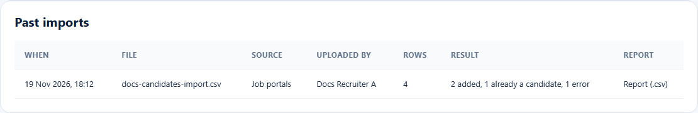

# Import candidates
> Doc ID: DOC-REC-CAN-011 · Verified on 2026-11-19 against `main` @ `6b61546c` · Roles: Recruiter, Team Lead

## Purpose
Add many candidates at once from a spreadsheet, checked row by row exactly like a manual add, without creating duplicates.

## Who Can Use This Feature
- **Recruiter** and **Team Lead** (other roles: "Your role cannot import candidates", from code).

## Prerequisites
- A CSV (UTF-8) or Excel (.xlsx) file, up to 1 MB and 1,000 candidates, one candidate per row. A name and a mobile or an email are required.

## How to Access
**Candidate Master** → **Import candidates** (`/recruiter/candidates/import`).

## Steps
### Step 1 — Download the template
Select **Download the template (.csv)**. **Column reference** explains each column: name, mobile, email, source_detail, location, country, state, city, qualification, college, passing_year, experience_months, relevant_experience_months, current_company, notice_days, preferred_role, preferred_locations, tools, languages (separate list items with `;`), linkedin, available_from (YYYY-MM-DD), willing_to_relocate (Yes or No).

### Step 2 — Choose the source and the file
Choose the **Candidate source** and the **Basis for holding the details** for the whole file, and the **Filled-in candidates file**.

### Step 3 — Check the file
Select **Check file**. Nothing is saved yet. **3. Check the rows** gives a summary ("2 new candidates, 1 already a candidate, 1 row with an error.") and a row each: **New candidate**, **Already a candidate** (with the existing ID) or **Error** (with the reason, such as "Total experience (months) must be a whole number").

### Step 4 — Import
Select **Import {n} new candidates** (or **Choose another file**). **Import result** shows "2 added, 1 already a candidate, 1 error. Fix the rows with errors and import just those." with the new IDs (CAN-000004 Docs Candidate Ravi, CAN-000005 Docs Candidate Kiran) and **Download the full report (.csv)**.

### Step 5 — Past imports
**Past imports** lists each import with the time, file, source, who uploaded it, rows, result and a **Report (.csv)**.

## Validation Messages
| Message | When |
|---|---|
| {column} must be a whole number | A number column has text |
| {column} must be a date (YYYY-MM-DD) | Bad date (from code; not captured) |
| {column} must be Yes or No | Bad yes/no value (from code; not captured) |

## Tips
- "A mobile number or email that is already in the candidate master is matched to that candidate — it is never added twice and the existing record is not changed." Meena's row was matched to CAN-000003 and left as it was.
- A person with a new mobile and email but the same name, location and college is added, then flagged for [Duplicate review](can-012-duplicates.md), as the second Docs Candidate Kiran was.
- Imported candidates get the importer as primary recruiter (Docs Recruiter A here).

## Related Features
- [Duplicate review and merge](can-012-duplicates.md)
- [Add a candidate](can-002-add-candidate.md)
