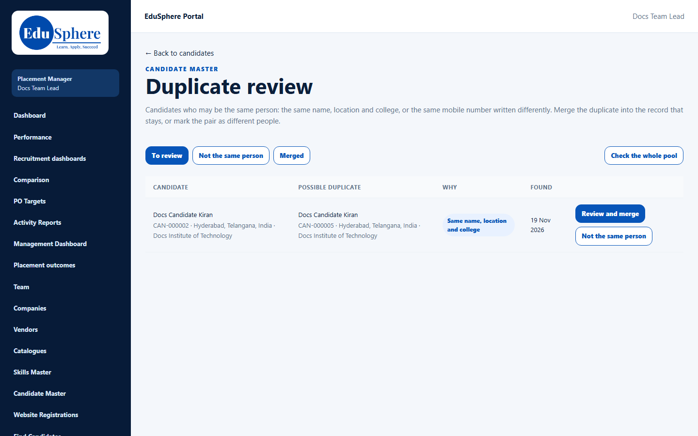
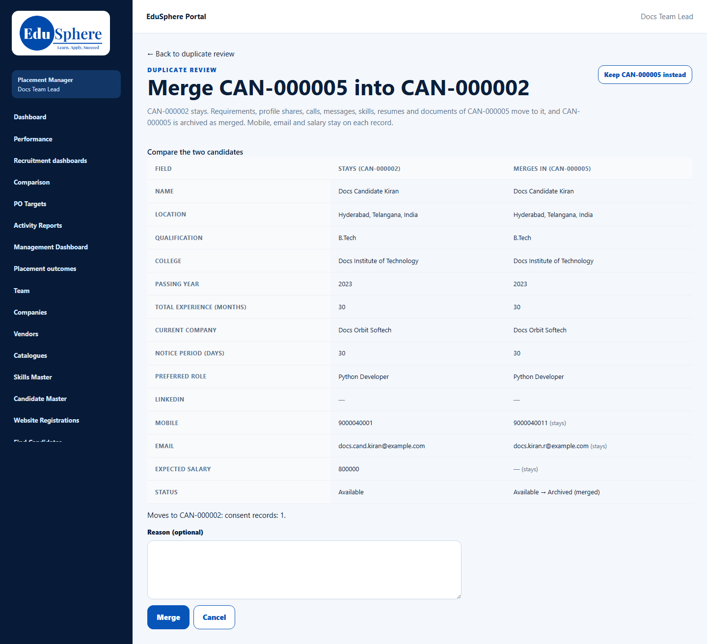
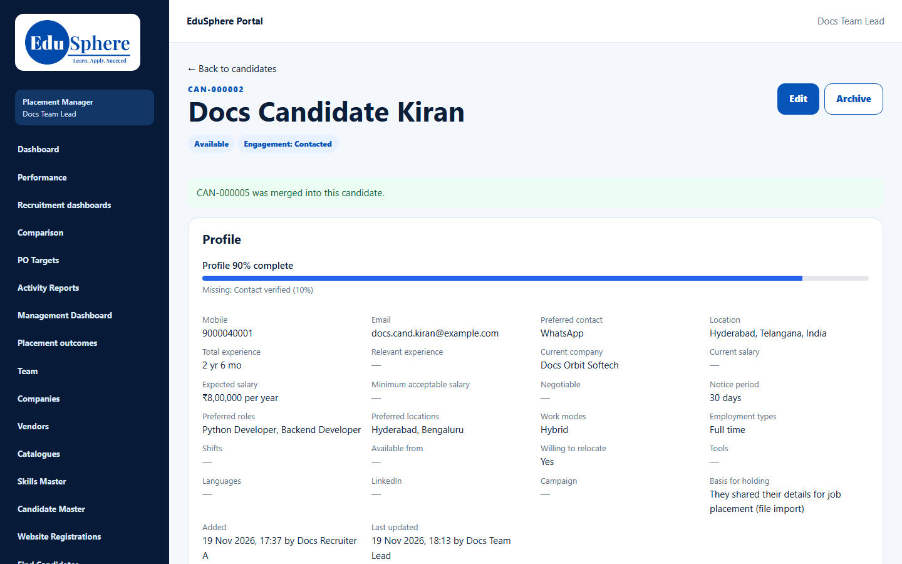
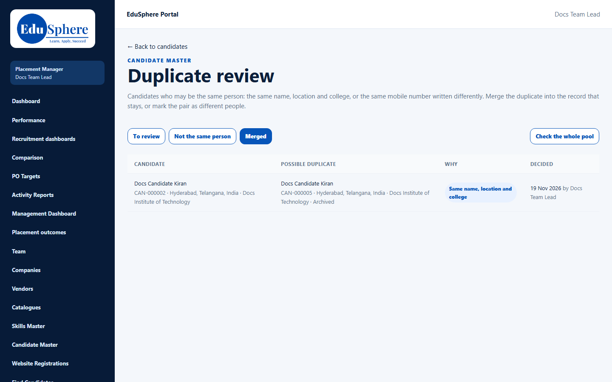

# Duplicate review and merge
> Doc ID: DOC-REC-CAN-012 · Verified on 2026-11-19 against `main` @ `6b61546c` · Roles: Team Lead

## Purpose
Find candidates who are probably the same person entered twice, and merge them into one record, or mark them as different people.

## Who Can Use This Feature
- **Team Lead** (sidebar **Duplicate Review**). The link is not in a recruiter's sidebar.

## Prerequisites
- None. The Kiran pair was found automatically right after the import; **Check the whole pool** looks again across everyone.

## How to Access
Sidebar → **Duplicate Review** (`/recruiter/candidates/duplicates`).

## Steps
### Step 1 — Read the queue
"Candidates who may be the same person: the same name, location and college, or the same mobile number written differently." Tabs: **To review**, **Not the same person**, **Merged**. Each pair shows both candidates (ID, location, college), **Why found** (here "Same name, location and college"), the date, and **Review and merge** / **Not the same person**.

### Step 2 — Compare
Select **Review and merge**. **Merge CAN-000005 into CAN-000002** compares every field side by side (**Stays** and **Merges in**) and explains: "Requirements, profile shares, calls, messages, skills, resumes and documents of CAN-000005 move to it, and CAN-000005 is archived as merged. Mobile, email and salary stay on each record." It also lists what moves ("consent records: 1"). Use **Keep CAN-000005 instead** to swap which record stays.

### Step 3 — Merge
Add a **Reason (optional)**, select **Merge**, and confirm "Merge CAN-000005 into CAN-000002? CAN-000005 is archived for good and cannot be restored." The surviving candidate opens with **CAN-000005 was merged into this candidate.**

The pair moves to the **Merged** tab with who decided and when; the merged-in record is marked **Archived**.

## Validation Messages
| Message | When |
|---|---|
| {code} was merged into this candidate. | Merged |

## Tips
- A merge cannot be undone. When in doubt, use **Not the same person**.
- The mobile and email of the merged-in record are kept on it, not copied to the survivor.

## Related Features
- [Import candidates](can-011-import.md)
- [Add a candidate](can-002-add-candidate.md)
