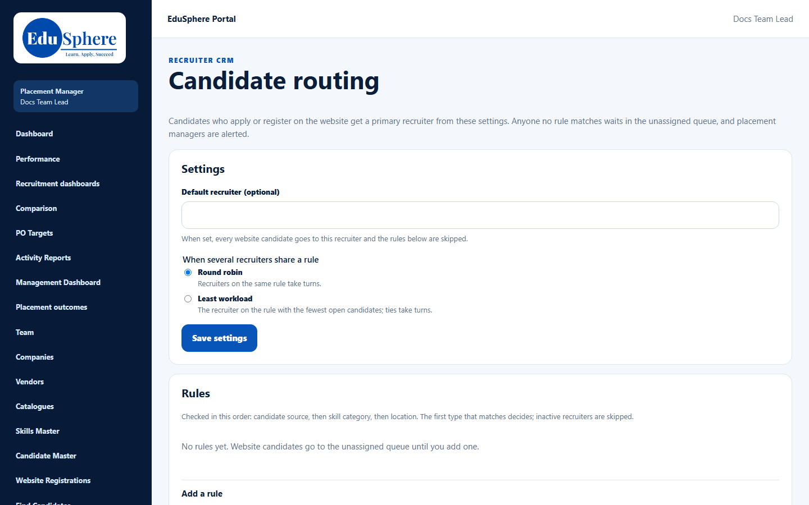
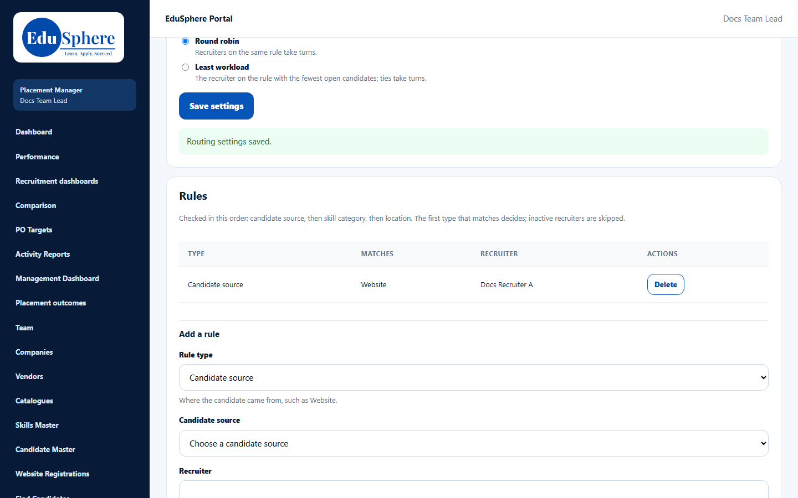

# Unassigned queue and routing rules
> Doc ID: DOC-REC-CAN-013 · Verified on 2026-11-18 against `main` @ `6b61546c` (routing rules). Unassigned queue: added in session S8 · Roles: Team Lead

## Purpose
Give every candidate who applies or registers on the website a primary recruiter automatically, and catch the ones no rule fits.

## Who Can Use This Feature
- **Team Lead** (and Super Admin): **Candidate Routing** and **Unassigned Queue** in the sidebar.

## Prerequisites
- At least one active recruiter.

## How to Access
Team Lead sidebar **Candidate Routing** (page **Candidate routing**: "Candidates who apply or register on the website get a primary recruiter from these settings. Anyone no rule matches waits in the unassigned queue, and placement managers are alerted.").

## Steps
### Step 1 — Choose the settings
- **Default recruiter (optional)**: "When set, every website candidate goes to this recruiter and the rules below are skipped." **Clear default recruiter** removes it.
- **When several recruiters share a rule**: **Round robin** ("Recruiters on the same rule take turns.") or **Least workload** ("The recruiter on the rule with the fewest open candidates; ties take turns.").

Select **Save settings**. The message **Routing settings saved.** appears.

### Step 2 — Add a rule
Under **Add a rule** choose the **Rule type** (**Candidate source**, **Skill category** or **Location**), the value (for example **Website**) and the **Recruiter**. Select **Add rule**: **Rule added.** "Checked in this order: candidate source, then skill category, then location. The first type that matches decides; inactive recruiters are skipped."

### Step 3 — Delete a rule
Select **Delete** on the rule and confirm. The message **Rule deleted.** appears (from code; not captured).

### Step 4 — The unassigned queue
VERIFICATION REQUIRED — captured in session S8.

## Validation Messages
| Message | When |
|---|---|
| Routing settings saved. | Settings saved |
| Rule added. | Rule added |
| Choose a recruiter. | No recruiter picked (from code; not captured) |

## Related Features
- [Website registrations](can-014-website-registrations.md)
