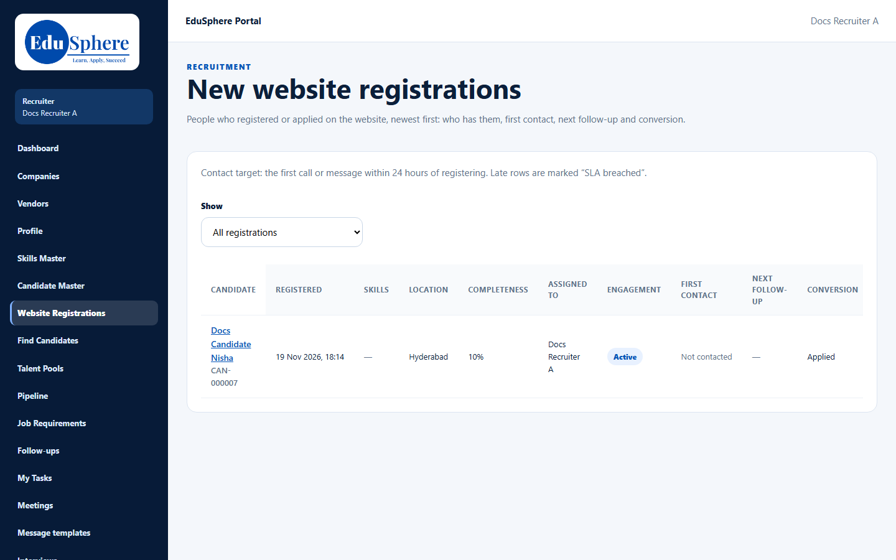

# New website registrations
> Doc ID: DOC-REC-CAN-014 · Verified on 2026-11-19 against `main` @ `6b61546c` · Roles: Recruiter, Team Lead, HR Manager (read)

## Purpose
See everyone who registered or applied on the website, and make sure each gets a first call or message within 24 hours.

## Who Can Use This Feature
- **Recruiter** and **Team Lead**. The HR Manager sees the list but cannot open the candidate from it (finding P4, from code; shown in session S13).

## Prerequisites
- Someone has applied or registered on the [careers page](../candidate-portal/cand-001-careers-apply.md).

## How to Access
Sidebar → **Website Registrations** (`/recruiter/website-registrations`).

## Steps
### Step 1 — Read the list
"People who registered or applied on the website, newest first: who has them, first contact, next follow-up and conversion. Contact target: the first call or message within 24 hours of registering. Late rows are marked 'SLA breached'."

Columns: **Candidate** (name and ID), **Registered**, **Skills**, **Location**, **Completeness**, **Assigned to**, **Engagement**, **First contact**, **Next follow-up** and **Conversion**. Docs Candidate Nisha (CAN-000007) applied and then registered: assigned to Docs Recruiter A by the Website routing rule, **Not contacted**, conversion **Applied**.

### Step 2 — Filter
**Show**: All registrations, Unassigned, New, Contacted, Screened, Active, Inactive, Duplicate review. With nothing yet the page says **No website registrations yet.**

### Step 3 — Follow up
Select the name to open the [candidate page](can-003-candidate-page.md), then [call or message](can-009-calls-messages.md) the person. The first contact is what the 24-hour target measures.

## Tips
- Who gets each registration is set by [routing rules](can-013-unassigned-routing.md); people no rule matches show under **Unassigned**.

## Related Features
- [Unassigned queue and routing](can-013-unassigned-routing.md)
- [Careers page and Apply online](../candidate-portal/cand-001-careers-apply.md)
