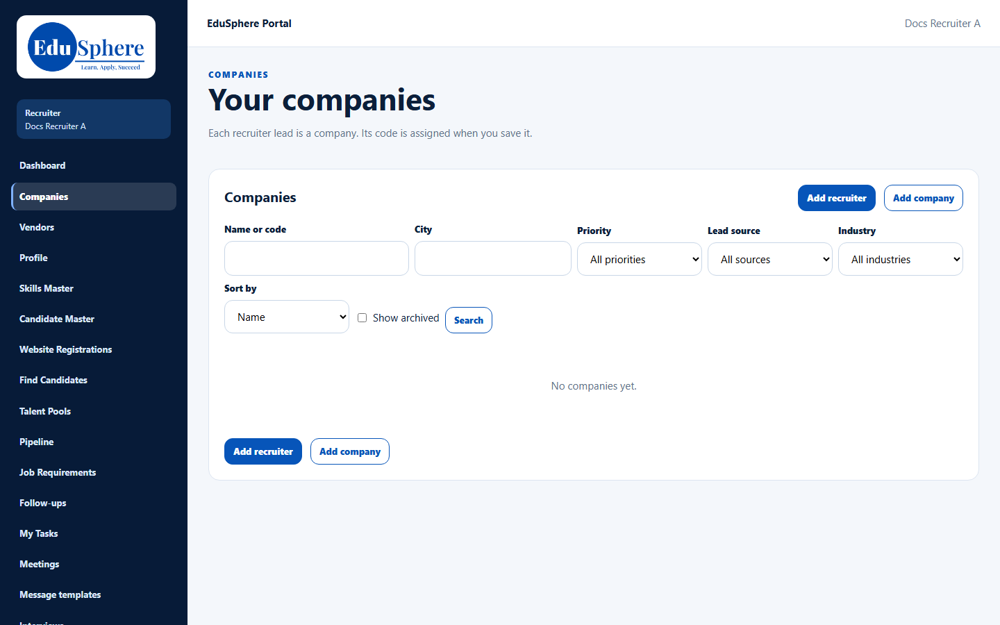
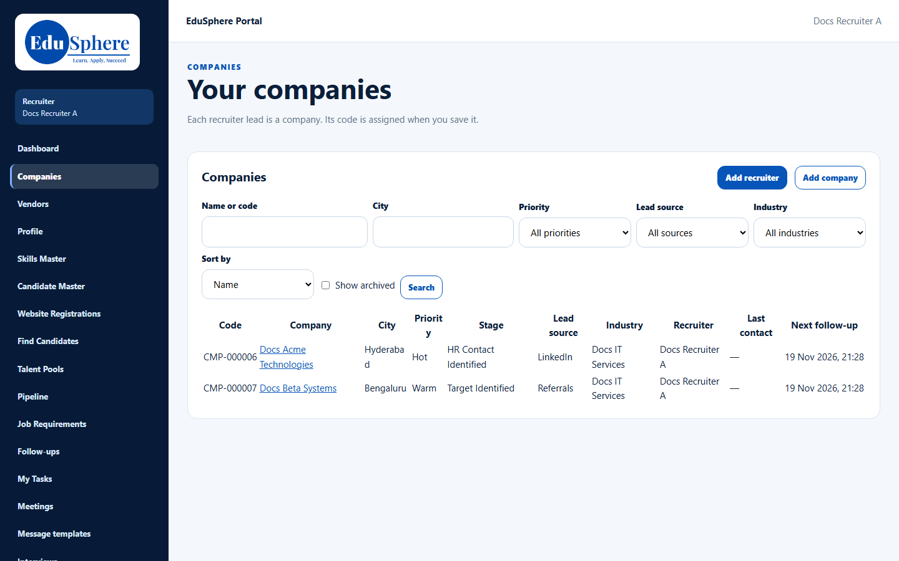
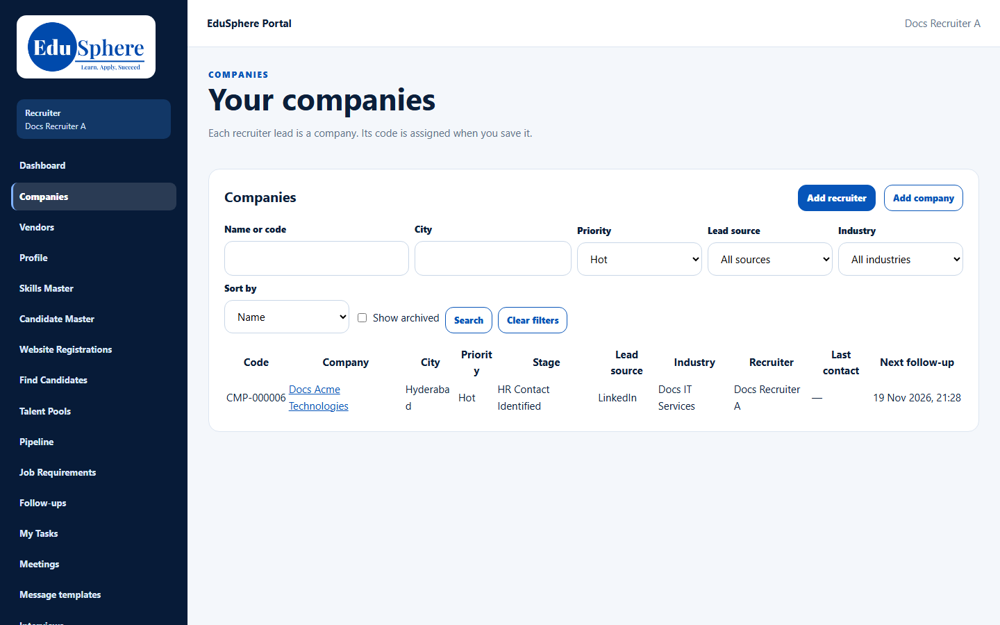
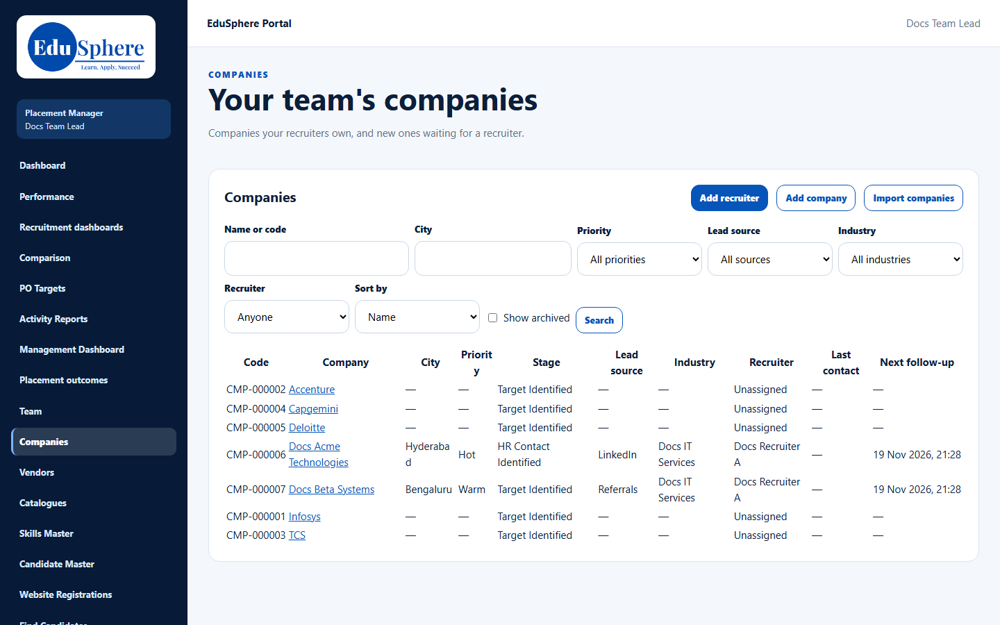

# Companies list and filters
> Doc ID: DOC-REC-CO-001 · Verified on 2026-11-18 against `main` @ `6b61546c` · Roles: Recruiter, Team Lead

## Purpose
See the companies you work with (your recruiter leads) and find one quickly.

## Who Can Use This Feature
| Role | Page heading | Sees |
|---|---|---|
| Recruiter | **Your companies** | Companies assigned to you |
| Team Lead | **Your team's companies** ("Companies your recruiters own, and new ones waiting for a recruiter.") | The team's companies and unassigned ones, with a **Recruiter** filter and **Import companies** |

## Prerequisites
- None.

## How to Access
Sidebar **Companies**. "Each recruiter lead is a company. Its code is assigned when you save it."

## Steps
### Step 1 — Read the list
Columns: **Code** (for example **CMP-000006**), **Company**, **City**, **Priority**, **Stage**, **Lead source**, **Industry**, **Recruiter**, **Last contact** and **Next follow-up**.

### Step 2 — Filter and sort
Use **Name or code**, **City**, **Priority** (Hot, Warm, Cold), **Lead source**, **Industry**, **Sort by** (Name, Last contacted) and **Show archived**, then **Search**.

### Step 3 — Open or add a company
Select the company name to open it, or use **Add recruiter** / **Add company** ([Add a company](co-002-add-company.md)).

## What each role sees

## Tips
- A new company with a contact starts at the stage **HR Contact Identified**; one without a contact at **Target Identified**.

## Related Features
- [Company page](co-003-company-page.md)
- [Pipeline board](co-014-pipeline-board.md)
