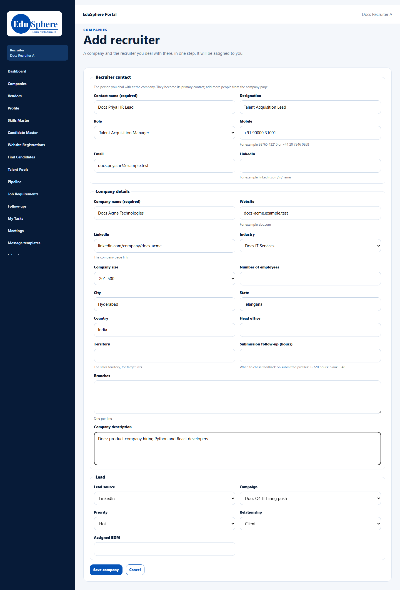
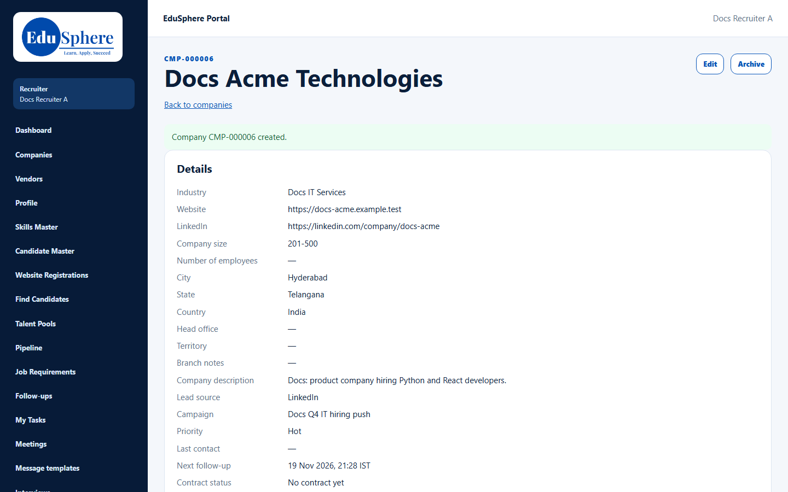

# Add a company (Add recruiter / Add company)
> Doc ID: DOC-REC-CO-002 · Verified on 2026-11-18 against `main` @ `6b61546c` · Roles: Recruiter, Team Lead

## Purpose
Record a new company you want to recruit for, with or without the person you deal with there.

## Who Can Use This Feature
- **Recruiter**: the company is assigned to you.
- **Team Lead**: may pick a recruiter or leave it unassigned.

## Prerequisites
- The industry, lead source and campaign you want are in the catalogues ([Catalogues](../masters/mst-003-catalogues.md)).

## How to Access
**Companies** → **Add recruiter** (company plus its first contact) or **Add company** (company only). The dashboard's quick actions **+ Add Recruiter** and **+ Add Company** open the same forms.

## Steps
### Step 1 — Recruiter contact (Add recruiter only)
"The person you deal with at the company. They become its primary contact." Fill **Contact name (required)**, **Designation**, **Role** (HR Manager, Talent Acquisition Manager, Recruiter, Hiring Manager, HR Head), **Mobile**, **Email** and **LinkedIn**.

### Step 2 — Company details
Fill **Company name (required)** and as much as you know: **Website**, **LinkedIn** (the company page), **Industry**, **Company size**, **Number of employees**, **City**, **State**, **Country**, **Head office**, **Territory**, **Submission follow-up (hours)** ("When to chase feedback on submitted profiles: 1–720 hours; blank = 48"), **Branches** (one per line) and **Company description**.

### Step 3 — Lead
Choose **Lead source**, **Campaign**, **Priority** (Hot, Warm, Cold) and **Relationship** (Client, Vendor, Both client and vendor), and optionally **Assigned BDM**.

### Step 4 — Save
Select **Save company**. The company page opens with **Company CMP-{number} created.**

## Expected Result
- The company has a code, is assigned to you, and has a **First outreach** follow-up due the next day for its contact.
- The stage is **HR Contact Identified** (with a contact) or **Target Identified** (without).

## Validation Messages
| Message | When |
|---|---|
| Company CMP-{number} created. | Saved |

## Related Features
- [Company page](co-003-company-page.md)
- [Contacts](co-004-contacts.md)
