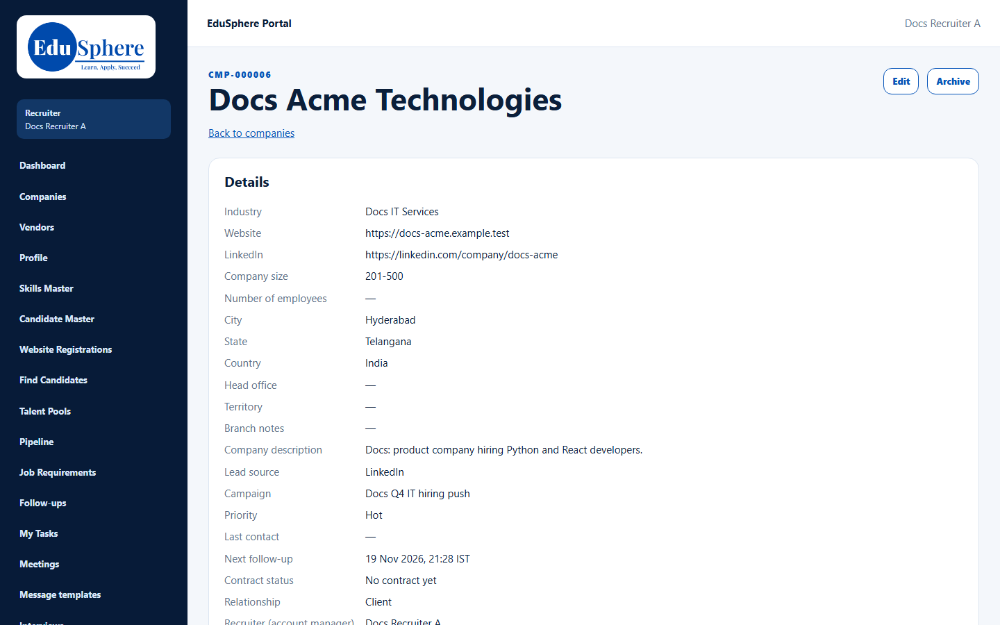
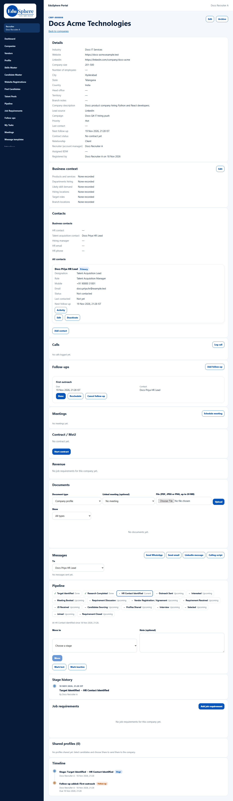
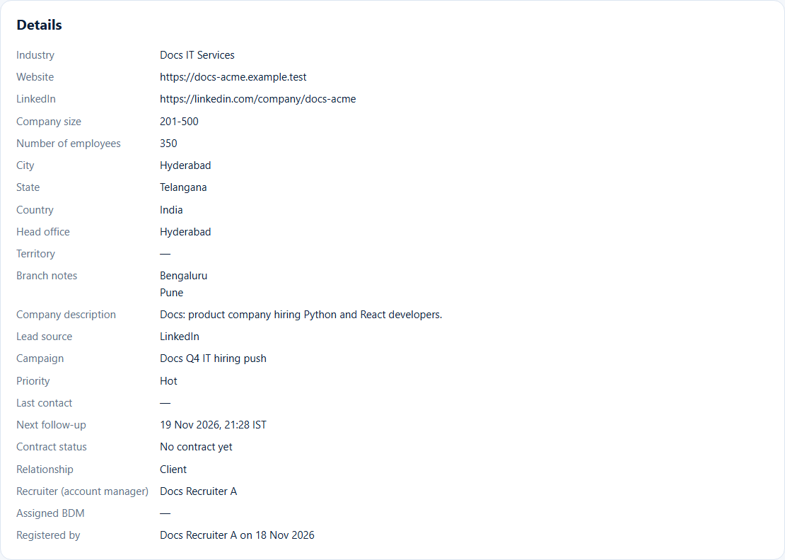
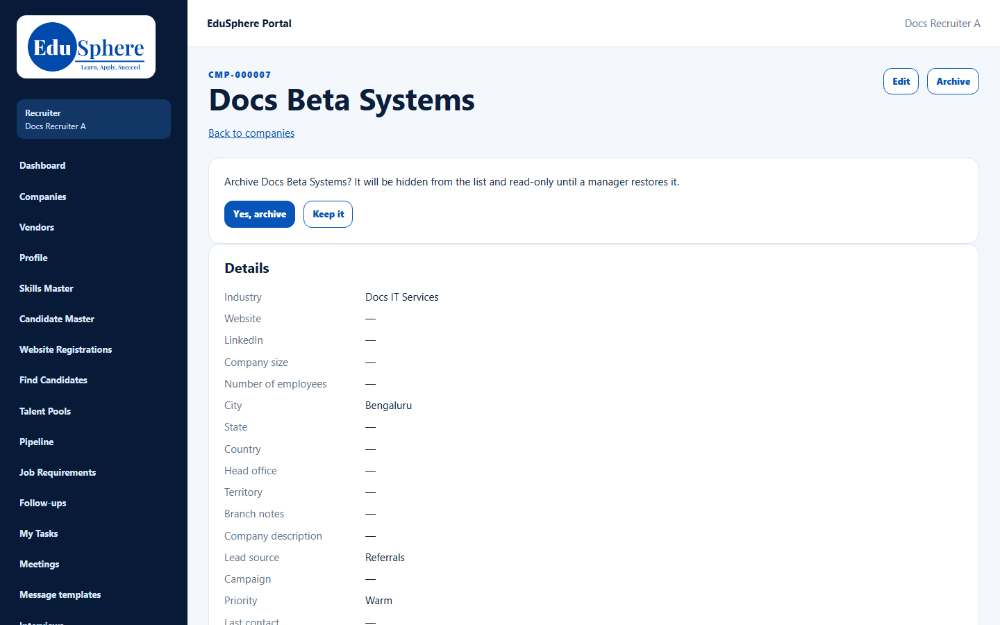
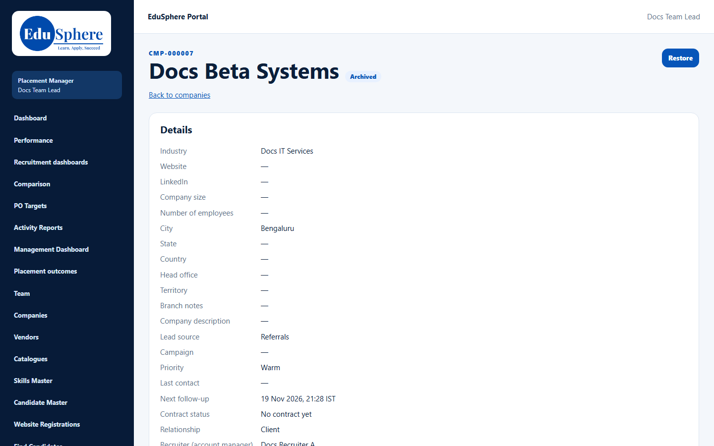

# Company page, edit, archive and restore
> Doc ID: DOC-REC-CO-003 · Verified on 2026-11-18 against `main` @ `6b61546c` · Roles: Recruiter (Team Lead: restore)

## Purpose
See everything about one company on one page and keep its details current.

## Who Can Use This Feature
| Role | Can do |
|---|---|
| Recruiter | Open their own companies, **Edit**, **Archive** |
| Team Lead | The team's companies; also **Restore** an archived company and reassign it |

## Prerequisites
- The company is yours (or your team's).

## How to Access
**Companies** → the company name. The header shows the code, name, **Edit** and **Archive**.

## Steps
### Step 1 — Read the sections
From top to bottom: **Details** (including contract status, relationship, recruiter and who registered it), **Business context**, **Contacts**, **Calls**, **Follow-ups**, **Meetings**, **Contract / MoU**, **Revenue**, **Documents**, **Messages**, the pipeline stage with its history, job requirements, shared profiles, the timeline and assignment.

### Step 2 — Edit
Select **Edit**, change the details (the same fields as when adding) and select **Save changes**: **Changes saved.**

### Step 3 — Archive
Select **Archive**, then **Yes, archive** (or **Keep it**). The message **Company archived.** appears and the name shows **Archived**. Archived companies are hidden unless you tick **Show archived** on the list.

### Step 4 — Restore (Team Lead)
The Team Lead opens the archived company and selects **Restore**: **Company restored.**

## Validation Messages
| Message | When |
|---|---|
| Changes saved. | Edit saved |
| Company archived. | Archived |
| Company restored. | Restored by the Team Lead |

## Tips
- **Revenue** and money-related parts of the company and its requirements are not covered in this guide; no payment is recorded here.
- **Documents**: choose a **Document type** (Company profile, Vendor onboarding form, Recruitment agreement, Job description, Meeting notes, Signed NDA), optionally a **Linked meeting**, pick a file (PDF, JPEG or PNG, up to 20 MB) and **Upload**. See [Documents, timeline and shared profiles](co-011-documents-timeline.md).

## Related Features
- [Contacts](co-004-contacts.md)
- [Pipeline stage](co-010-pipeline-stage.md)
