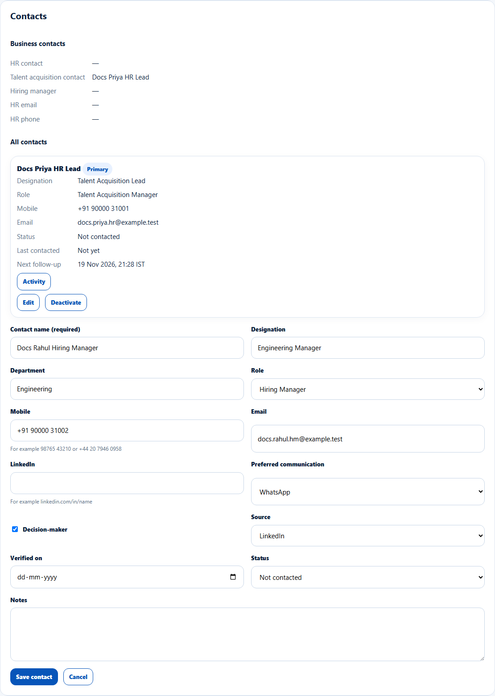
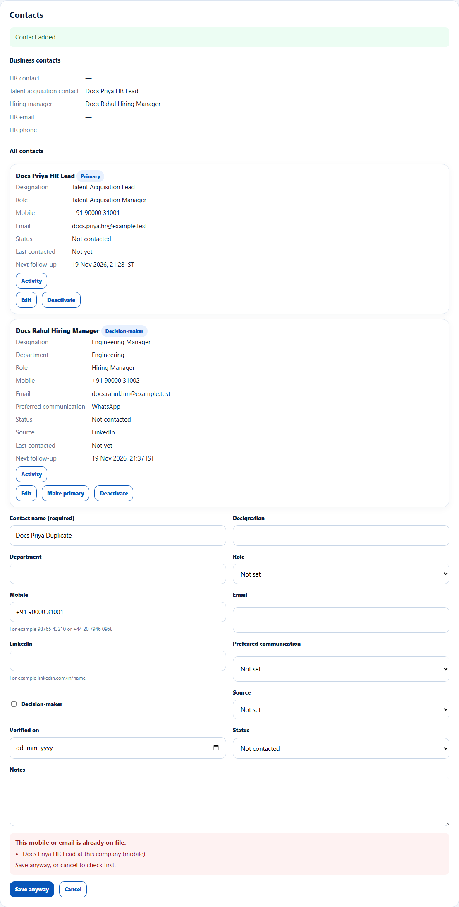
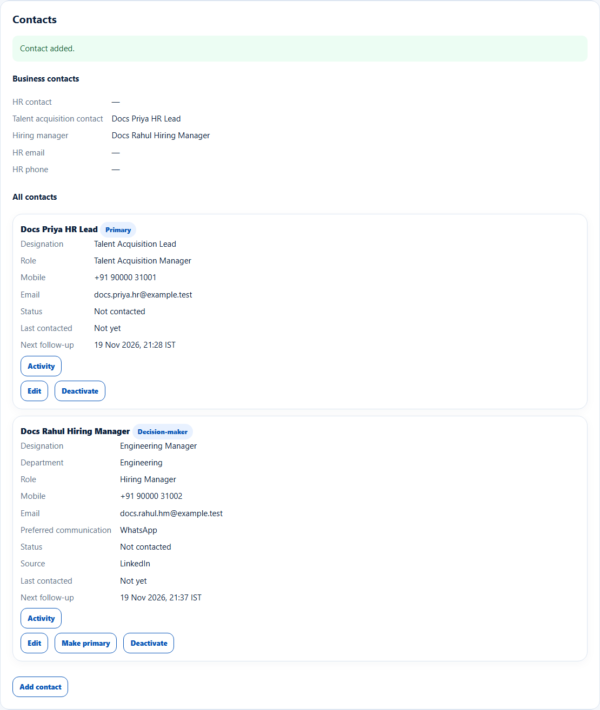

# Company contacts
> Doc ID: DOC-REC-CO-004 · Verified on 2026-11-18 against `main` @ `6b61546c` · Roles: Recruiter, Team Lead

## Purpose
Keep the people you deal with at a company: HR, talent acquisition, hiring managers and decision-makers.

## Who Can Use This Feature
- **Recruiter** and **Team Lead**, on companies they work.

## Prerequisites
- The company exists.

## How to Access
Company page → **Contacts**.

## Steps
### Step 1 — Add a contact
Select **Add contact**. Fill **Contact name (required)**, **Designation**, **Department**, **Role**, **Mobile**, **Email**, **LinkedIn**, **Preferred communication** (Call, WhatsApp, Email, LinkedIn), tick **Decision-maker** if they decide, and set **Source**, **Verified on**, **Status** and **Notes**. Select **Save contact**: **Contact added.**

### Step 2 — Duplicate warning
If the mobile or email is already on file, the form says: "This mobile or email is already on file: {name} at this company (mobile). Save anyway, or cancel to check first."

### Step 3 — Read and maintain contacts
**Business contacts** names the HR contact, talent acquisition contact and hiring manager. **All contacts** lists each person with **Primary**, **Decision-maker**, their details, **Status** (Not contacted, Contacted, Replied, Meeting scheduled, Not interested, Do not contact), **Last contacted** and **Next follow-up**, and buttons **Activity**, **Edit**, **Make primary** and **Deactivate**.

## Validation Messages
| Message | When |
|---|---|
| Contact added. | Saved |
| This mobile or email is already on file: … Save anyway, or cancel to check first. | Possible duplicate |

## Tips
- A new contact gets a **First outreach** follow-up automatically.
- A **Do not contact** contact is never offered in the message composers.

## Related Features
- [Messages](co-009-messages.md)
- [Merge a duplicate company or contact](co-013-merge.md)
