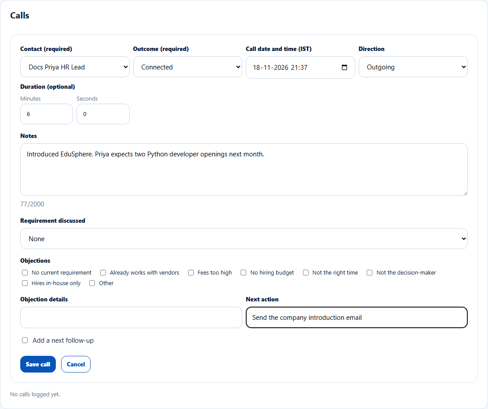
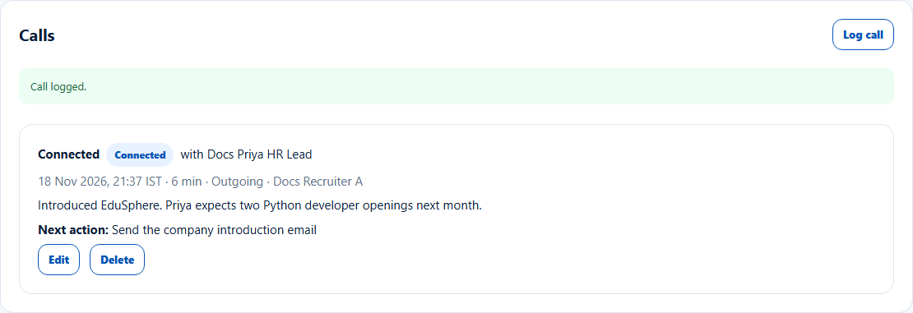

# Log calls
> Doc ID: DOC-REC-CO-005 · Verified on 2026-11-18 against `main` @ `6b61546c` · Roles: Recruiter

## Purpose
Record each call with a company contact, what came of it, and what happens next.

## Who Can Use This Feature
- **Recruiter** (and Team Lead) on companies they work.

## Prerequisites
- The company has at least one contact.

## How to Access
Company page → **Calls** → **Log call**.

## Steps
### Step 1 — Fill in the call
Choose **Contact (required)** and **Outcome (required)** (Connected, Call back requested, Busy, No answer, Switched off, Wrong number). **Call date and time (IST)** starts at now. Choose **Direction** (Outgoing / Incoming), enter **Minutes** and **Seconds**, **Notes** and optionally the **Requirement discussed**. Tick any objections (No current requirement, Already works with vendors, Fees too high, No hiring budget, Not the right time, Not the decision-maker, Hires in-house only, Other) and add **Objection details**. Write the **Next action**, and tick **Add a next follow-up** to schedule one.

### Step 2 — Save
Select **Save call**: **Call logged.** The call appears in the list.

## Validation Messages
| Message | When |
|---|---|
| Call logged. | Saved |

## Related Features
- [Company follow-ups](co-006-follow-ups.md)
