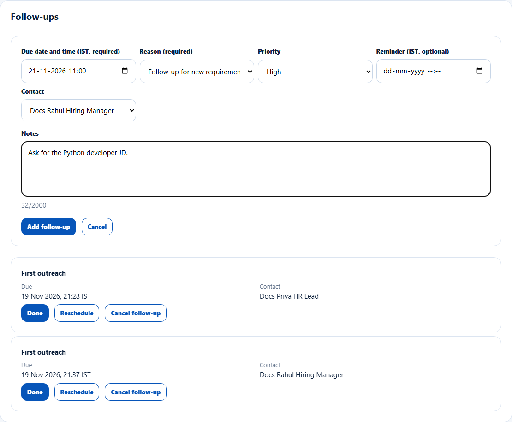
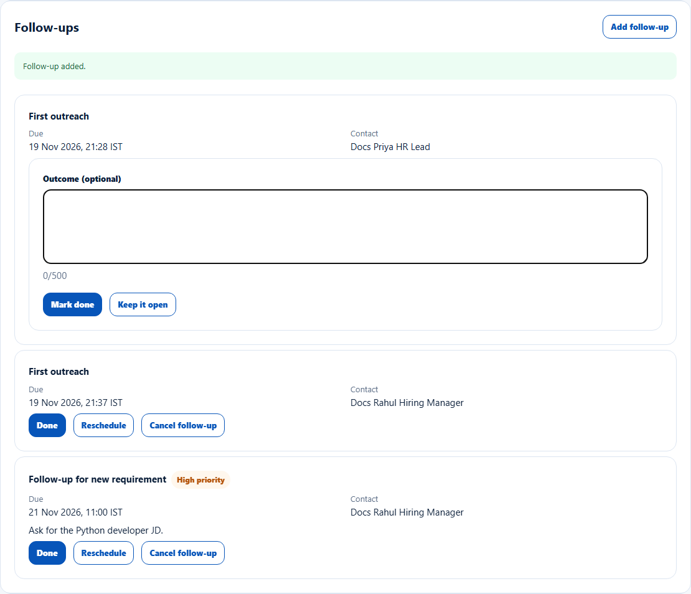

# Company follow-ups
> Doc ID: DOC-REC-CO-006 · Verified on 2026-11-18 against `main` @ `6b61546c` · Roles: Recruiter

## Purpose
Plan the next touch with a company so nothing slips.

## Who Can Use This Feature
- **Recruiter** on their companies. The Team Lead reads the team's follow-ups ([Follow-ups](../work/work-001-follow-ups.md)).

## Prerequisites
- The company exists.

## How to Access
Company page → **Follow-ups** → **Add follow-up**.

## Steps
### Step 1 — Add a follow-up
Fill **Due date and time (IST, required)** and **Reason (required)** (Follow-up for new requirement, Follow-up for JD, Follow-up for profile feedback, Interview feedback, Offer status, Joining confirmation, New openings, Contract/MoU, Payment/commercial discussion, Clarification from the client, First outreach, Outreach cadence step). Choose **Priority** (High, Medium, Low), an optional **Reminder (IST, optional)**, the **Contact** and **Notes**. Select **Add follow-up**: **Follow-up added.**

### Step 2 — Complete, reschedule or cancel
Each follow-up shows its reason, priority, due time, contact and notes, with **Done**, **Reschedule** and **Cancel follow-up**. **Done** asks for an **Outcome (optional)** (up to 500 characters); select **Mark done**, or **Keep it open**.

## Validation Messages
| Message | When |
|---|---|
| Follow-up added. | Added |

## Tips
- Adding a company or a contact creates a **First outreach** follow-up due the next day.
- Follow-ups also appear on **Follow-ups** in the sidebar and in the dashboard's **Follow-ups Due**.

## Related Features
- [Follow-ups list](../work/work-001-follow-ups.md)
- [Log calls](co-005-calls.md)
