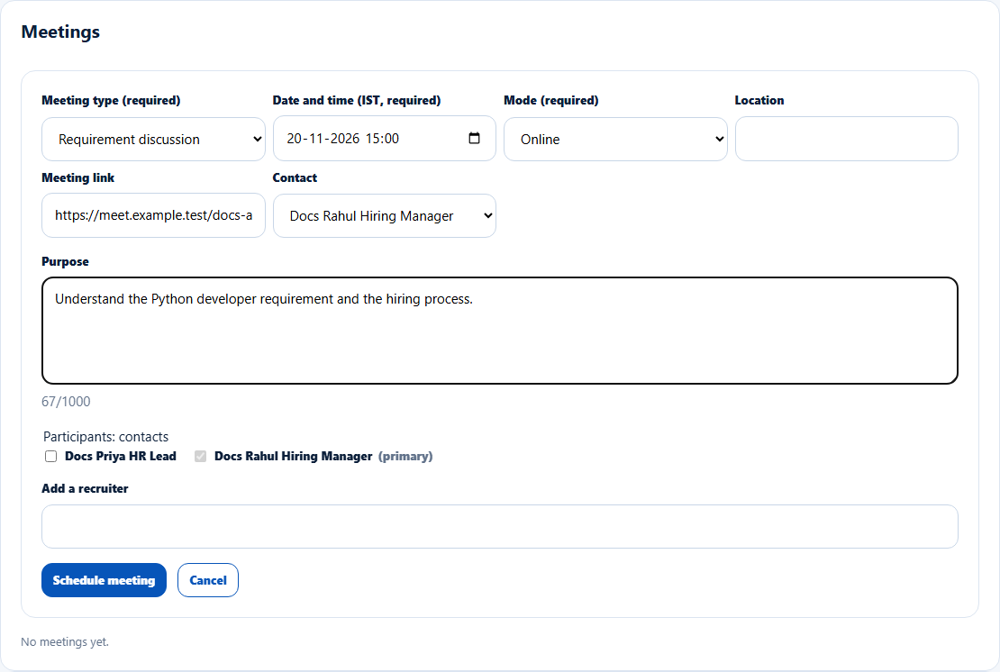
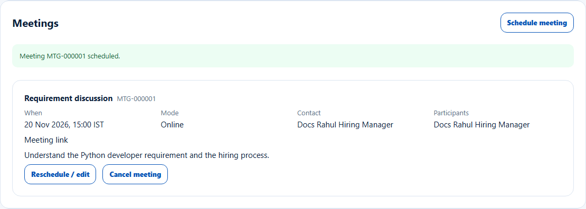

# Company meetings
> Doc ID: DOC-REC-CO-007 · Verified on 2026-11-18 against `main` @ `6b61546c` (scheduling). Recording an outcome: VERIFICATION REQUIRED (needs a past meeting) · Roles: Recruiter

## Purpose
Schedule meetings with a company and record what came of them.

## Who Can Use This Feature
- **Recruiter** on their companies. The Team Lead reads the team's meetings.

## Prerequisites
- The company exists.

## How to Access
Company page → **Meetings** → **Schedule meeting**.

## Steps
### Step 1 — Schedule
Choose **Meeting type (required)** (Company meeting, HR meeting, Requirement discussion, Recruitment presentation, Contract discussion, Campus recruitment discussion, Placement drive discussion, Company visit (BD visit)), **Date and time (IST, required)** and **Mode (required)** (Online, Phone, In person). Add a **Location** or **Meeting link**, the **Contact**, the **Purpose**, tick the company participants and **Add a recruiter** if colleagues join. Select **Schedule meeting**.

### Step 2 — Read the meeting
The message **Meeting MTG-{number} scheduled.** appears. The meeting shows its type, number, time, mode, contact, participants, link and purpose, with **Reschedule / edit** and **Cancel meeting**.

### Step 3 — Record the outcome
VERIFICATION REQUIRED — after the meeting time, record the outcome with action items and a forecast (captured in session S15).

## Validation Messages
| Message | When |
|---|---|
| Meeting MTG-{number} scheduled. | Scheduled |

## Related Features
- [Meetings list](../work/work-003-meetings.md)
