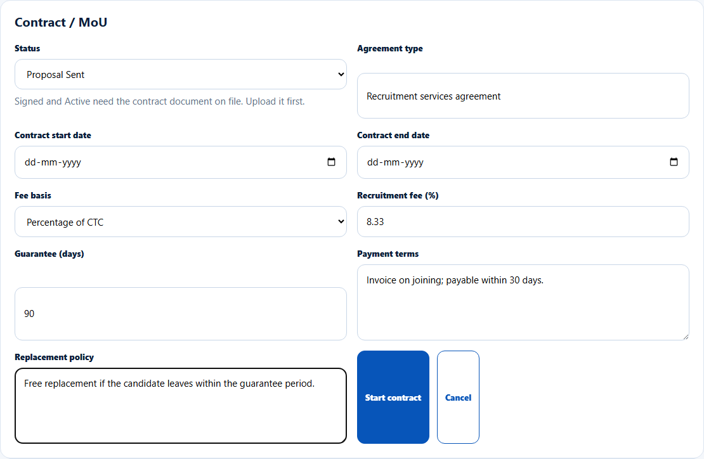
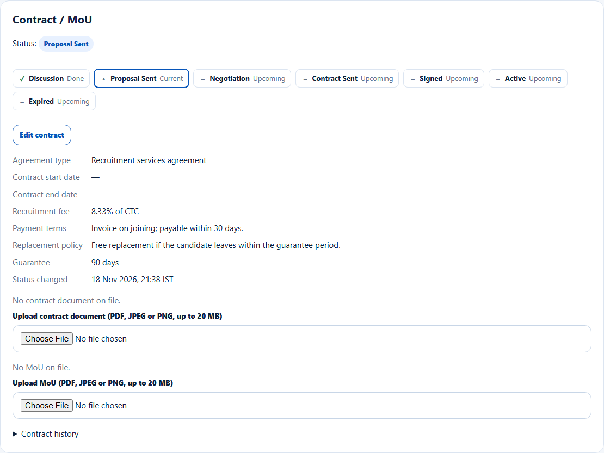

# Contract / MoU
> Doc ID: DOC-REC-CO-008 · Verified on 2026-11-18 against `main` @ `6b61546c` · Roles: Recruiter (terms need the client commercials permission)

## Purpose
Track the recruitment agreement with a company: where it stands, its terms and its documents. No money is recorded here.

## Who Can Use This Feature
- **Recruiter** and **Team Lead** with the client commercials permission (both have it by default).

## Prerequisites
- The company exists.

## How to Access
Company page → **Contract / MoU** → **Start contract**.

## Steps
### Step 1 — Start the contract
Choose the **Status** (Discussion, Proposal Sent, Negotiation, Contract Sent, Signed, Active). Fill **Agreement type**, **Contract start date**, **Contract end date**, **Fee basis** (Not agreed yet, Fixed amount per hire (₹), Percentage of CTC), **Recruitment fee**, **Guarantee (days)**, **Payment terms** and **Replacement policy**. Select **Start contract**: **Contract started.**

### Step 2 — Follow its progress
The card shows the steps Discussion → Proposal Sent → Negotiation → Contract Sent → Signed → Active → Expired with the current one marked, the terms (for example **Recruitment fee 8.33% of CTC**, **Guarantee 90 days**) and when the status changed. Use **Edit contract** to move it on.

### Step 3 — Upload the documents
Use **Upload contract document** and **Upload MoU** (PDF, JPEG or PNG, up to 20 MB). Signed and Active need the document (from code; not captured). **Contract history** lists earlier versions; **Start renewal** begins the next one.

## Validation Messages
| Message | When |
|---|---|
| Contract started. | Started |

## Tips
- **Expired** is set automatically after the end date.
- The fee and guarantee here become the defaults for the company's job requirements ("From the contract").

## Related Features
- [Commercial terms on a requirement](../requirements/req-010-commercial-terms.md)
