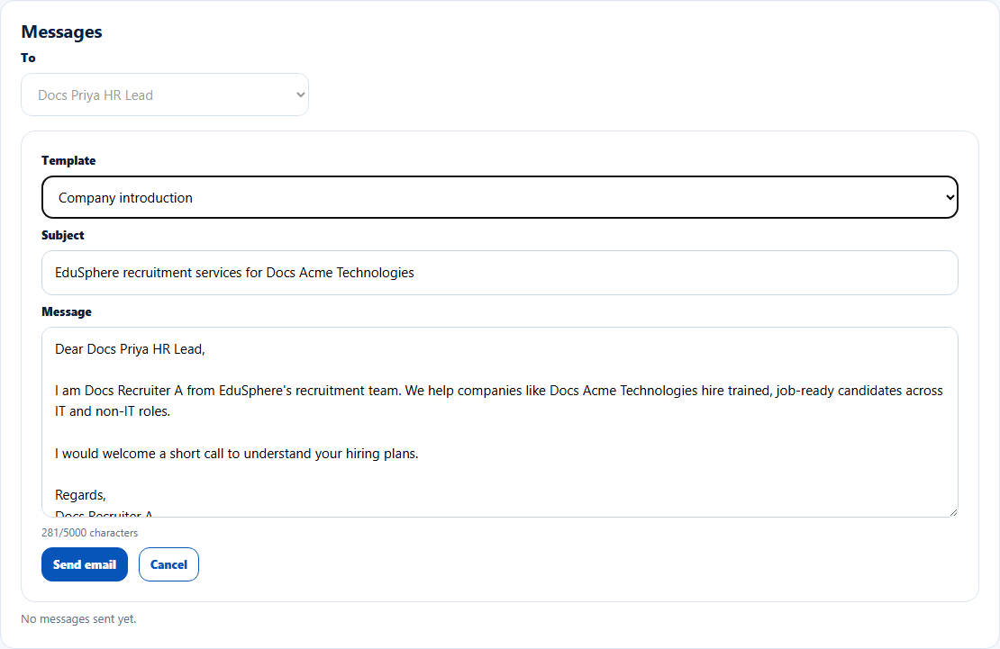
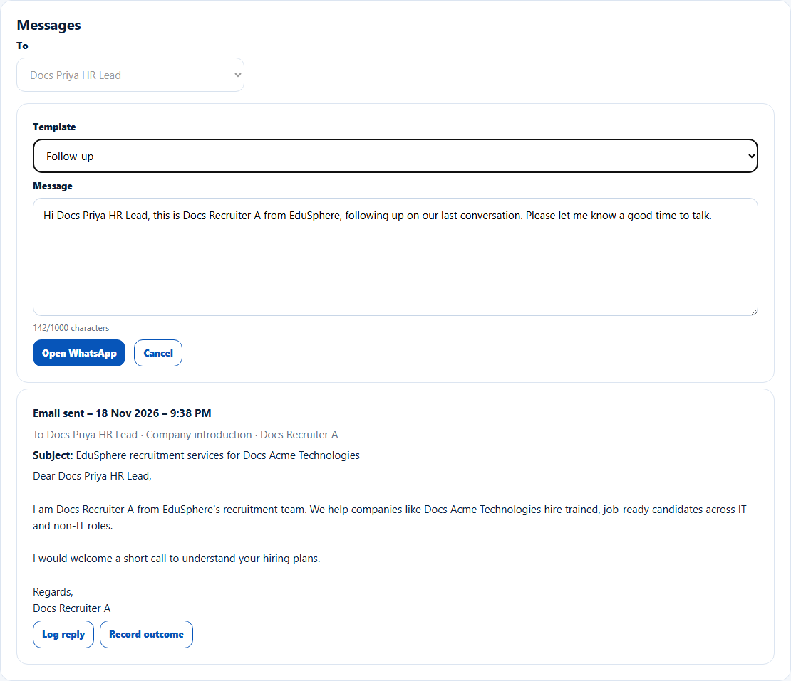
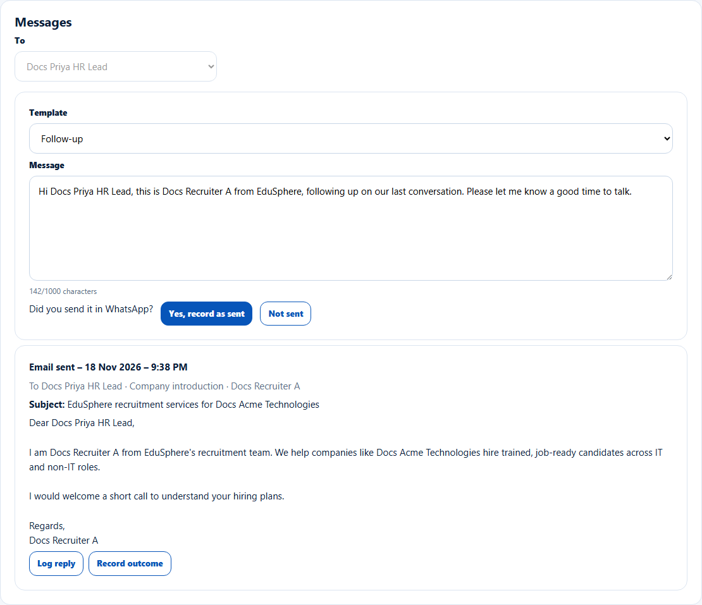
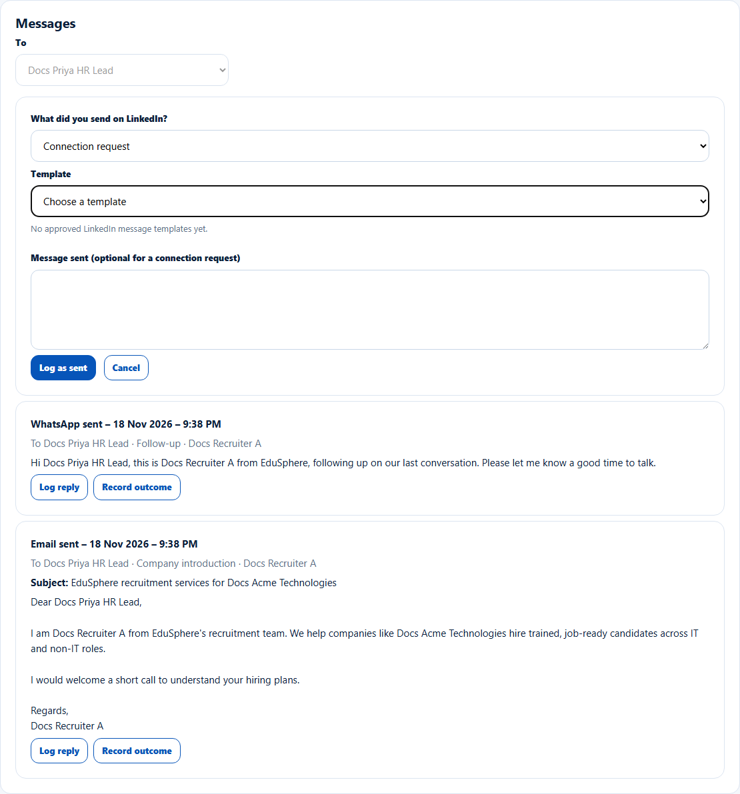
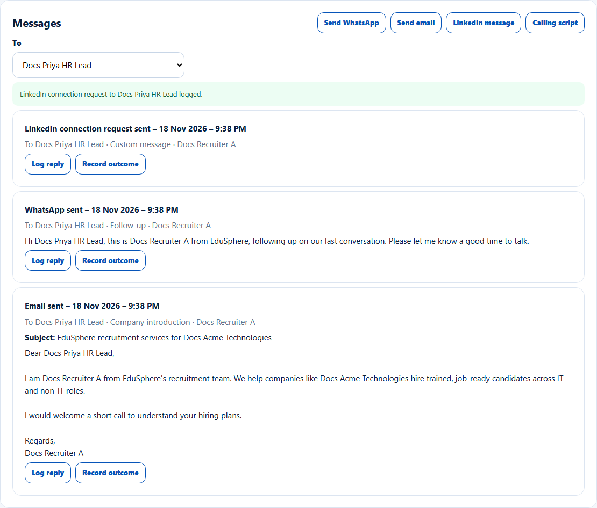
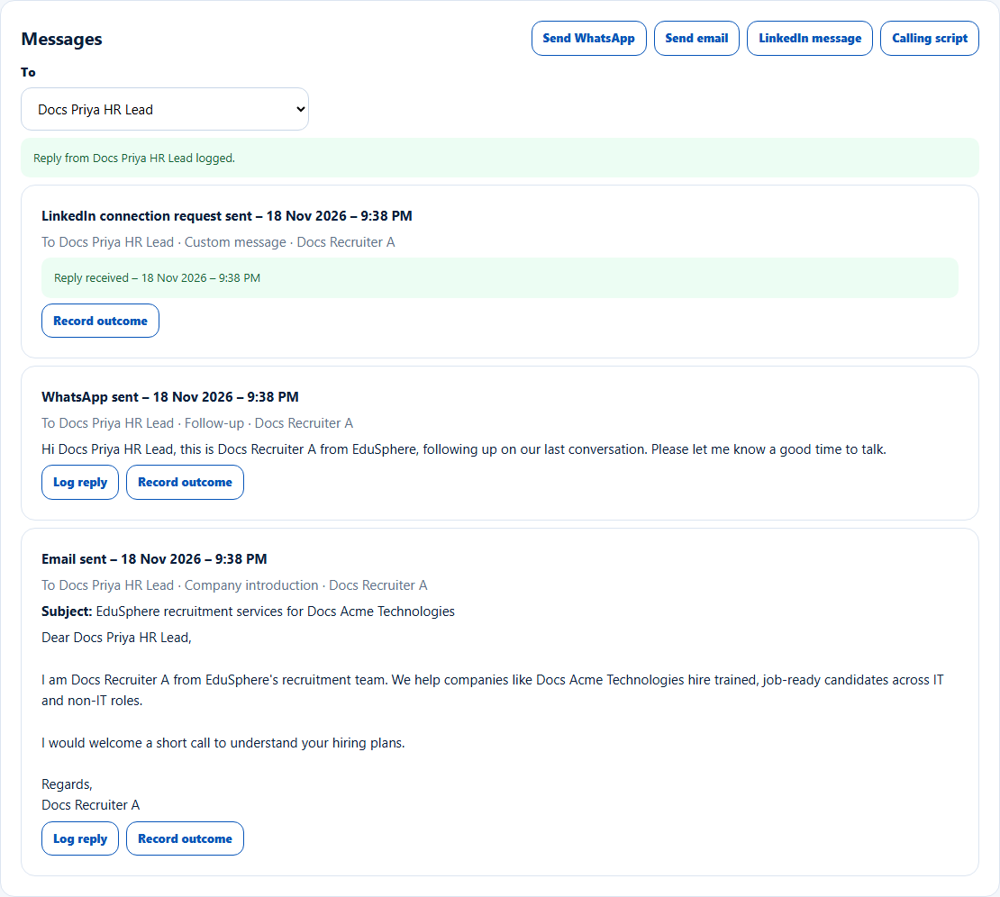

# Messages: email, WhatsApp, LinkedIn and calling script
> Doc ID: DOC-REC-CO-009 · Verified on 2026-11-18 against `main` @ `6b61546c` · Roles: Recruiter

## Purpose
Contact a company's people from approved templates and keep a record of every message and reply.

## Who Can Use This Feature
- **Recruiter** (and Team Lead) on companies they work.

## Prerequisites
- The contact has an email (for email) or mobile (for WhatsApp). Contacts marked **Do not contact** are not offered.

## How to Access
Company page → **Messages**. Choose the recipient in **To**, then **Send WhatsApp**, **Send email**, **LinkedIn message** or **Calling script**.

## Steps
### Step 1 — Send an email
Select **Send email**, choose a **Template** (or **Custom message**); the **Subject** and **Message** fill in with the contact's and company's names. Edit and select **Send email**. The message **Email to {name} queued for sending.** appears; EduSphere sends it.

### Step 2 — Send a WhatsApp message
Select **Send WhatsApp**, choose a **Template** and check the **Message** (up to 1000 characters). Select **Open WhatsApp**: WhatsApp opens in a new tab with the text. Back in EduSphere, answer **Did you send it in WhatsApp?** with **Yes, record as sent** (or **Not sent**). The message **WhatsApp to {name} recorded.** appears.

### Step 3 — LinkedIn and calling scripts
**LinkedIn message**: choose **What did you send on LinkedIn?** (Connection request / Message), optionally a **Template**, and copy the text; select **Log as sent**: **LinkedIn connection request to {name} logged.** **Calling script** opens a template to read from during a call. Nothing is sent from EduSphere for these two.

### Step 4 — Replies and outcomes
Every message is listed with type, time, recipient, template and text. **Log reply** records that the contact replied ("Reply from {name} logged."). **Record outcome** notes what came of the message, with a next follow-up.

## Validation Messages
| Message | When |
|---|---|
| Email to {name} queued for sending. | Email accepted |
| WhatsApp to {name} recorded. | WhatsApp send confirmed |
| LinkedIn connection request to {name} logged. | LinkedIn logged |
| Reply from {name} logged. | Reply logged |
| The mail server didn't accept it yet. It will be retried automatically. | Email delayed (from code; not captured) |

## Tips
- WhatsApp delivery is never reported back; EduSphere only records that you sent it.
- Templates come from the [Message template library](../masters/mst-004-message-templates.md).

## Related Features
- [Outreach cadences](co-015-outreach-cadences.md)
