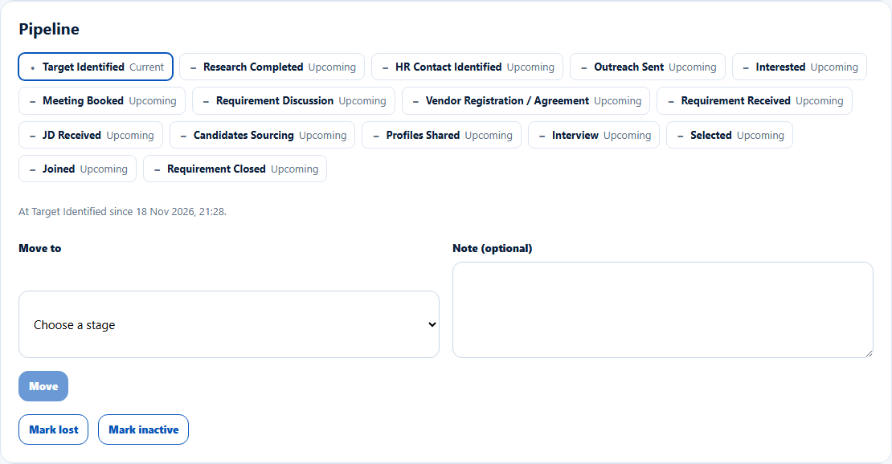
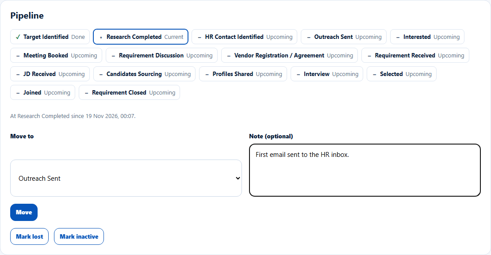
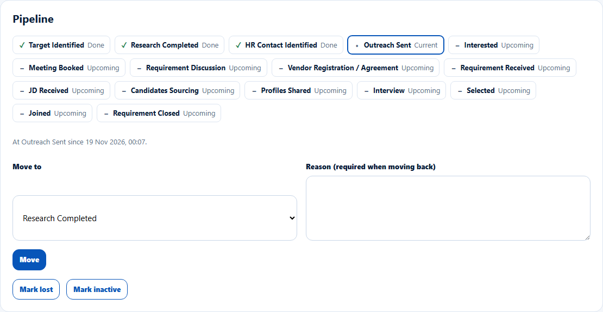
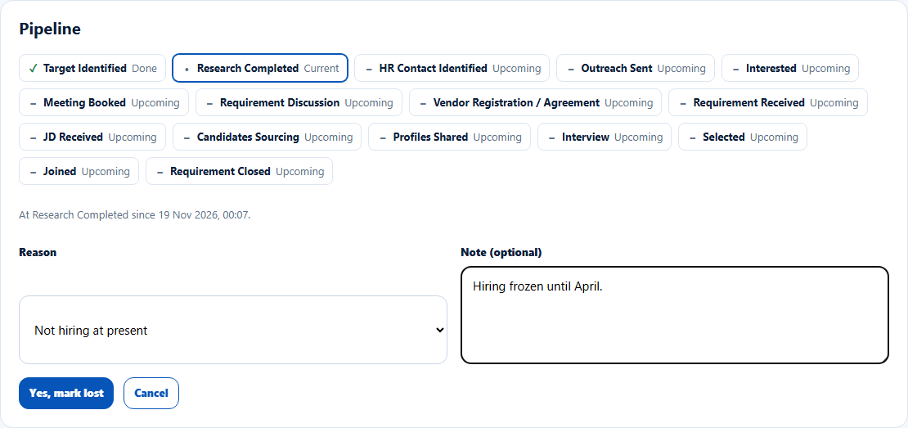
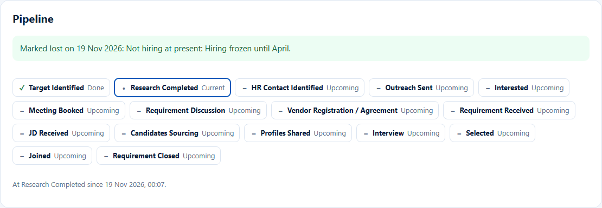
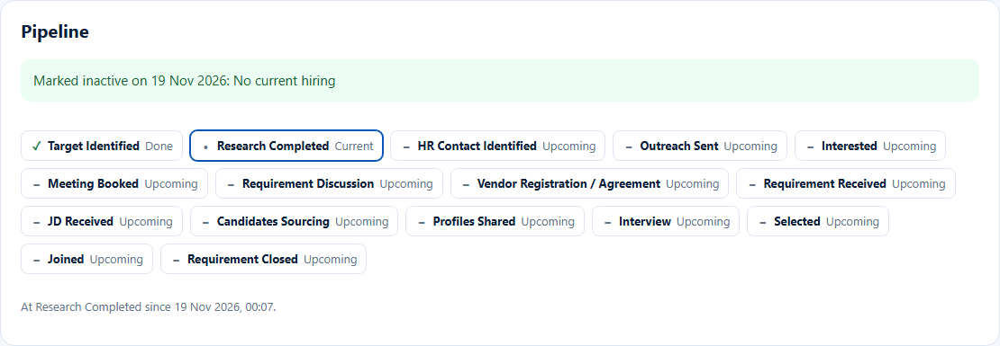
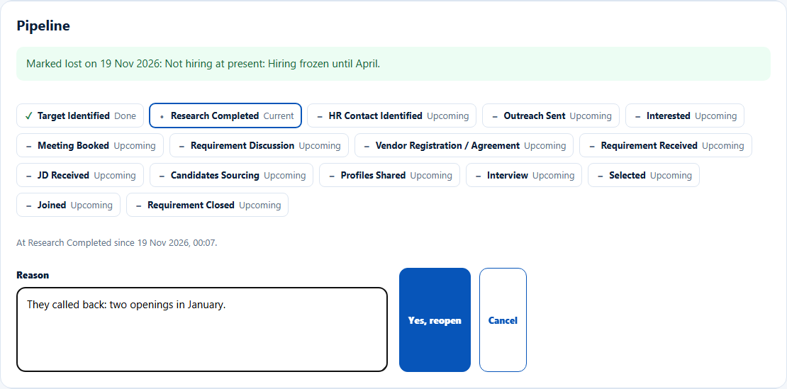
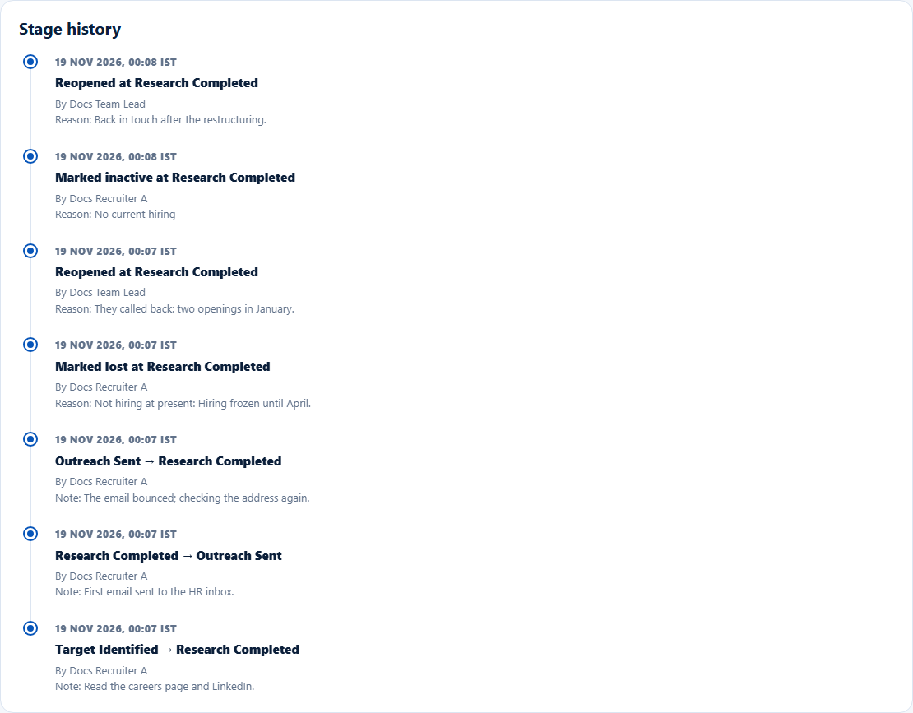

# Pipeline stage, lost and inactive
> Doc ID: DOC-REC-CO-010 · Verified on 2026-11-19 against `main` @ `6b61546c` · Roles: Recruiter (move, mark lost or inactive), Team Lead (reopen)

## Purpose
Show where a company stands in the sales pipeline, move it on as the relationship grows, and close it as lost or inactive when it goes cold.

## Who Can Use This Feature
- **Recruiter** assigned to the company: moves the stage and marks it lost or inactive.
- **Team Lead**: reopens a lost or inactive company. A recruiter cannot reopen.

## Prerequisites
- The company is not archived.

## How to Access
Company page → **Pipeline**.

## Steps
### Step 1 — Read the stage
The **Pipeline** card lists every stage from **Target Identified** to **Requirement Closed**, each marked **Done**, **Current** or **Upcoming**, and says since when the company is at its stage. A new company starts at **Target Identified**, or at **HR Contact Identified** when it was added with a contact.

### Step 2 — Move to another stage
In **Move to**, choose a stage. You can choose only the early, manual stages: Target Identified, Research Completed, HR Contact Identified, Outreach Sent, Interested, Meeting Booked, Requirement Discussion and Vendor Registration / Agreement. Add a **Note (optional)** and select **Move**. The message **Moved to {stage}.** appears.

Moving back to an earlier stage needs a reason: the field becomes **Reason (required when moving back)**.

### Step 3 — Mark the company lost
Select **Mark lost**, choose a **Reason** (Not hiring at present, Chose another vendor, Fee or terms not agreed, No response, Not a fit for our candidates, Other), add a **Note (optional)** and select **Yes, mark lost**. The message **Marked lost.** appears and the card shows **Marked lost on {date}: {reason}**. The recruiter can no longer move the stage.

### Step 4 — Mark the company inactive
**Mark inactive** works the same way, with its own reasons (No current hiring, Contact left the company, No response, On hold by the company, Other) and **Yes, mark inactive**: **Marked inactive.**

### Step 5 — Reopen (Team Lead)
On a lost or inactive company the Team Lead sees **Reopen**. Enter the **Reason** and select **Yes, reopen**: **Reopened.** The company goes back to the stage it was at.

### Step 6 — Stage history
**Stage history** lists every move, close and reopen, newest first, with who did it and the note or reason.

## Validation Messages
| Message | When |
|---|---|
| Moved to {stage}. | Stage moved |
| Marked lost. | Marked lost |
| Marked inactive. | Marked inactive |
| Reopened. | Reopened by the Team Lead |
| No reasons are set up yet. Ask a placement manager to add one. | No lost or inactive reasons in the catalogue (from code; not captured) |

## Tips
- From **Requirement Received** on, the stage moves by itself with the company's job requirements ("The stage now moves with its job requirements."). Meetings move it too: scheduling MTG-000001 put Docs Acme Technologies at **Meeting Booked**.
- A badge shows the client status (**Active Client** after the first requirement, **Repeat Business** after a joining on another requirement) and **Follow-up due** (from code; not captured).
- A company with no activity for 182 days is marked inactive by a nightly job (from code; captured in session S15).
- The lost and inactive reasons come from [Catalogues](../masters/mst-003-catalogues.md).

## Related Features
- [Pipeline board](co-014-pipeline-board.md)
- [Company page](co-003-company-page.md)
