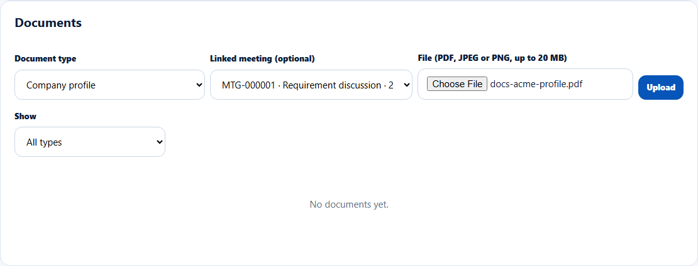
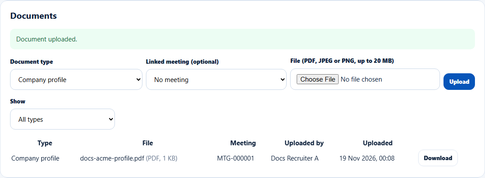
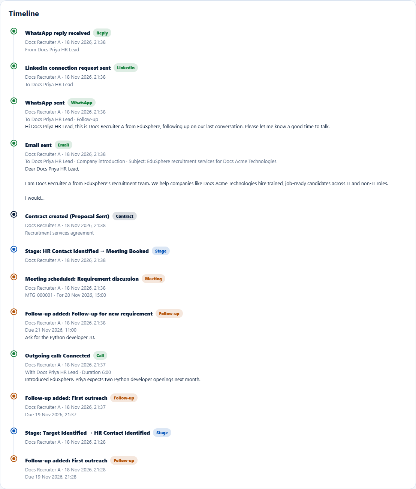

# Documents, timeline and shared profiles
> Doc ID: DOC-REC-CO-011 · Verified on 2026-11-19 against `main` @ `6b61546c` · Roles: Recruiter, Team Lead

## Purpose
Keep a company's files in one place, read everything that happened with it in order, and see which candidate profiles were sent to it.

## Who Can Use This Feature
- **Recruiter** on their companies and **Team Lead**: upload and download documents. Uploading a **Recruitment agreement** needs the client commercials permission (from code; not captured).

## Prerequisites
- The company exists.

## How to Access
Company page → **Documents**, **Timeline** and **Shared profiles**.

## Steps
### Step 1 — Upload a document
In **Documents**, choose the **Document type** (Company profile, Vendor onboarding form, Recruitment agreement, Job description, Meeting notes, Signed NDA), optionally a **Linked meeting (optional)**, and the **File (PDF, JPEG or PNG, up to 20 MB)**. Select **Upload**: **Document uploaded.**

### Step 2 — Find and download documents
The list shows type, file name and size, linked meeting, who uploaded it and when, with **Download**. Use **Show** to list one type only.

### Step 3 — Read the timeline
**Timeline** lists calls, follow-ups, meetings, stage changes, contract changes, messages and replies, newest first, each with who and when. Select **Show older entries** for more.

### Step 4 — Shared profiles
**Shared profiles ({count})** lists each time candidate profiles were sent to the company, with the company's response for each candidate. With nothing shared it reads "No profiles shared yet. Select candidates and choose Share to send them to the company." Sharing is covered in session S11.

## Validation Messages
| Message | When |
|---|---|
| Document uploaded. | Upload accepted |
| Choose a file to upload. | No file chosen (from code; not captured) |
| Upload a PDF, JPEG or PNG file. | Wrong file type (from code; not captured) |
| The file must be at most 20 MB. | File too large (from code; not captured) |

## Tips
- An uploaded document did not appear in the timeline in our test; the timeline records the company's activities, not its files.
- Contract and MoU files are uploaded on the [Contract / MoU](co-008-contract.md) card.

## Related Features
- [Company meetings](co-007-meetings.md)
- [Messages](co-009-messages.md)
