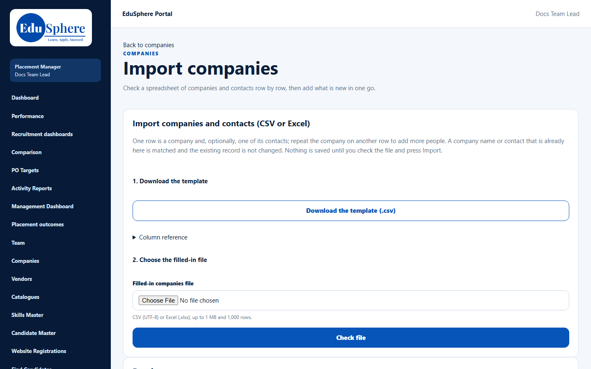
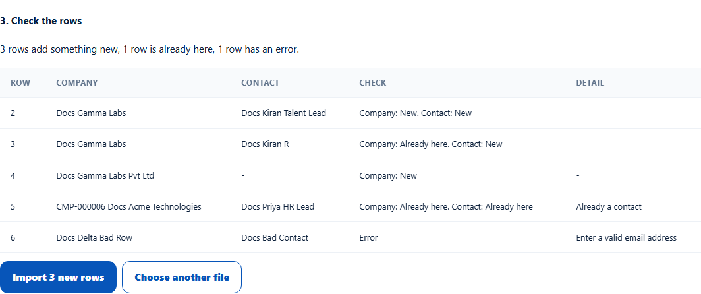
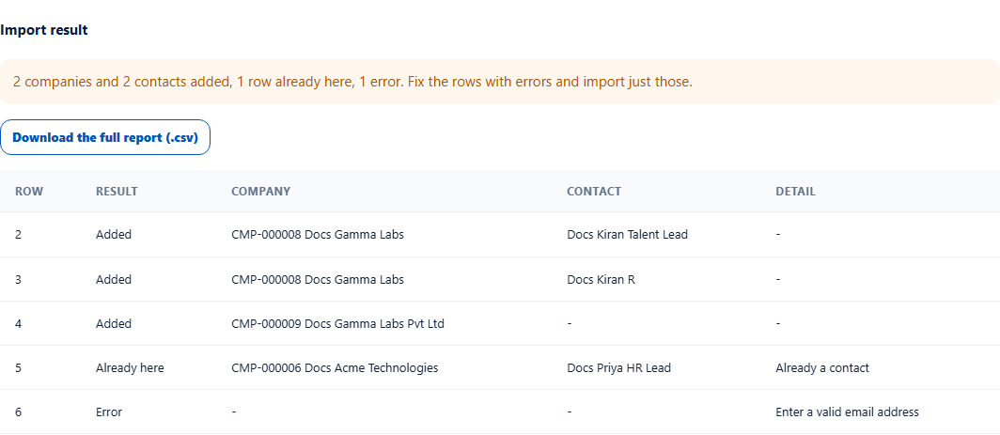
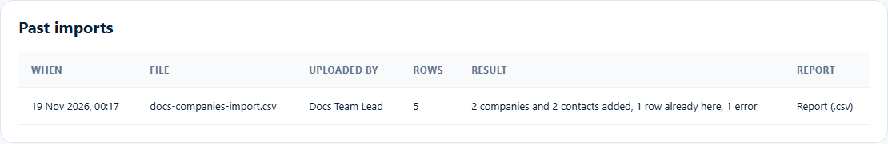
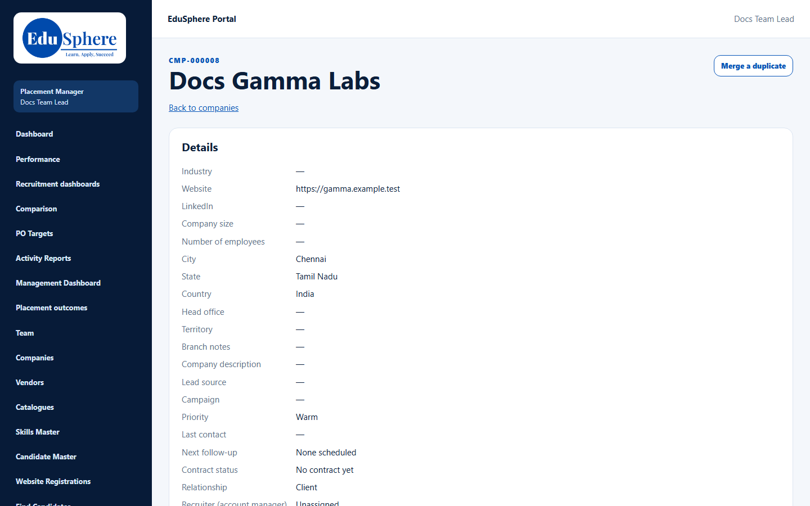
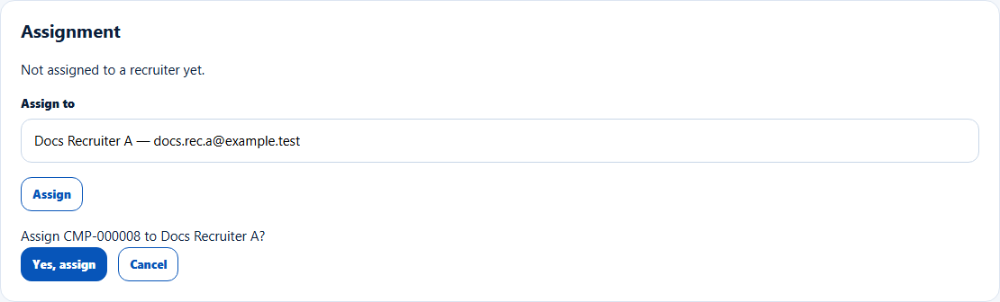

# Import companies
> Doc ID: DOC-REC-CO-012 · Verified on 2026-11-19 against `main` @ `6b61546c` · Roles: Team Lead

## Purpose
Add many companies and their contacts from a spreadsheet, checking every row before anything is saved.

## Who Can Use This Feature
- **Team Lead**. A recruiter who opens the page sees "Your role cannot import companies. Ask your Team Lead for access."

## Prerequisites
- A filled-in CSV (UTF-8) or Excel (.xlsx) file, up to 1 MB and 1,000 rows.

## How to Access
**Companies** → **Import companies** (`/recruiter/companies/import`).

## Steps
### Step 1 — Download the template
Select **Download the template (.csv)**. **Column reference** explains each column: `company_name` is required; the others (website, industry, city, priority, and the contact's name, designation, role, mobile, email, preferred channel, source, decision-maker, notes) are optional. One row is a company and, optionally, one of its contacts; repeat the company on another row to add more people.

### Step 2 — Check the file
Choose the **Filled-in companies file** and select **Check file**. Nothing is saved yet. Each row shows **Company: New** or **Already here**, the same for the contact, or **Error** with the reason.

### Step 3 — Import
Select **Import {n} new rows**. The **Import result** says what was added ("2 companies and 2 contacts added, 1 row already here, 1 error"), shows each company with its code, and offers **Download the full report (.csv)**. Fix the rows with errors and import just those.

### Step 4 — Past imports
**Past imports** lists each file with who uploaded it, the row count, the result and its **Report (.csv)**.

### Step 5 — Assign the new companies
Imported companies are not assigned to anyone ("Not assigned to a recruiter yet.").

 On the company page, the Team Lead picks a recruiter in **Assign to**, selects **Assign** and confirms with **Yes, assign**: **Company assigned to {name}.**

## Validation Messages
| Message | When |
|---|---|
| Enter a valid email address | A row's contact email is not valid (row error) |
| Already a contact | The row's contact already exists (row matched) |
| Choose a filled-in .csv or .xlsx file first. | No file chosen (from code; not captured) |
| Choose a .csv or .xlsx file. | Wrong file type (from code; not captured) |
| The file is larger than 1 MB. | File too large (from code; not captured) |
| Company assigned to {name}. | Assigned |

## Tips
- A company name or contact already in EduSphere is matched, and the existing record is not changed.
- Importing the same file again adds nothing twice.
- A similar name such as "Docs Gamma Labs Pvt Ltd" is not matched to "Docs Gamma Labs"; merge such duplicates afterwards ([Merge duplicates](co-013-merge.md)).

## Related Features
- [Add a company](co-002-add-company.md)
- [Merge duplicates](co-013-merge.md)
